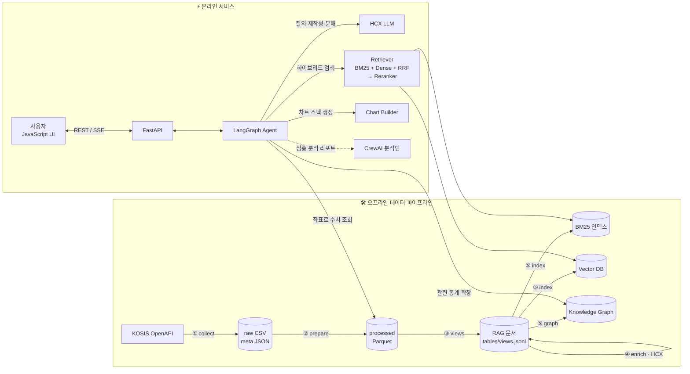
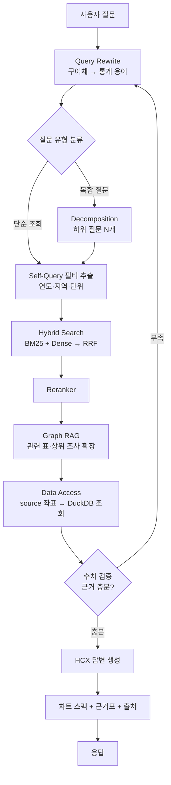

# t4core-stat-agent
lion_project, With 국가데이터처 통계 데이터

**국가통계포털(KOSIS) 공식 통계를 근거로, 자연어 질문에 "답변 + 통계 데이터 + 그래프"를 함께 제공하는 RAG 기반 Agent 서비스**

```
사용자 의 통계 데이터 관련 질의에 대하여 

Agent : 2015년 대비 2024년 서울 인구는 ○○명(−x.x%), 부산은 ○○명(−x.x%) 감소했습니다. …
        [시도별 총인구 추이 라인 차트]
        [근거 데이터 표]  📎 출처: 인구총조사 「성별·연령별 인구」 (KOSIS)
        2015년부터 등록센서스 방식으로 집계 기준이 변경되었습니다.
```

---

## 1. 프로젝트 목적

| 목표 | 설명 |
|---|---|
| **찾기 쉬운 통계** | 2,000개가 넘는 통계표 중 질문에 맞는 표와 뷰를 **BM25 + Dense 하이브리드 검색과 리랭킹**으로 찾음 |
| **설명 가능한 답변** | 자연어 요약, 근거 데이터 표, 그래프, 출처, 주의사항(집계 기준 변경 등)을 함께 제공 |
| **복합 질문 처리** | "A와 B 비교", "원인 분석"처럼 여러 통계가 필요한 질문은 **질의 분해(Decomposition)와 Agent 워크플로**로 처리 |

**데이터 범위 (1차):** KOSIS 국내통계 > 주제별 > **인구** (14개 조사, 약 2,300개 통계표, 표본부문 제외)

---

## 2. 시스템 아키텍처



### 질의 처리 흐름 (LangGraph)



---

## 3. 기술 스택

| 영역 | 기술 | 역할 |
|---|---|---|
| **LLM** | **HCX** (HyperCLOVA X) | 질의 재작성·분해, 답변 생성, RAG 문서 보강(질문·동의어·요약) |
| **임베딩** | 후보: **HCX 임베딩** (CLOVA Studio) / **BAAI/bge-m3** / **KURE-v1** | `embed_text` → Dense 벡터. 한국어 통계 질의 평가셋으로 비교 후 확정 |
| **RAG: 검색** | **BM25** (Kiwi 형태소) + **Dense Retrieval** → **RRF** 결합 → **Cross-encoder Reranker** | 키워드(지역·연도·항목명)와 의미 검색을 함께 사용 |
| **RAG: 고급** | **Query Rewrite**, **RAG Decomposition**, **Self-Query 필터**, **Parent-Child(Small-to-Big)** | 구어체 대응, 복합 질문 분해, 메타데이터 사전 필터 |
| **RAG: Graph** | **Graph RAG** (조사 → 표 → 분류 → 코드 계층, 개념 동의어) | 관련 통계 확장, 지역·연령 계층 탐색 |
| **RAG: Agentic** | **Agentic RAG** (검색 → 검증 → 재검색 루프) | 근거 부족 시 자동 재검색 |
| **Agent** | **LangGraph** | 온라인 질의 처리 상태 그래프 (메인 오케스트레이션) |
| | **CrewAI** | 역할 기반 다중 에이전트: 심층 분석 리포트, 배치 데이터 보강 |
| **데이터 엔진** | DuckDB, Parquet, pandas | 대용량 통계 조회 (좌표 → 데이터) |
| **Backend** | **FastAPI** | 채팅(SSE 스트리밍), 검색, 데이터, 차트 API |
| **Frontend** | **React | 채팅 UI, 차트 렌더링, 근거표 |
| **EDA / 시각화** | **matplotlib, seaborn**, plotly | 데이터 품질 점검, 분포·결측 분석, 검색 성능 시각화 |
| **기타** | **JEV** *(용도 확정 필요)* | — |

> **LangGraph와 CrewAI 역할 분담:** 응답 속도가 중요한 **실시간 질의**는 LangGraph의 결정적인 상태 그래프로 처리합니다. 시간이 걸려도 되는 **심층 분석 리포트**("인구 고령화 현황 종합 분석")나 **오프라인 문서 보강**은 CrewAI의 역할 분담형 팀(검색 담당, 분석 담당, 작성 담당)으로 처리합니다.

---

## 4. 데이터 파이프라인

작성중예정..

---

## 5. 데이터 형태

작성 예정..
```

```
## 6. 프로젝트 폴더 구조 (초안)

```text
kosis-stat-agent/
├── README.md               # 프로젝트 개요 및 실행 방법
├── .env                    # API Key 및 환경변수 설정
├── .gitignore              # Git 추적 제외 파일 설정
│
├── backend/                # FastAPI 기반 백엔드 및 API
├── frontend/               # JavaScript 기반 사용자 인터페이스
├── src/                    # 공통 기능 및 데이터 처리 로직
│
├── rag/                    # RAG 검색 및 임베딩 관련 기능
├── agent/                  # AI Agent 워크플로 및 처리 로직
│
├── data/                   # KOSIS 원본 데이터 및 전처리 데이터
├── notebooks/              # EDA 및 실험용 Jupyter Notebook
└── tests/                  # 기능 테스트 및 성능 검증
```         

### 설계 원칙

1. **원본 보존:** `data/kosis/`는 KOSIS 구조 그대로 둡니다. 가공은 모두 그다음 단계 폴더에서만 합니다.
2. **검색과 수치 분리:** 검색은 "어떤 뷰인가"만 찾고, 답변의 숫자는 항상 `source` 좌표로 원본을 다시 조회합니다.
3. **`src/` 공용화:** 파이프라인과 백엔드가 같은 검색·조회 코드를 써서, 오프라인 평가 결과와 실제 서비스 동작이 일치합니다.
4. **교체 가능한 모델:** LLM(HCX)과 임베딩 모델은 인터페이스 뒤에 두어 비교 실험과 교체가 쉽게 합니다.

---

## 7. 빠른 시작

```bash


```

---

## 8. 로드맵

- [x] KOSIS 인구 주제 전수부문 수집 파이프라인
- [x] 그래프용 정제 + 뷰 생성 + 데이터 좌표
- [ ] HCX 기반 문서 보강 (질문·재작성·분해·요약)
- [ ] 임베딩 모델 비교 (HCX 임베딩 / bge-m3 / KURE) → 확정
- [ ] BM25 + Dense 하이브리드 검색 + 리랭커
- [ ] Graph RAG (조사-표-분류-코드 그래프)
- [ ] LangGraph Agent (재작성 → 분해 → 검색 → 검증 → 답변 → 차트)
- [ ] FastAPI + JavaScript 채팅 UI
- [ ] CrewAI 심층 분석 리포트
- [ ] 평가셋 구축 및 자동 평가 (Recall@k, 수치 정확도)
- [ ] 인구 외 주제(고용, 보건, 주거 등) 확장

---

## 9. 데이터 출처 및 라이선스

- 통계 데이터: [국가통계포털(KOSIS)](https://kosis.kr) OpenAPI. 각 통계의 작성기관은 표 레코드의 `source.kosis_url`에서 확인할 수 있습니다.
- KOSIS 공유서비스 이용약관을 따르며, 답변에는 항상 출처를 표기합니다.
