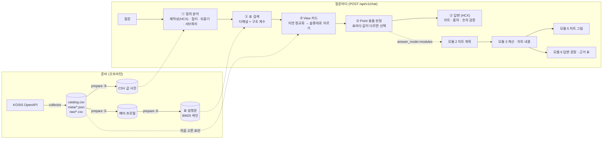

# t4core-stat-agent

**국가통계포털(KOSIS) 공식 통계를 근거로, 자연어 질문에 "답변 + 근거 데이터 표 + 차트 + 출처"를 함께 돌려주는 RAG 서비스**

```
질문  최근 5년간 대전의 인구 변화 추이
답변  대전광역시 총인구는 2021년 ○○명에서 2025년 ○○명으로 약 x.x% 감소했습니다. …
      [추이 차트]  [근거 표]  출처: 주민등록인구현황 「행정구역(시군구)별, 성별 인구수」 (KOSIS)
```

- 데이터 범위: KOSIS 국내통계 > 주제별 > **인구** (전수부문, 약 2,300개 통계표) + 주거 > 주택총조사
- LLM·임베딩: HCX(HyperCLOVA X, CLOVA Studio) 대화 + CLOVA 임베딩 v2(bge-m3)
- 숫자는 LLM 이 만들지 않습니다. 답변의 수치는 항상 View 카드(정규화 parquet 에서 자른 표)에서 오고, 카드의 `source` 좌표로 원본을 다시 조회할 수 있습니다.

---

## 목차

1. [빠른 시작](#1-빠른-시작)
2. [파이프라인](#2-파이프라인)
3. [API](#3-api)
4. [설정](#4-설정)
5. [데이터 경로](#5-데이터-경로)
6. [폴더 구조](#6-폴더-구조)
7. [CLI](#7-cli)
8. [검색 평가·튜닝](#8-검색-평가튜닝)
9. [합성 골든셋 생성기 (synthetic_gold_pipeline)](#9-합성-골든셋-생성기-synthetic_gold_pipeline)
10. [개인 파이프라인 플러그인](#10-개인-파이프라인-플러그인)
11. [테스트](#11-테스트)
12. [Docker](#12-docker)
13. [자주 나는 오류](#13-자주-나는-오류)
14. [로드맵 · 데이터 출처](#14-로드맵--데이터-출처)

---

## 1. 빠른 시작

```bash
python -m venv .venv && source .venv/bin/activate      # Windows: .venv\Scripts\activate
pip install -r requirements-dev.txt
cp .env.example .env                                   # KOSIS_API_KEY, HCX_API_KEY 입력

# 데이터: 수집 결과(kosis_data)를 storage/kosis_data 에 두거나 .env 의 KOSIS_DATA_DIR 로 지정
python -m backend.core.config                          # 경로 해석 결과 (KOSIS_DATA_DIR 에 ✓)

python -m backend.rag.ingestion.prepare                # 처음 한 번: 메타 프로필 → 표 색인 → CSV 값 사전

uvicorn backend.main:app --reload --port 8000          # http://localhost:8000/docs
#   POST /api/v1/chat  {"question": "작년 대구의 남자 20대 인구 수"}

python -m backend.agent "최근 5년간 대전의 인구 변화 추이"   # 터미널에서 같은 파이프라인
pytest -q                                              # HCX·네트워크 없이 전체 테스트
```

---

## 2. 파이프라인



### 준비

| 단계 | 하는 일 | 결과 |
|---|---|---|
| 수집 `collector` | KOSIS 목록 → 전수/표본 판별 → 메타 → 수치 (4만 셀 제한 자동 분할, 이어받기) | `kosis_data/catalog.csv`, `meta/`, `raw/<조사>/<기관>_<표>.csv` |
| ① 메타 프로필 | catalog(selected) 표의 메타 JSON → 분류 종류·기간·단위 요약 | `parquet/meta_profiles.jsonl` |
| ② 표 색인 | 표마다 "무엇을 세었는가" 설명문 + Kiwi BM25 토큰 (지역 코드·연도 목록은 넣지 않음) | `indices/table_index/` |
| ③ CSV 값 사전 | 원본 CSV 의 열 머리·분류 값·항목·단위·실제 수록 연도·주석 → 값 → 표 역색인 (바뀐 표만 다시) | `csv_index/` |
| 정규화 (지연) | 검색에서 **처음 뽑힌 표만** 그때 raw → tidy parquet + 프로필 | `parquet/processed/`, `profiles/` |

`python -m backend.rag.ingestion.prepare` 또는 `POST /api/v1/ingest/prepare` 가 ①②③ 을 한 번에 합니다. catalog·meta·raw 가 바뀌면 다시 실행합니다.

### ① 질의 분석 — `backend/rag/query_analyzer`

질문 → `QueryAnalysis {status, slots, clarifications, sub_queries, view_bundle, trace}`. HCX 는 재작성에서 1회만 부릅니다.

| 단계 | 파일 | 내용 |
|---|---|---|
| 코드 추출 | `extract.py` | 상대 시점(작년·최근 N년)·연도 범위·시도·성별·연령·국적·출생연도를 정규식 + `dictionary/rule_dict.json` 으로 |
| 용어 사전 | `terms.py` | 일상어 → 통계어 (`dictionary/term_dict.json`, '혼자 사는' → 1인가구) |
| HCX 슬롯 | `slots.py` | 슬롯 12개(시점·지역·전출지·전입지·국적·대상·성별·연령·조건·이동·지표·비교축) + 의도 9종 + 하위 질문 |
| 검증 | `validate.py`, `measures.py` | 질문에 근거 없는 값 빼기, 계산 단어('구성비') 떼기, 하위 질문 정리 |
| 접지 | `lexicon.py`, `grounding.py` | 슬롯 값 → CSV 에 실제로 있는 값·표 (rule_dict > CSV > term_dict > 학습 사전) |
| 시점 규칙 · 되묻기 | `clarify.py` | '요즘' = 자료의 최신 연도, '추이' = 최근 5개 해. 필수 슬롯(시점·지역·대상) 확인 |
| 서브쿼리 | `decompose.py`, `roles.py` | 표 단위로 나누기 (지표마다), 분모('…중 비율')·조건('…가 N명 이상') 검색 단위 |
| 검색 문장 · View 입력 | `search_text.py`, `adapter.py` | 지역·시점 단어를 뺀 검색 문장 + View 슬롯(연도 int, 연령 {from,to}, View 의도 4종) |

`clarify_mode: soft`(기본)는 필수 슬롯이 없어도 멈추지 않고 가정(시점=최신, 지역=전국)으로 진행하며 되묻기 후보는 `clarifications` 에 남깁니다. `strict` 면 `needs_clarification` 으로 멈춥니다.

### ② 표 검색 — `backend/rag/search`

후보를 먼저 자르지 않고 표 전체(약 1,100개)에 채널 점수를 매겨 가중 RRF 로 합친 뒤, 표 구조 계수를 곱합니다.

```
채널 (원문 + 재작성 문장 각각)     dense 1.6 · value 1.6 · title 1.4 · lex 1.0 · ngram 0.8
  dense  HCX bge-m3 임베딩       value  질문 속 표현이 어느 표의 항목·분류 값인가
  title  표 이름이 질문에 있는가   lex    Kiwi BM25 (표 설명문)      ngram  글자 2·3-gram BM25
구조 계수 (곱)  시점(실제 수록 연도) · 주기(월·분기·반기) · 시군구 이름 · 지역 수준 · 시도 · 연령·성별 분류 · 조사 이름
형제 표 해소    같은 통계의 (계)/(남)/(여) · 전국/시도/시군구판 · 연도판 무리 안에서 질문 좌표에 맞는 표를 앞으로
분모 단위       '인구'·'가구' 뿐인 하위 질의는 본 질의 1위 표와 같은 조사의 단순한 표를 찾음
(선택) LLM 재정렬  상위 12개를 표 구조 요약으로 HCX 가 다시 줄 세움 (configs/search.yaml 의 llm_rerank.enabled)
```

조건은 걸러 내지 않고 계수로만 반영합니다 (메타나 질문 해석이 틀려도 정답 표가 사라지지 않게). 지표 슬롯은 순위에 쓰지 않고 `unmet` 표시용으로만 붙입니다.

### ② View 카드 · Point 충돌 — `backend/rag/view`

- 검색 단위(본 질의 또는 서브쿼리)마다 상위 `n_views` 개 표를 슬롯대로 잘라 **Record**(View 카드)를 만듭니다. 표에 없는 조건은 억지로 맞추지 않고 `notes` 에 남깁니다.
- 같은 단위의 View 들을 교차점(시점·지역·성별·연령·지표·단위)으로 펼쳐 비교합니다. 단위가 배수만 다르면(명·천명) 맞춰서 비교합니다.
  - 값이 같으면 `ok`, 다르면 `ambiguous` → 선택지(표 설명·주석·산출 기준·값 미리보기) + 서명된 **선택 토큰**
  - `auto_select` 면 검색 순위가 가장 높은 선택지로 바로 진행, 아니면 `needs_selection` 으로 멈춤
- 선택 토큰은 서버 세션 없이 동작합니다 (토큰 안에 좌표가 있어 다른 서버·CLI 에서도 같은 View 를 다시 만듦).
- 지표를 나누는 분류(`기본항목별: 출생아수(명)·사망자수(명)…`, 합계 없음)에 요청 지표가 없으면 첫 코드로 바꿔치기하지 않습니다.
  그 View 는 `metadata.indicator_missing` 이 붙고 답변으로 넘기지 않으며, 단위의 View 가 모두 그렇다면
  "요청한 지표를 담은 통계표를 찾지 못함" 으로 답합니다 (다른 지표 값으로 답하지 않음).

### ③ 답변 — `backend/agent`

Record 목록 → HCX 답변 1회. 조건을 모두 맞춘 View → 일부 → 빈 View 순으로 문맥에 넣고(검색 단위마다 최소 1개), `[자료]` 에 없는 숫자는 `unverified_numbers` 로 표시합니다. 차트 스펙(line/bar/table)과 출처를 함께 돌려줍니다.

### ③ 모듈 2·3·5·6 — `backend/agent/{chart_decision, chart_calculate, draw_chart, answer_compose}`

`/chat` 에 `answer_mode: "modules"` 를 주면 ③ 답변 대신 아래 순서로 갑니다 (기본 `default` 는 위의 답변 그대로).
연결은 `backend/agent/modules.py` 한 곳에서 하고, 각 모듈 설명은 모듈 폴더의 README · 명세(md)에 있습니다.

| 모듈 | 하는 일 | HCX |
|---|---|---|
| 2 chart_decision | 하위 질문마다 차트 유형 · measure · 쓸 View (세트) | 0~1회 (`use_llm`) |
| 3 chart_calculate | 계산 계획 → 계산(증감률·비중·순위 …) → 차트 내용 구성 · 검증 | 1회 |
| 5 draw_chart | 차트 그림 (plotly JSON) | 없음 |
| 6 answer_compose | 계산 결과를 자리표시자로 채운 답변 문장 · 근거 표 · 주의사항 | 1~2회 |

검색·View 와 모듈 사이의 약속 (`modules.py`)
- View 는 충돌 선택이 끝난 카드(`ViewSet.records`)만 넘깁니다. 모듈 2·3 은 단위마다 순위가 가장 높은 View 를 씁니다.
- 역할 단위(분모·조건, `query_analyzer/roles.py`)는 따로 답할 질문이 아니라서 모듈 2·3 의 질문에서 빼고, 그 View 를 모든 세트에 붙입니다.
  모듈 3 은 세트 밖 View 를 분모로 쓰면 비중 계산을 보류하기 때문입니다.

### 판단 — `backend/rag/judge`

View 가 질문 조건(슬롯)을 실제로 담았는지 규칙으로 판정합니다 (`pass/partial/fail` + 사유 코드). `/chat` 응답을 그대로 `POST /api/v1/rag/judge/from-chat` 에 넣으면 됩니다.

---

## 3. API

`uvicorn backend.main:app --reload --port 8000` → http://localhost:8000/docs (Swagger 순서 = 파이프라인 순서)

| 단계 | 엔드포인트 | 내용 |
|---|---|---|
| system | `GET /health`, `GET /api/v1/system/paths`, `GET /api/v1/system/pipelines` | 상태 · 경로 · 플러그인 |
| ⓪ 준비 | `POST /api/v1/ingest/prepare` (+ `/status`) | 메타 프로필 → 표 색인 → CSV 값 사전 (백그라운드) |
| | `GET /api/v1/ingest/meta/profiles[/{tbl_id}]` · `POST /api/v1/ingest/normalize/{tbl_id}` · `GET …/normalize/{tbl_id}/profile` · `GET …/dict/{name}` | 메타 프로필 · 정규화 · 표기 사전 |
| | `POST /api/v1/csv-index/build` · `GET …/summary` · `…/values` · `…/find` · `…/tables/{tbl_id}` | CSV 값 사전 |
| ① 분석 | `POST /api/v1/rag/analyze` · `POST /api/v1/rag/clarify` | 질문 → QueryAnalysis · 되묻기 응답 |
| | `POST /api/v1/rag/lexicon/lookup` · `…/learn` · `GET …/pending` · `POST /api/v1/rag/decompose` · `GET /api/v1/rag/settings` · `GET /api/v1/rag/hcx-check` | 동의어 · 서브쿼리 · 설정 · HCX 확인 |
| ② 검색·View | `POST /api/v1/rag/search` | 자연어(+슬롯) → 표 후보 |
| | `POST /api/v1/rag/views` · `…/views/select` · `…/views/points` | 단위별 View + 충돌 판정 · 선택 반영 · Point 비교만 |
| ②-1 판단 | `POST /api/v1/rag/judge` · `…/judge/from-chat` · `GET …/judge/config` | View ↔ 질문 조건 |
| ③ 답변 | `POST /api/v1/agent/answer` | 질문 + Record 목록 → 답변 |
| ③-1 차트 | `POST /api/v1/chart/decide` · `…/chart/calc` (+ `/trace`) · `GET …/chart/specs` | 모듈 2 차트 계획 · 모듈 3 계산 · 차트 15종 |
| ③-2 답변·표 | `POST /api/v1/answer/compose` (+ `/trace`) | 모듈 6 답변 문장 · 근거 표 |
| | `POST /api/v1/agent/modules` | `/rag/views` 응답 → 모듈 2→3→5→6 한 번에 |
| ★ | **`POST /api/v1/chat`** | ①→②→③ 한 번에 (`answer_mode: modules` 면 ③ 대신 모듈 2→3→5→6) |
| ④ | `POST /api/v1/data/source` | Record / source 좌표 → parquet 재조회 + 차트 |

단계별로 이어 붙이기: `/rag/analyze` 응답 → `/rag/views` 의 `analysis` → 응답 `records` → `/agent/answer` 의 `records`.

모듈 단계별: `/rag/views` 응답을 `/chart/decide` 의 `view_input` 에, 그 `view_bundle` 을 `query_bundle` 에 넣습니다 →
응답 `charts` · `records` → `/chart/calc` → 응답 `calc_results` · `displays` · `chart_plan.answer_steps` → `/answer/compose`.
`frontend/chart-lab` 이 있으면 `/lab/chart-lab/` 에서 같은 흐름을 화면으로 봅니다.

### `/chat` 상태와 이어서 하기

| `status` | 뜻 | 다음 요청 |
|---|---|---|
| `ok` | `result` 에 답변·차트·출처 | — |
| `needs_clarification` | 필수 슬롯 없음 (`clarify_mode: strict` 일 때) | `{question, previous: 이 응답, selections: {"지역": ["대전광역시"]}}` — 재작성 HCX 를 다시 부르지 않음 |
| `needs_selection` | 같은 교차점 값이 표마다 다름 (`auto_select: false` 일 때) | `{question, previous: 이 응답, view_selections: [{selection_token, option_id}]}` — 분석·검색을 다시 하지 않음 |
| `out_of_scope` | 통계 수치를 묻지 않는 질문 | 검색 없이 안내 답변 |

```jsonc
// 요청
{"question": "최근 5년간 대전의 인구 변화 추이", "today": "2026-11-02", "auto_select": true,
 "overrides": {"clarify_mode": "strict"}}        // configs/pipeline.yaml 값을 요청마다 바꿀 수 있음
// 응답
{"status": "ok", "analysis": {…QueryAnalysis}, "views": {…ViewSet: units[].conflict, records, pending},
 "records": [Record…], "result": {"answer", "chart", "sources", "unverified_numbers", …},
 "notes": [...], "timings": {"analyze": 0.9, "views": 2.1, "answer": 1.4, "total": 4.4}}
```

---

## 4. 설정

| 파일 | 읽는 곳 | 내용 |
|---|---|---|
| `.env` | `backend/core/config.py` | `KOSIS_API_KEY`, `HCX_API_KEY`, `HCX_BASE_URL`, `HCX_MODEL`, `HCX_APP_TYPE`, (선택) `HCX_EMBED_PATH`, `VIEW_SELECTION_SECRET`, 경로 변수 |
| `configs/pipeline.yaml` | `backend/core/settings.py` | 필수 슬롯 · 기준 해 · 되묻기 모드 · 검색 문장 · 서브쿼리 정책 · View 수 · 충돌 허용 오차 · 선택 토큰 유효 시간 |
| `configs/search.yaml` | `backend/rag/search/engine.py` | 채널 가중치 · rrf_k · 구조 계수 · LLM 재정렬 · 형제 표 · 분모 단위 · 개념 카탈로그 (비워 두면 코드 기본값) |
| `configs/colloquial.yaml` | `backend/rag/search/query.py` | 일상어 정규식 → 더할 통계어 ('수도권으로 몰리는' → 순이동) |
| `backend/rag/query_analyzer/dictionary/` | 재작성 | `rule_dict.json`·`term_dict.json` (`build_dicts.py` 가 원본 사전에서 만듦) |

- 다른 설정 파일: `PIPELINE_CONFIG=<경로>`. 테스트처럼 한 값만 바꾸기: `PIPELINE_CLARIFY_MODE`, `PIPELINE_BASE_YEAR_MODE`.
- API 요청의 `overrides` 로 `pipeline.yaml` 값 일부만 바꿀 수 있고, 바꾼 값은 `trace` 의 params 에 남습니다.

---

## 5. 데이터 경로

모든 경로는 `backend/core/config.py` 한 곳에서 정합니다. 환경변수 → 실제로 있는 후보 → 기본 위치 순입니다.

| 변수 | 내용 | 기본 위치 |
|---|---|---|
| `STORAGE_DIR` | 아래 기본 위치의 뿌리 | `storage/` |
| `KOSIS_DATA_DIR` | 수집 원본 (catalog.csv, meta/, raw/) | `storage/kosis_data` → 없으면 `./kosis_data`, `../kosis_data` |
| `VIEW_OUT_DIR` | 정규화 parquet · 프로필 · 메타 프로필 · View csv · 표기 사전 | `storage/parquet` |
| `TABLE_INDEX_DIR` | 표 설명문 BM25 색인 | `storage/indices/table_index` |
| `CSV_INDEX_DIR` | CSV 값 사전 (+ 학습 사전 · 개념 카탈로그) | `storage/csv_index` |
| `EMBED_CACHE` | HCX 임베딩 캐시 (sqlite) | `storage/indices/embed_cache.sqlite` |
| `RUNS_DIR` | 단계별 실행 기록 · 검색 비교 · 일괄 실행 결과 | `storage/runs` |
| `ANSWERS_DIR` | `/chat` `save: true` 결과 | `storage/answers` |
| `PRIVATE_DIR` | 개인 파이프라인 플러그인 | `./private`, `../private`, `../<저장소>_private` |

`storage/` 는 git 에 폴더 뼈대만 올라갑니다. 예전 임베딩 캐시 `storage/indices/embed_cache_view.sqlite` 가 있으면 `embed_cache.sqlite` 로 이름만 바꾸면 그대로 씁니다 (캐시 키 같음).

---

## 6. 폴더 구조

```text
t4core-stat-agent/
├── backend/
│   ├── main.py                 FastAPI 앱 (Swagger)
│   ├── api/                    ingest · csv_index · query · views · judge · chat · chart · answer (+ deps: 예외 → HTTP)
│   ├── schemas/                query · view · record · chat · judge · ingest · chart · answer (모듈 사이 계약)
│   ├── core/                   config(경로·.env) · settings(pipeline.yaml) · llm(HCX 대화·임베딩) · tracking · plugins · utils
│   ├── agent/                  pipeline(run_chat) · answer · modules(모듈 2·3·5·6 연결) · prompts · batch · __main__(CLI)
│   │   ├── chart_decision/     모듈 2 차트 계획 (LangGraph)
│   │   ├── chart_calculate/    모듈 3 계산 · 차트 내용 (LangGraph)
│   │   ├── draw_chart/         모듈 5 차트 그림 (plotly)
│   │   └── answer_compose/     모듈 6 답변 문장 · 근거 표 (LangGraph)
│   ├── data_engine/            duckdb_client(좌표 → parquet 재조회) · chart_generator
│   └── rag/
│       ├── ingestion/          collector(KOSIS 수집) · meta_profile · table_text · normalize · prepare
│       ├── csv_index/          CSV 값 사전 (source · scanner · store)
│       ├── query_analyzer/     ① 재작성(terms·extract·slots·validate·sentence·rewrite) + 분석(analyze·lexicon·grounding·clarify·decompose·roles·search_text·adapter)
│       ├── search/             ② engine · index · channels · facets · query · resolve · siblings · concepts · llm_rerank · tuning/
│       ├── view/               ② build · run · points · conflict · selection · viewset
│       └── judge/              판단 (extract · slots · adapters · aggregate)
├── configs/                    pipeline.yaml · search.yaml · colloquial.yaml
├── synthetic_gold_pipeline/    합성 골든셋 생성기 (독립 패키지, 9절)
├── tests/                      HCX·네트워크 없이 가짜 KOSIS 데이터로 (11절)
├── storage/                    로컬 데이터 (git 제외)
└── frontend/                   정적 테스트 화면 (있으면 /lab 으로 서빙)
```

---

## 7. CLI

모두 저장소 루트에서 실행합니다.

```bash
# 수집 (데이터를 새로 받거나 갱신할 때만)
python -m backend.rag.ingestion.collector catalog     # 목록 트리 → catalog.csv (전수/표본 판별)
python -m backend.rag.ingestion.collector schema      # 메타 → meta/*.json, table_schema.csv
python -m backend.rag.ingestion.collector download    # 수치 → raw/ (오래 걸림, 중단 후 이어받기)
python -m backend.rag.ingestion.collector status      # 조사별 진행 현황
#   옵션: --surveys 인구총조사 … · --root 인구 주거:주택총조사 [--append] · --max-tables 20 · --recent 5 · --max-cells N

# 준비
python -m backend.rag.ingestion.prepare [--workers 4] [--force]          # ①②③ 한 번에
python -m backend.rag.ingestion.normalize --tables DT_1B040A3 [--force]   # 큰 표를 시연 전에 미리 정규화
python -m backend.rag.csv_index find 출생아 수                            # 값 사전 조회 (summary · values 지역 · table <tbl_id>)

# 질문
python -m backend.agent "작년 대전 인구 수" [--select ask|first] [--json out.json]   # 되묻기·선택을 터미널에서
python -m backend.rag.search "2023년 서울 40대 남성 이혼 건수" [--llm] [--no-analyze]  # 검색 순위·채널·계수가 깎인 이유
python -m backend.agent.batch --queries q.csv [--no-answer] [--workers 3]             # 질문 파일 일괄 실행 → results.json

# 사전
python backend/rag/query_analyzer/dictionary/build_dicts.py    # 원본 사전 → rule_dict.json · term_dict.json
```

---

## 8. 검색 평가·튜닝

`backend/rag/search/tuning/` — 골든셋으로 검색 설정을 비교하고 가중치를 맞춥니다.

```bash
# 비교: dense 종류 · LLM 재정렬을 같은 질의 분석으로 나란히 (analysis_cache.jsonl 로 HCX 는 한 번만)
python -m backend.rag.search.tuning.compare --golden tests/retrieval_golden.jsonl --dense hcx none --llm
python -m backend.rag.search.tuning.compare --golden <합성 셋.jsonl> --alt <alt_positives.jsonl> --split heldout
#   → storage/runs/search_compare/<시각>_compare/ (report.md · summary.json · per_query.csv)
#   지표: Hit@1·3·5·10 · Groups@5·10(모든 근거 그룹) · MRR · pool@50 · 형제 표 혼동 · 실패 원인

# 가중치 맞추기 (dev 로 맞추고 held-out 점수를 같이 봄 → configs/search.tuned.yaml, 확인 후 search.yaml 로)
python -m backend.rag.search.tuning.tune --golden tests/retrieval_golden.jsonl --split dev --cache <compare 폴더>/analysis_cache.jsonl

# 대체 정답 (같은 좌표 값이 정답 값과 같은 다른 표) → compare --alt
python -m backend.rag.search.tuning.alt_gold --golden <합성 셋.jsonl>

# 일상어 사전 후보 캐내기 (dev 레코드 O·P 쌍) → 사람이 골라 configs/colloquial.yaml 로
python -m backend.rag.search.tuning.colloq_mine mine --golden <합성 셋.jsonl> --out colloquial.candidates.yaml
python -m backend.rag.search.tuning.colloq_mine eval --golden <합성 셋.jsonl> --extra colloquial.candidates.yaml

# 개념 카탈로그 (같은 값을 주는 표 묶음) → <CSV 값 사전>/concepts.json
python -m backend.rag.search.concepts build --alt <alt_positives.jsonl> --golden <합성 셋.jsonl>

# 여러 표 질문 상한: 근거 그룹 설명을 하위 단위로 넣었을 때 Groups@5·10 (분석은 compare 캐시 재사용, HCX 없음)
python -m backend.rag.search.tuning.oracle_groups --golden <합성 셋.jsonl> --cache <compare 폴더>/analysis_cache.jsonl --multi-only

# 남은 실패 점검표: Hit@1 을 놓친 문항 → 판정(A 진짜 실패 · B 1위도 답 · C 라벨 이상 · D 질문이 표를 못 정함) → 판정 반영 지표
python -m backend.rag.search.tuning.audit make  --per-query <compare 폴더>/per_query.csv --golden <합성 셋.jsonl> --out audit.csv
python -m backend.rag.search.tuning.audit score --per-query <compare 폴더>/per_query.csv --audit audit.csv
```

- LLM 재정렬(`--llm`): 형제·같은 개념 표는 상위 12개 뒤에 붙여 함께 보여 주고, 하위 검색 단위는 그 단위 문장을 기준으로 줄 세웁니다.
  분모 단위는 규칙이 고른 순서를 그대로 둡니다 (`configs/search.yaml` 의 `llm_rerank.skip_roles`).

- 합성 셋은 레코드 해시로 dev / heldout 을 나눕니다 (`tuning/splits.py`). 사전·카탈로그를 캐낸 문항과 평가 문항을 가르기 위함입니다.
- `tests/retrieval_golden.jsonl` 은 손으로 만든 89문항 검색 골든셋입니다 (split: dev / test).

---

## 9. 합성 골든셋 생성기 (synthetic_gold_pipeline)

KOSIS 원본과 결정론적 도구로 **정답을 먼저 확정**하고, 그 Fact 를 정답으로 갖는 질문을 거꾸로 만드는(Reverse Generation) 평가셋 생성기입니다. `backend` 와 독립적으로 동작하고(`backend.core.llm` 만 선택적으로 재사용), 산출물은 `synthetic_gold_pipeline/outputs/` 아래에만 씁니다.

- LLM 은 연산 계획(JSON)·질문 문장·의미 검수만 맡습니다. 수치는 RAW 행 → DuckDB 조회 → Decimal 계산이며 원본 파일·행 번호·SQL·계산식으로 재현됩니다.
- 유형: 단순 조회(쉬운 셋 전용) · 두 시점 비교(증감률·차이·%p) · 두 표 비율(구성비·천 명당) · 조건부 집계(필터 합·개수·평균·TOP-K …) · 답변 불가(문맥·코퍼스·모호·범위 밖·미래)
- 주요 규칙: 결측 기호를 0 으로 바꾸지 않음 · 같은 단위 계열만 변환·합산 · 주기·실측/추계·모집단 혼합 금지 · 총계·소계는 벡터 집계에서 제외 · Join 행 증폭·코드 체계 불일치 폐기 · 동점 순위 폐기 · 질문에 정답 값 노출 금지 · View 하나씩 빼 보는 Ablation 으로 모든 View 가 필요한지 확인

```bash
pip install -r synthetic_gold_pipeline/requirements.txt

# Demo (API 키 불필요, 가상 KOSIS 데이터 + Mock LLM)
python -m synthetic_gold_pipeline.main_pipeline --config synthetic_gold_pipeline/configs/pipeline.yaml --mode demo --target-count 10
# Real (실제 데이터 + HCX)
python -m synthetic_gold_pipeline.main_pipeline --config synthetic_gold_pipeline/configs/pipeline.yaml --mode real \
    --data-root storage/kosis_data --target-count 100 [--resume] [--llm-provider mock|hcx|hcx_repo|openai_compat]
# 쉬운 셋 (단순 조회·두 시점 비교 위주, 2015년 이후, 분류 조건 1개 이하 → outputs_easy/)
python -m synthetic_gold_pipeline.main_pipeline --config synthetic_gold_pipeline/configs/pipeline_easy.yaml --mode real --target-count 60
```

| 산출물 (`outputs/`) | 내용 |
|---|---|
| `datasets/synthetic_gold_dataset.jsonl` | 전체 레코드 (정답·원본 좌표·SQL·계산식·검증 결과·모듈별 평가 기준) |
| `datasets/synthetic_gold_queries.csv` | `id,survey,test_type,target_module,question` — 공식(-O)·일상어(-P) 질문 |
| `datasets/synthetic_gold_answers_references.csv` | 평가자 전용 정답·참고 (RAG 입력 금지) |
| `reports/generation_report.json`, `run_manifest.json` | 단계별 성공률·분포·실패 사유 · seed·설정 해시·데이터 스냅샷 |

**RAG 채점** — 통합 파이프라인으로 질문 파일을 일괄 실행한 뒤 채점합니다.

```bash
python -m backend.agent.batch --queries synthetic_gold_pipeline/outputs/datasets/synthetic_gold_queries.csv   # --no-answer: 답변 HCX 생략
python -m synthetic_gold_pipeline.score_rag_results --rag-results storage/runs/batch/synthetic_gold_queries
#   → outputs/reports/rag_eval/<실행 이름>/ (per_question.csv · summary.json · original_vs_paraphrased.csv)
```

| 지표 | 의미 |
|---|---|
| `Table_Any/All_Hit@K`, `Table_Coverage@K`, `Table_MRR` | 필수 근거 그룹마다 허용 표가 어느 검색 단위 top-K 에 있는가 (All = 모든 그룹) |
| `View_All_Hit`, `Final_Context_All_Hit` | 만든 View · 답변에 넣은 View 의 source 좌표가 필수 원본 좌표를 모두 포함하는가 |
| `query_ok` | 질의 분석이 시점·지역을 맞게 뽑았는가 |
| `ans_Numeric/Unit/Intermediate_Fact_Accuracy`, `Abstention_Accuracy` | 답변 수치 채점 (`--no-answer` 없이 실행했을 때) |
| `first_failure`, `root_cause` | 단계별 최초 실패 · `ORIGINAL_ONLY` = 일상어만 실패 (질의 변환 의심) |

- 메타데이터 인덱스는 표 단위로 캐시되어 중단 후 이어서 진행합니다 (`--rebuild-index` 로 전부 다시).
- 실제 HCX 구조화 출력·실데이터 규모 성능·실제 LLM 질문 품질은 이 저장소의 테스트(가상 데이터 + Mock LLM)로는 검증되지 않았습니다. Demo 레코드는 모두 `NEEDS_HUMAN_REVIEW` 입니다.

---

## 10. 개인 파이프라인 플러그인

`private/pipelines/<이름>.py` (git 제외)에 `run_chat(question, today=None, top_k=None, n_views=None, **kw) -> dict` 를 두면 자동 등록됩니다. 반환 dict 는 `ChatResponse` 와 같은 키를 권장합니다 (응답 모양은 검사하지 않고 그대로 돌려줌). `DESCRIPTION = "…"` 은 선택.

- 확인: `GET /api/v1/system/pipelines` · 호출: `POST /api/v1/chat {"question": …, "pipeline": "<이름>"}`
- 폴더 위치: 환경변수 `PRIVATE_DIR` → `<저장소>/private` → `<저장소 상위>/private` → `<저장소 상위>/<저장소이름>_private`

---

## 11. 테스트

```bash
pytest -q                                    # backend (HCX·네트워크 없음)
pytest -q synthetic_gold_pipeline/tests      # 골든셋 생성기
```

| 파일 | 확인하는 것 |
|---|---|
| `test_pipeline_e2e.py` (`e2e_scenario.py`) | 경로 해석 → 준비 → 분석 → View → 답변 → `/chat` (범위 밖 · 되묻기 이어서 · 충돌 선택 이어서 · 서브쿼리 · soft 모드) → 월간표 좌표 재조회 → 판단 → 일괄 실행 → Swagger |
| `test_query_analysis.py` (`scenario_query.py`) | CSV 값 사전 · 동의어 계층 · 접지 · 시점 규칙 · 되묻기 왕복 · 서브쿼리 분리 정책 · 지역 칸 바로잡기 |
| `test_views.py` (`scenario_views.py`) | 충돌 재현(단위 환산 포함) · 선택지 주석·설명 · 선택 토큰 왕복·변조·만료 · auto_select · 허용 오차 · `/chat` 선택 왕복 |
| `query_analyzer/`, `test_decompose_split.py`, `test_resolve.py` | 재작성 단계별 · 변환 · 서브쿼리 · 검색 문장 |
| `test_search.py` | 표 검색 채널·구조 계수 (작은 코퍼스, 저장소 없음) |
| `test_search_fixes.py` (`scenario_search_fixes.py` · `scenario_search_cli.py`) | 원문 표현 정리 · 형제 표 · 분모·조건 단위 · LLM 후보 위치·하위 단위 · 개념 카탈로그 / compare · tune · 상한 실험 · 점검표 · View |
| `test_tuning.py` | dev/heldout 나누기 · 일상어 후보 캐기 · 개념 카탈로그 만들기 |
| `judge/` | 판단 모듈 |
| `test_indicator_missing.py` (`scenario_indicator_missing.py`) | 요청 지표가 없는 표(인구동태 표에 '외국인 인구수')의 첫 코드로 답하지 않음 · 있는 지표는 그대로 · 다른 표가 있으면 그 표만 |
| `test_agent_modules.py` (`scenario_agent_modules.py`) | 실제 `/rag/views` 결과 → `/chart/decide` → `/chart/calc` → `/answer/compose` · `/agent/modules`(그림 포함) · `/chat answer_mode` · 충돌 선택 · 역할 단위 세트 |
| `chart/`, `chart_calculate/`, `answer_compose/` | 모듈 2 · 3 · 6 단위 (HCX 는 가짜 함수 또는 decision 직접 입력) |

`tests/fake_kosis.py` 가 가짜 KOSIS 수집 결과(연간·5년 주기·월간 표 등)와 HCX 대역(`llm._post`)을 만듭니다. 시나리오는 저장소 위치를 환경변수로 바꾸려고 별도 프로세스로 실행하며, 되묻기 왕복을 확인하려고 `clarify_mode: strict`, 기준 해 고정(`base_year_mode: fixed`)으로 돕니다 (`tests/helpers.py`).

---

## 12. Docker

```bash
docker compose up --build                                                   # 운영: 127.0.0.1:8000, storage 를 마운트
docker compose -f docker-compose.yml -f docker-compose.dev.yml up --build   # 개발: 127.0.0.1:8001, backend·configs 코드 마운트 + --reload
```

이미지에는 `backend/`, `configs/` 만 들어갑니다. 데이터(`storage/`)는 실행할 때 마운트하고, 키는 `.env` 로 넘깁니다.

---

## 13. 자주 나는 오류

| 증상 | 원인 | 조치 |
|---|---|---|
| HTTP **409** | 표 색인·메타 프로필·CSV 값 사전·원본 없음 | `python -m backend.rag.ingestion.prepare` |
| HTTP **503** | `.env` 에 `HCX_API_KEY` 없음 | `.env` 확인 후 서버 재시작 |
| HTTP **502** | HCX 호출 실패 (429·키·모델명) | `GET /api/v1/rag/hcx-check` |
| HTTP **404** (선택) | 선택 토큰 변조·만료·없는 option_id | 같은 `/chat`(또는 `/rag/views`) 응답의 토큰 사용, 유효 시간 `selection_ttl_hours` |
| 첫 질문이 매우 느림 | 큰 표의 지연 정규화 + 처음 한 번 전체 표 임베딩 | 시연 전 `normalize --tables …`, 질문 한 번 미리 실행 |
| `pip install` 에서 `cp949` 오류 | Windows 인코딩 | `requirements*.txt` 는 ASCII 로 유지, 또는 `$env:PYTHONUTF8=1` |

---

## 14. 로드맵 · 데이터 출처

- [x] KOSIS 인구 주제 전수부문 수집 · 지연 정규화 · View 카드 + 좌표 재조회
- [x] 질의 재작성 · CSV 값 사전 접지 · 되묻기 · 서브쿼리
- [x] 다채널 표 검색 (BM25 + dense + 값·제목 채널 + 구조 계수 + 형제 표 해소)
- [x] View Point 충돌 판정 · 선택 · 판단 모듈 · 합성 골든셋 생성기
- [ ] 실데이터로 검색 가중치 다시 측정 → `configs/search.yaml`
- [ ] 반기·분기·월 단위 View (지금은 연도 단위로 자름), 조건부 집계(`… N명 이상인 지역`) View
- [ ] LangGraph 오케스트레이션 (검증 → 재검색 루프), Graph RAG, 프론트엔드 채팅 UI
- [ ] 인구 외 주제(고용, 보건, 주거 등) 확장

통계 데이터: [국가통계포털(KOSIS)](https://kosis.kr) OpenAPI. 각 통계의 작성기관은 Record 의 `source.kosis_url` 에서 확인할 수 있으며, KOSIS 공유서비스 이용약관에 따라 답변에 항상 출처를 표기합니다.
