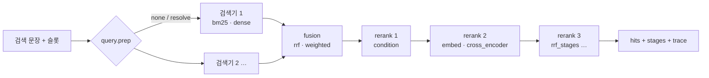

# Step 3 — 검색 실험실 (Retrieval Lab)

검색을 **구성 파일 하나**로 조립해서, 같은 질의를 여러 구성으로 돌려 **사람이 나란히 비교**하는 도구.
정답셋 없이 쓰는 것이 기본이다 (6-1 결정): 보고서를 보고 판정표에 관련도를 적으면 그 판정으로 구성별 점수를 낸다.

- 구성: `configs/retrieval/<이름>.yaml` — 코퍼스 · 토크나이저 · 임베더 · 검색기 · 합치기 · 재정렬 체인
- 코드: `backend/rag/retrieval/` (`interfaces` · `corpus` · `tokenizers` · `embedders` · `retrievers` · `rerankers` · `factory` · `pipeline` · `lab`)
- 실행: Swagger `② Retrieval 검색 실험실 v4` · CLI `eval/retrieval/compare.py` · 노트북 `notebooks/v4/retrieval_lab.ipynb`
- 기존 검색은 그대로. `baseline` 구성이 지금 검색(`table_search.search`)과 **같은 순위·점수**를 낸다 (테스트로 확인)

---

## 1. 흐름



검색기가 하나면 합치기는 건너뛴다. 후보마다 `stages[단계 이름] = {rank, score}` 가 쌓여서
**어느 단계가 순위를 바꿨는지** 보인다.

## 2. 구성 파일

```yaml
# configs/retrieval/baseline.yaml — 현재 검색 재현
description: 현재 검색 재현 — BM25(kiwi) 50 → 조건 확인 → 상위 top_k → HCX bge-m3 재정렬
corpus: {type: table_text}
query: {prep: none}
retrievers:
  - {name: bm25, type: bm25, k: 50, tokenizer: {type: kiwi, variant: table}}
rerank:
  - {type: condition, top_n: top_k}
  - {type: embed, embedder: {type: hcx_bge_m3}, respect_cost: true}
top_k: 10
```

- `extends: baseline` 으로 물려받고 바꿀 칸만 쓴다 (목록은 통째로 바뀜)
- `requires: [sentence_transformers]` — 없으면 그 구성만 실행하지 않고 이유를 알려 줌 (비교 전체는 계속)
- 실행할 때 일부만 바꾸기: 점 경로 `{"rerank.0.top_n": 20, "fusion.weights": {"dense": 2}}`
- `top_n: top_k` = 검색 호출의 top_k 를 따름

### 갈아 끼울 수 있는 것

| 자리 | type | 인자 (주요) | 비고 |
|---|---|---|---|
| corpus | `table_text` | — | 지금 검색의 표 설명문 (`storage/indices/table_index`) |
|  | `csv_index` | `scope: selected\|all`, `footnotes` | CSV 값 사전의 실제 열 머리·분류 값·항목·단위·연도·주석으로 만든 설명문 |
|  | `external` | `path`, `id_field`, `text_field` | 다른 팀 정제 데이터 등 (jsonl / csv / parquet) |
| tokenizer | `kiwi` | `variant: table\|hybrid`, `user_dict: lexicon\|<파일>`, `tags`, `split_complex` | `lexicon` = CSV 값 사전 항목·분류 이름 + term_dict 통계어를 사용자 단어로 ('1인가구' 를 한 토큰으로) |
|  | `okt` · `mecab` | `tags` | `pip install konlpy` (mecab 은 시스템 설치도) |
|  | `char_ngram` | `n: [2, 3]`, `keep_words` | 띄어쓰기·붙여쓰기 차이에 강함 |
|  | `whitespace` | — | 하한선 |
| embedder | `hcx_bge_m3` | `workers` | 지금 검색 (HCX, 기존 캐시 공유) |
|  | `sentence_transformers` | `model`, `device: auto\|cpu\|cuda`, `query_prefix`, `doc_prefix`, `max_seq_length`, `fp16` | 로컬 HuggingFace 모델. 벡터 캐시 `storage/indices/retrieval_lab/embed_cache.sqlite` |
|  | `hash` | `dim` | 구조 확인용 (품질 비교 대상 아님) |
| retriever | `bm25` | `tokenizer`, `k`, `variant: okapi\|plus\|l`, `k1`, `b` | 문서 토큰 디스크 캐시 |
|  | `dense` | `embedder`, `k` | 코퍼스 전체 벡터 (디스크 캐시) |
| fusion | `rrf` | `k`, `weights`, `pool` | 검색기 2개 이상일 때 |
|  | `weighted` | `weights`, `norm: minmax\|zscore\|none`, `pool` | |
| rerank | `condition` | `top_n` | `resolve.rerank` — 슬롯 조건을 못 맞춘 정도(cost) 순. 점수는 앞 단계 값 유지 |
|  | `embed` | `embedder`, `respect_cost`, `top_n` | 후보 설명문만 임베딩 (= 지금 검색 2단계) |
|  | `cross_encoder` | `model`, `max_length`, `batch_size`, `device`, `respect_cost`, `top_n` | 예: `BAAI/bge-reranker-v2-m3`, `dragonkue/bge-reranker-v2-m3-ko` |
|  | `rrf_stages` | `stages`, `k`, `weights`, `top_n` | 앞 단계 순위끼리 RRF (앙상블) |
|  | `none` | `top_n` | |

새 구현은 `@factory.register("reranker", "my_llm")` 로 이름을 붙이면 YAML 에서 바로 쓸 수 있다 (`interfaces.py` 의 모양만 맞추면 됨).

### 들어 있는 구성

| 이름 | 무엇을 보려고 | 필요 |
|---|---|---|
| `baseline` | 지금 검색 (기준) | — |
| `bm25_only` | bge-m3 재정렬이 바꾼 순위 | — |
| `kiwi_lexicon` | Kiwi 사용자 단어(CSV 값 사전) + 복합어 분해 | CSV 값 사전 |
| `char_ngram` | 형태소 대신 글자 n-gram | — |
| `hybrid_rrf_hcx` | dense 를 1단계부터 (BM25 가 놓친 표) → RRF | 첫 실행 때 표 설명문 전체 HCX 임베딩 (캐시) |
| `ensemble_rrf` | BM25(kiwi) + BM25(글자) + dense → RRF → 단계 순위 앙상블 | 위와 같음 |
| `csv_index_corpus` | 코퍼스를 CSV 값 기반 설명문으로 | CSV 값 사전 |
| `st_bge_m3` | HCX 대신 로컬 bge-m3 | sentence-transformers |
| `st_e5_hybrid` | 로컬 multilingual-e5-large 하이브리드 | sentence-transformers |
| `rerank_bge_v2_m3` | cross-encoder 재정렬 | sentence-transformers |
| `offline_hash` | 네트워크 없이 구조 확인 | — |

## 3. 비교하기

### 질의 묶음

| source | 내용 | HCX |
|---|---|---|
| `bundles` | `eval/query_rewrite/outputs/query_bundles.json` 재작성 80문항 → `views.run_query` 와 **같은 검색 단위** (본 질의 + 하위 질의, `resolve.search_query` 로 다듬은 문장 + View 슬롯). 103단위 | 없음 |
| `golden` | `eval/golden_set/kosis_rag_eval_50.jsonl` 질문 50개 (`gold_table_ids` 가 채워지면 자동 지표) | 없음 (`analyze: v4` 면 질문마다 1회) |
| `examples` | 쿼리 모듈 예시 12개 | 없음 |
| 파일 | `eval/retrieval/queries_sample.yaml` 모양: `{id, question, search_text?, filters?, gold?}` | 없음 |

### 실행

```bash
python eval/retrieval/compare.py list
python eval/retrieval/compare.py run --configs baseline bm25_only kiwi_lexicon hybrid_rrf_hcx --source bundles --limit 20
python eval/retrieval/compare.py run --configs baseline st_bge_m3 rerank_bge_v2_m3 --source eval/retrieval/queries_sample.yaml --blind
python eval/retrieval/compare.py search "1인가구 가구수" --config kiwi_lexicon --filters '{"시점":[2025],"지역":["전국"]}'
```

Swagger: `POST /api/v1/retrieval-lab/compare` → 응답의 `report_url` 을 브라우저로.

### 결과 (`storage/runs/<run_id>/`)

| 파일 | 내용 |
|---|---|
| `report.html` | 질의마다 구성별 상위 k 를 나란히. **같은 표 = 같은 색**, 칸에 마우스 → 단계별 순위, 못 맞춘 조건 표시 |
| `review.csv` | 판정표 — **(질의, 표) 한 줄**, `found_by` = 어느 구성이 몇 위로 냈는지. 엑셀에서 열림 |
| `report.md` · `summary.json` · `results.jsonl` · `params.json` | 같은 내용의 텍스트판 · 구성별 일치도 · 전체 결과 · 펼친 구성 |
| `key.json` | `--blind` 일 때 A·B·C ↔ 구성 이름 |

`summary` 의 일치도(기준 구성 대비): 1위 같음 비율 · 상위 k 겹침 · Jaccard · 공통 표의 평균 순위 차.
**이 숫자는 "얼마나 다른가"이지 "얼마나 좋은가"가 아니다** — 좋고 나쁨은 판정으로.

### 판정 → 점수

`review.csv` 의 `label` 칸: **2** 이 표로 바로 답할 수 있음 · **1** 관련 있음·조건 일부 · **0** 무관 (O/△/X 도 됨).
같은 (질의, 표)는 한 번만 판정하면 그 표를 낸 모든 구성에 적용된다.

```bash
python eval/retrieval/compare.py score <run_id>          # 또는 POST /api/v1/retrieval-lab/runs/{run_id}/score
```

→ 구성별 `p_at_k`(1 이상 비율) · `p_at_k_strict`(2 비율) · `mrr` · `ndcg`(2/1/0 등급) · `hit1` · `judged`(판정된 비율).
`judged` 가 낮으면 판정 안 된 표를 0 으로 센 것이므로 점수가 낮게 나온다.

## 4. View 까지 보기

`POST /api/v1/rag/views?retrieval_config=<이름>` (또는 `/views/detail`) — 그 구성으로 검색해서 View 카드까지.
지정하지 않으면 기존 검색 그대로. 코드에서는 `views.run_query(b, search_fn=get_pipeline(name).search_compat)`.

## 5. 확인한 것 (tests/v4/test_retrieval_lab.py)

가짜 KOSIS 데이터에 표 15개를 더한 18개 표:
- `baseline` == `table_search.search`: 재작성 80문항의 검색 단위 103개 + 슬롯 없는 질문 50개, **153건 모두 같은 결과** (순위·점수·unmet)
- `run_query(search_fn=baseline)` == `run_query()` (View 카드 id·좌표)
- 구성 11개 모두 조립·검색. `sentence-transformers` 는 가짜 모듈로 대신해 호출 경로(인코딩·cross-encoder·cost 우선 정렬)만 확인
- extends · 점 경로 overrides · inline 구성 · `register` 로 새 리랭커 · 알 수 없는 type 오류 메시지
- API: 구성 목록 · search(trace 단계 순서) · compare(망가진 구성 하나는 오류로만 남음) · 보고서·판정표 · 판정 → 점수 · blind · 파일 경로 제한
- `/rag/views?retrieval_config=baseline` == 기존

**실제 모델은 이 환경에서 돌려 보지 못했다** (HuggingFace 접속 불가). 로컬 모델 구성은 처음 실행할 때 모델을 받으므로
`python eval/retrieval/compare.py search "인구" --config st_bge_m3` 로 한 번 확인하는 것을 권한다.

## 6. 비교하면서 보인 것 (기존 동작, 이번에 고치지 않음)

`resolve.search_query`(views.run_query 가 쓰는 검색 문장 다듬기)가 남기는 찌꺼기가 보고서에 그대로 보인다:
- `2022~2026년 대전광역시 인구수 추이` → `~ 인구수 추이` (기간의 `~`)
- `경기도로 전입한 사람 수` → `로 전입한 사람 수 …` (조사 `로` 가 빠지는 목록에 없음)

v4 쿼리 모듈의 `search_text` 는 기호만 남은 토큰을 지우지만, `/rag/views` 경로는 원래 함수를 쓴다.
고칠지는 Step 4 에서 View 묶음을 만들 때 함께 정하면 좋겠다 (고치면 baseline 재현 기준도 바뀜).
