# 모듈 2 · 차트 유형 판단 (chart_decision) — 설명 · API 명세

> 코드 위치: `backend/agent/chart_decision/`
> 이 문서는 모듈 2를 처음 보는 사람이 **무엇을 받아 무엇을 내보내는지**, **안에서 어떤 순서로 판단하는지**를 빠르게 이해하도록 정리했다.

---

## 1. 한눈에 보기

### 모듈 2가 하는 일
질문(재작성 결과)과 검색된 통계표(View)를 보고, **하위질문마다 "어떤 차트로(chart_type), 어떤 값을(measure)" 그릴지 정한다.**

| 하는 일 | 하지 않는 일 |
| --- | --- |
| 하위질문 ↔ 통계표(View) 짝짓기 | 수치 계산 (→ 모듈 3) |
| 질문 조건으로 표 행 거르기 | 차트 그리기 (→ 모듈 5) |
| 값 가공 방법(measure) 정하기 | 답변 문장 쓰기 (→ 모듈 6) |
| 차트 종류(chart_type) · 대체 차트 정하기 | |
| 사용자에게 알릴 경고 남기기 | |
| 두 차트를 겹쳐 그릴지 표시 (모듈 5용) | |

### 파이프라인 속 위치

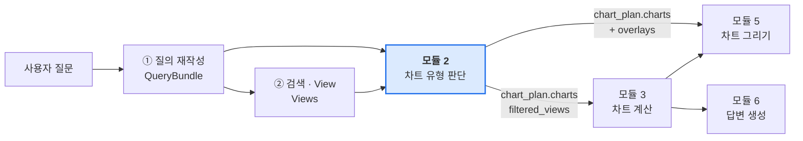

### 가장 짧은 사용법

```python
from backend.agent.chart_decision import run_chart_decision

out = run_chart_decision(query_bundle, views)      # dict 또는 JSON 파일 경로
out["chart_plan"]        # 최종 결과 → 모듈 3 · 모듈 5
out["filtered_views"]    # 조건으로 거른 View → 모듈 3
out["errors"]            # 경고 · 문제 기록 (없으면 [])
```

| 인자 | 기본값 | 설명 |
| --- | --- | --- |
| `query_bundle` | (필수) | 질의 재작성 결과. dict, `[dict]`, JSON 파일 경로 |
| `view_input` | (필수) | 검색 결과 Views. dict, JSON 파일 경로 |
| `use_llm` | `True` | `False`면 HCX를 부르지 않는다 (규칙으로 못 정한 measure는 `None`) |
| `show_steps` | `False` | `True`면 `out["steps"]`에 단계(노드)별 중간 값 `[{node, update}]` |

- HCX(LLM)는 **measure를 규칙으로 못 정할 때만** 부른다. 대부분의 질문은 규칙만으로 끝난다.

---

## 2. 전체 흐름 (내부 로직)

모듈 2는 LangGraph 그래프 하나다. 노드 하나 = 판단 단계 하나.

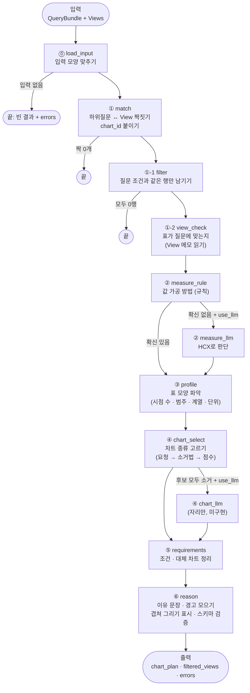

| 단계 | 노드 | 한 줄 설명 | 코드 |
| --- | --- | --- | --- |
| ⓪ | load_input | 입력을 표준 모양으로 정리 | `chart_type_loader.py` |
| ① | match | 하위질문마다 View 1개를 짝짓고 `c1, c2…` 부여 | `chart_type_matcher.py` |
| ①-1 | filter | 시점·지역·지표 등 조건과 같은 행만 남김 | `chart_type_view_filter.py` |
| ①-2 | view_check | 표가 요청을 못 맞췄는지 확인 → 경고 / 표만 | `chart_type_view_check.py` |
| ② | measure_rule · measure_llm | raw · change · share … 중 하나 | `chart_type_measure.py` |
| ③ | profile | 차트 판단 재료(시점 수, 범주, 계열 …) | `chart_type_profiler.py`, `chart_type_axes.py` |
| ④ | chart_select · chart_llm | 차트 종류 고르기 | `chart_type_chart_picker.py`, `chart_type_preference.py` |
| ⑤ | requirements | 차트가 지켜야 할 조건 · 대체 차트 | `chart_type_chart_picker.py` |
| ⑥ | reason | 이유 · 경고 · overlays · 스키마 검증 | `chart_type_reason.py`, `chart_type_overlay.py`, `chart_type_schema.py` |

- 규칙·사전(키워드, 차트 후보, 조건 값)은 모두 `chart_type_rules.py` 한 파일에 있다. 규칙을 바꿀 때는 이 파일만 고친다.
- **원칙: 차트는 하위질문마다 1개.** 하위질문 둘을 한 차트로 합치지 않는다. 합쳐 보여 주는 일은 모듈 5가 `overlays`를 보고 한다.

---

## 3. 최종 입력 스키마

```python
run_chart_decision(query_bundle, view_input, use_llm=True)
```

### 3-1. `query_bundle` (질의 재작성 결과)

| 필드 | 타입 | 필수 | 설명 |
| --- | --- | --- | --- |
| `original` | str | | 사용자 원 질문 (차트 이름 요청 찾기 · LLM 판단에 씀) |
| `rewritten` | str | ✔ | 재작성 질문 |
| `intent` | list[str] \| str | | 의도: `추이`·`비교`·`순위`·`구성비`·`증감`·`증감률`·`값 조회`·`합계` |
| `filters` | dict | | 질문 전체 조건 `{슬롯: [값]}` |
| `sub_questions` | list[str] | | 하위질문 (없으면 질문 하나로 본다) |
| `sub_filters` | list[dict] | | 하위질문별 조건 (`sub_questions`와 같은 순서) |

`filters` / `sub_filters`의 슬롯: `시점, 지역, 전출지, 전입지, 국적, 대상, 성별, 연령, 조건, 이동, 지표, 비교축`

```json
{
  "original": "2015년부터 2024년까지 출생아수와 합계출산율 추이",
  "rewritten": "2015~2024년 전국 인구 출생아수 합계출산율 연도별 추이",
  "intent": "추이",
  "filters": {"시점": ["2015년", "…", "2024년"], "지역": ["전국"], "지표": ["출생아수", "합계출산율"], "비교축": ["연도"]},
  "sub_questions": ["2015~2024년 전국 출생아수 연도별 추이", "2015~2024년 전국 인구 합계출산율 연도별 추이"],
  "sub_filters": [{"시점": ["2015년", "…"], "지역": ["전국"], "지표": ["출생아수"], "비교축": ["연도"]},
                  {"시점": ["2015년", "…"], "지역": ["전국"], "지표": ["합계출산율"], "비교축": ["연도"]}]
}
```

### 3-2. `view_input` (검색 · View 결과)

```text
view_input
├── query_id                       "bceeb062"
└── units[]                        하위질문(unit)마다 하나 + main
    ├── unit_id                    "main" | "{query_id}-1" | "{query_id}-2" …
    ├── query                      unit 문장 (하위질문과 짝짓기에 씀)
    └── views[]                    후보 View (모듈 2는 rank 1만 씀)
        ├── rank                   1, 2, 3 …
        └── record
            ├── id                 "view::101_DT_1B8000G::Y::bceeb062-1-1::trend"
            ├── table
            │   ├── columns        ["시점", "행정구역별", "종류별", "항목", "값"]
            │   └── rows           [["2015", "전국", "출생아수(명)", "…", 438420.0], …]
            ├── notes[]            View가 맞추지 못한 조건 메모 {slot, type, requested, applied, text}
            └── metadata           {prd_se, geo_level, …}
```

| 필드 | 쓰는 단계 | 설명 |
| --- | --- | --- |
| `units[].unit_id` · `query` | ① match | 하위질문과 짝짓기 |
| `views[].rank` | ⓪ load_input | rank 1만 남긴다 |
| `record.table` | ①-1 filter, ③ profile | 표 본체 |
| `record.notes` | ①-2 view_check | 시점 대체·나눔 없음 등 |
| `record.id` | 출력 `view_ids` | 모듈 3이 View를 찾는 열쇠 |

---

## 4. 최종 출력 스키마

```python
out = {"chart_plan": {...}, "filtered_views": [...], "errors": [...]}
```

### 4-1. 출력 구조

```text
out
├── chart_plan                     ChartPlanOut  (→ 모듈 3 · 모듈 5)
│   ├── query_id
│   ├── charts[]                   ChartOut — 하위질문마다 1개
│   │   ├── chart_id               "c1"
│   │   ├── sub_question_ids       ["bceeb062-1"]
│   │   ├── view_ids               ["view::…"]
│   │   ├── chart_type             "line" | … | null (표만)
│   │   ├── requirements           ["time_axis_required", …]
│   │   ├── fallback_charts        ["bar"]
│   │   ├── measure                "raw" | … | "범위 밖" | null
│   │   ├── reason                 "출생아수 연도별 추이"
│   │   └── warnings               ["요청한 성별 구분이 표에 없음", …]
│   └── overlays[]                 OverlayOut — 겹쳐 그리기 표시 (모듈 5만 읽음)
│       ├── overlay_id             "c1+c2"
│       ├── charts                 ["c1", "c2"]
│       ├── mode                   "combo" | "lines" | "bars"
│       ├── axes                   {"c1": "y", "c2": "y2"}   (combo만)
│       └── reason
├── filtered_views[]               조건으로 거른 View (+ filter_info) → 모듈 3
└── errors[]                       {node, chart_id?, level?, reason}
```

### 4-2. `charts[]` (ChartOut)

| 필드 | 타입 | 설명 |
| --- | --- | --- |
| `chart_id` | str | 차트 이름표. 짝지은 순서대로 `c1`, `c2` … |
| `sub_question_ids` | list[str] | 이 차트가 답하는 하위질문 `"{query_id}-{순번}"`. 하위질문이 없으면 `["{query_id}-1"]` |
| `view_ids` | list[str] | 쓰는 View의 `record.id` (`filtered_views[].record.id`와 짝) |
| `chart_type` | str \| null | 차트 종류 15가지 중 하나. **null = 차트 없이 표만** |
| `requirements` | list[str] | 데이터가 지켜야 할 조건 이름 (실제 검사는 모듈 3) |
| `fallback_charts` | list[str] | `chart_type`이 조건을 못 지키면 차례로 시도할 차트 |
| `measure` | str \| null | 값 가공 방법 (아래 표). `"범위 밖"` = 데이터로 답할 수 없는 질문 |
| `reason` | str | 고른 이유 문장 (로그 · QA용) |
| `warnings` | list[str] | **사용자에게 보여 줄 경고** (모듈 5가 차트 아래에 표시) |

- `chart_type` 15가지: `line, bar, stacked_bar, pyramid, area, pie, donut, bubble, combo, radar, map, heatmap, treemap, scatter, dumbbell`
- `measure` 11가지 + 1:

| measure | 뜻 | measure | 뜻 |
| --- | --- | --- | --- |
| `raw` | 값 그대로 (조회 · 추이 · 비교) | `diff` | 두 항목 차이 (A−B) |
| `change` | 이전 대비 증감 (개수) | `ratio` | 몇 배 (A÷B) |
| `growth_rate` | 이전 대비 증감률 (%) | `rank` | 순위 · 상위/하위 |
| `cagr` | 연평균 증가율 | `extreme` | 최댓값 · 최솟값 |
| `index` | 기준 시점 = 100 | `aggregate` | 합계 · 평균 |
| `share` | 구성비 (%) | `범위 밖` | 인구 통계로 답할 수 없음 |

### 4-3. `overlays[]` (OverlayOut)

| 필드 | 타입 | 설명 |
| --- | --- | --- |
| `overlay_id` | str | `"c1+c2"` |
| `charts` | list[str] (2개) | 겹쳐 그릴 두 차트 |
| `mode` | `combo` \| `lines` \| `bars` | combo = 큰 값 막대(왼쪽 축) + 작은 값 선(오른쪽 축) |
| `axes` | dict | combo일 때 `{chart_id: "y" \| "y2"}` |
| `reason` | str | 겹친 이유 |

- 모듈 5만 읽는다. 모듈 3 어댑터는 `charts`만 읽으므로 모듈 3 입력은 겹쳐 그리기와 관계없다.

### 4-4. `filtered_views[]`
원래 View를 복사해 행을 거르고 `filter_info`를 붙인 것.

| `filter_info` 필드 | 예 | 설명 |
| --- | --- | --- |
| `indicator_col` | `"종류별"` | 지표 이름이 든 열 |
| `indicators` | `["출생아수"]` | 요청한 지표 |
| `unit` | `"명"` | 지표 열 괄호의 단위 |
| `slot_cols` | `{"시점": "시점", "지역": "행정구역별", "지표": "종류별"}` | 슬롯 → 실제로 거른 열 |
| `unmatched_slots` | `["대상", "비교축"]` | 값은 있지만 맞는 열이 없어 거르지 않은 슬롯 |

### 4-5. `errors[]`

| 필드 | 설명 |
| --- | --- |
| `node` | 어느 단계에서 나왔나 (`match`, `view_check`, `profile`, `chart_select`, `reason` …) |
| `chart_id` | (있으면) 해당 차트 |
| `level` | `warning` = 사용자에게 알릴 만함 / `info` = 기록용 / 없음 = 처리 문제 |
| `reason` | 내용 |

- `view_check`·`chart_select`의 `warning`만 그 차트의 `charts[].warnings`로도 복사된다. `profile` 메모는 개발자용이라 `errors`에만 남는다.

### 4-6. 출력 예시 (실제 실행 결과)

질문: "2015년부터 2024년까지 출생아수와 합계출산율 추이"

```json
{
  "query_id": "bceeb062",
  "charts": [
    {"chart_id": "c1", "sub_question_ids": ["bceeb062-1"],
     "view_ids": ["view::101_DT_1B8000G::Y::bceeb062-1-1::trend"],
     "chart_type": "line", "requirements": ["time_axis_required", "min_points_3"], "fallback_charts": ["bar"],
     "measure": "raw", "reason": "출생아수 연도별 추이", "warnings": []},
    {"chart_id": "c2", "sub_question_ids": ["bceeb062-2"],
     "view_ids": ["view::101_INH_1B8000F_01::Y::bceeb062-2-1::trend"],
     "chart_type": "line", "requirements": ["time_axis_required", "min_points_3"], "fallback_charts": ["bar"],
     "measure": "raw", "reason": "합계출산율 연도별 추이", "warnings": []}
  ],
  "overlays": [
    {"overlay_id": "c1+c2", "charts": ["c1", "c2"], "mode": "combo", "axes": {"c1": "y", "c2": "y2"},
     "reason": "같은 x축 · 크기 차이 353,850배 (≥ 10) → 막대(c1) + 선(c2)"}
  ]
}
```

→ 모듈 5는 c1(출생아수 선), c2(합계출산율 선), c1+c2(막대 + 선 combo) 3개를 그린다.

---

## 5. 단계별 세부 로직

각 단계는 공통 작업 목록 `matches`(하위질문 하나 = 항목 하나)에 필드를 하나씩 더해 간다.

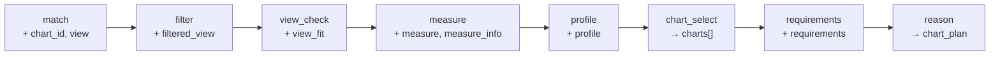

### ⓪ load_input — 입력 모양 맞추기

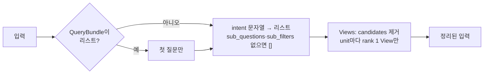

| 들어오는 모양 | 처리 |
| --- | --- |
| `[ {...} ]` 리스트 | 첫 질문만 쓴다 (2개 이상이면 경고) |
| `intent: "추이"` | `["추이"]` |
| 하위질문 없음 | 빈 리스트 → ①에서 main 하나로 처리 |
| 파일 경로 | 읽어서 쓴다 |
| 둘 중 하나 없음 | `errors`에 "입력에 ○○ 없음"을 남기고 끝 |

### ① match — 하위질문 ↔ View 짝짓기

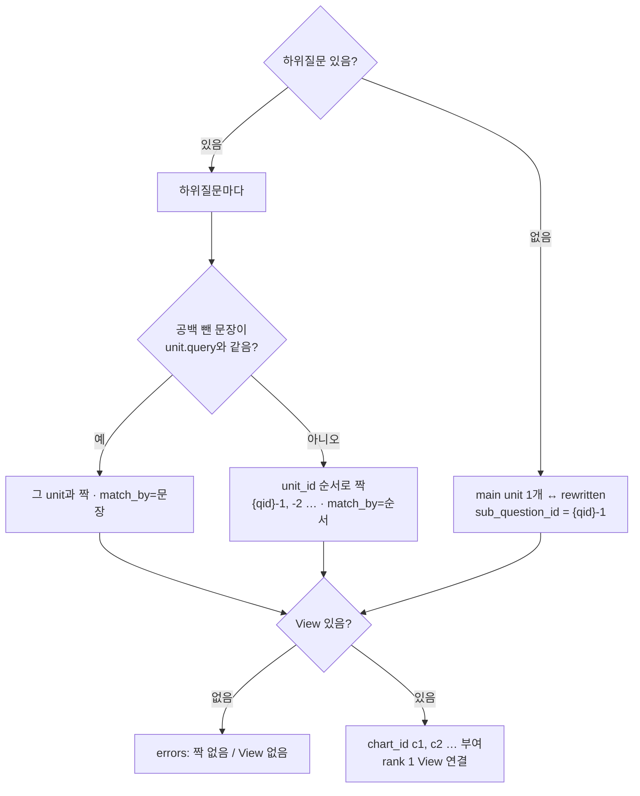

| 출력 필드 (`matches[]`) | 예 | 설명 |
| --- | --- | --- |
| `chart_id` | `c1` | 짝지은 순서 |
| `unit_id` | `bceeb062-1` | View 쪽 unit |
| `sub_question_id` | `bceeb062-1` | 모듈 3과 같은 형식 |
| `sub_question` | `2015~2024년 전국 출생아수 연도별 추이` | |
| `sub_filter` | `{시점, 지역, 지표 …}` | 없으면 전체 `filters` |
| `view` | rank 1 View | |
| `match_by` | `문장` / `순서` / `main` | 짝지은 방법 |

### ①-1 filter — 질문 조건과 같은 행만 남기기

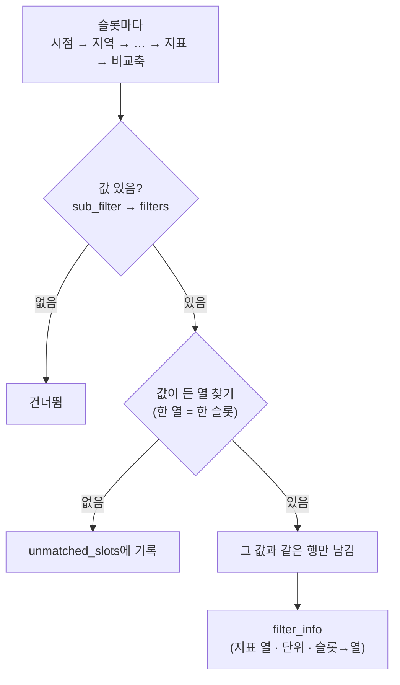

- 비교 방법: 시점은 숫자만 (`2021년` → `2021`), 나머지는 괄호·공백 제거 (`혼인건수(건)` → `혼인건수`)
- 원본 View는 바꾸지 않는다 (복사본을 거름). 모든 하위질문이 0행이면 여기서 끝난다.
- 출력: `matches[].filtered_view` (= 출력 `filtered_views[]`), 필드는 [4-4](#4-4-filtered_views) 참고

### ①-2 view_check — 표가 질문에 맞는지 (View 메모)

View 모듈은 요청을 다 맞추지 못하면 `record.notes`에 남긴다. 이 단계는 그 메모를 **규칙으로** 읽는다 (HCX 없음).

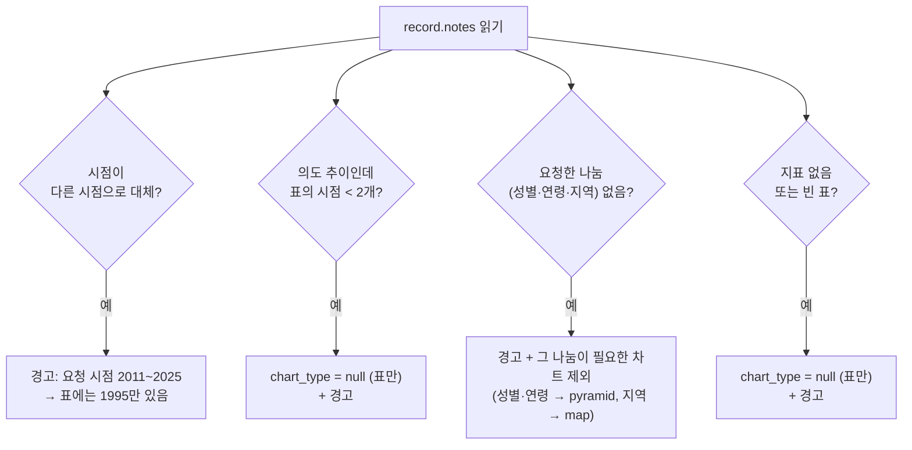

| 출력 필드 (`matches[].view_fit`) | 설명 |
| --- | --- |
| `time` | `ok` / `replaced` / `missing` |
| `time_requested` · `time_applied` | 요청 시점 · 실제 표 시점 |
| `missing_splits` · `partial_splits` | 표에 없는 / 일부만 있는 나눔 (`성별`, `연령`, `지역`) |
| `indicator` | `ok` / `replaced` / `missing` |
| `empty` · `truncated` | 빈 표 / 잘린 표 |
| `notes` | 원래 메모 문장 |

- 경고는 `errors`에 `{node: "view_check", chart_id, level: "warning", reason}` → `charts[].warnings`로도 간다.
- 기준 값: `TREND_MIN_POINTS = 2`, `SPLIT_SLOTS`, `SPLIT_CHARTS` (`chart_type_rules.py`)

### ② measure — 값 가공 방법 정하기

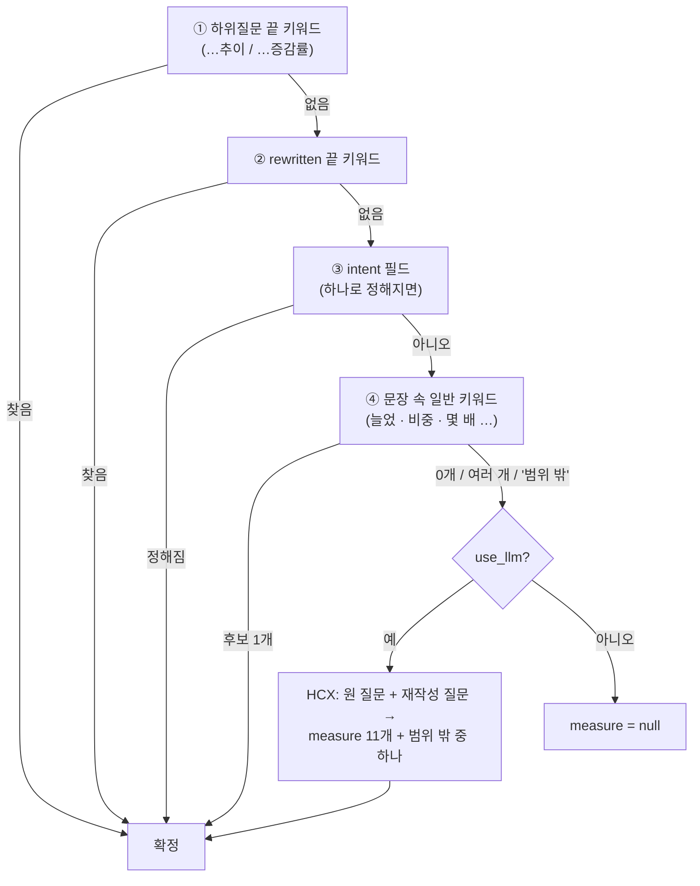

- 끝 키워드 → measure: `값 조회·추이·비교 → raw`, `증감 → change`, `증감률 → growth_rate`, `구성비 → share`, `순위 → rank`, `합계 → aggregate`
- 키워드는 긴 것부터 찾는다 ('증감률'이 '증감'보다 먼저, '연평균 증가율'이 '증가율'보다 먼저).

| 출력 필드 (`matches[].measure_info`) | 예 | 설명 |
| --- | --- | --- |
| `measure` | `raw` | 결정한 값 |
| `confident` | `true` | 규칙으로 확신했는지 |
| `source` | `rule` / `llm` | 누가 정했나 |
| `basis` | `sub_question 끝 '추이'` | 규칙 근거 |
| `llm_called` · `llm_reason` · `llm_seconds` | | HCX를 불렀을 때 |

### ③ profile — 표 모양 파악

차트를 고르는 재료를 거른 표에서 뽑는다. 핵심은 **질문이 나눠 달라고 한 열만 범주·계열로 쓰는 것**이다.

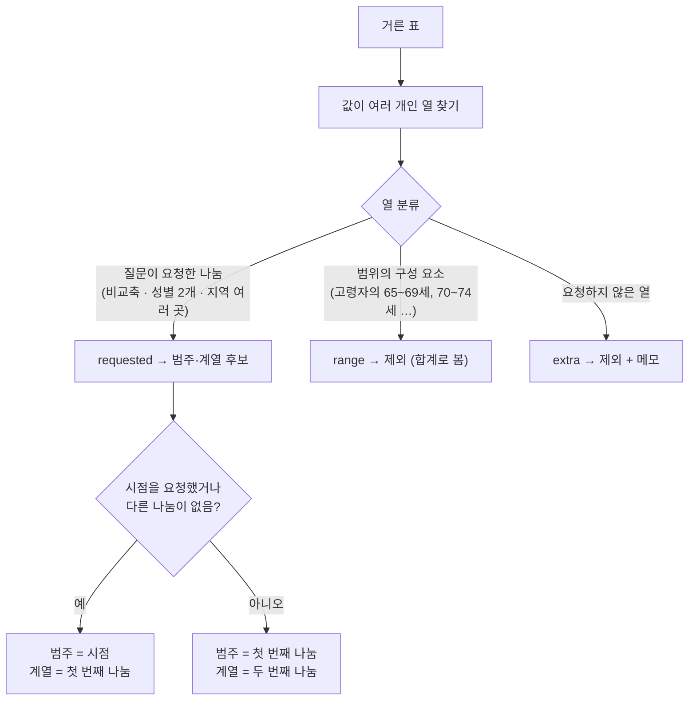

| 출력 필드 (`matches[].profile`, 주요) | 예 | 설명 |
| --- | --- | --- |
| `has_time` · `n_points` · `periods` | `true`, `10` | 시점 2개 이상인지, 시점 수 |
| `requested_axes` | `["시점"]` | 질문이 요청한 나눔 |
| `category_axis` | `{axis: "시점", col: "시점", n: 10}` | x축(범주) |
| `series_axis` | `null` 또는 `{axis: "성별", …, n: 2}` | 계열(범례) |
| `n_categories` · `n_series` · `n_dims` | `10`, `1`, `1` | 범주 수, 계열 수, 차원 수 |
| `excluded_dims` · `axis_notes` | | 범주에서 뺀 열과 이유 |
| `has_region` · `n_regions` | | 지역 2곳 이상 (map 조건) |
| `indicators` · `units` · `units_differ` | `{"출생아수": "명"}` | 지표와 단위 |
| `non_negative` · `has_total` | | 음수 없음 · 합계 행 있음 (구성비 차트 조건) |
| `two_points_per_category` | | 비교 대상이 정확히 2개 (dumbbell 조건) |

### ④ chart_select — 차트 종류 고르기

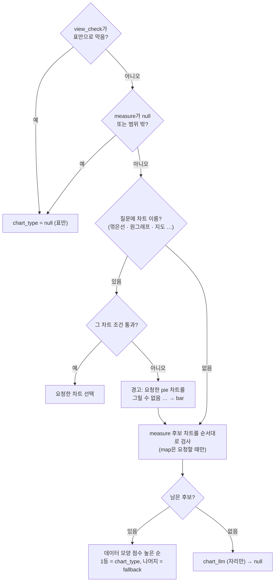

**measure별 후보 차트** (앞일수록 우선)

| measure | 후보 |
| --- | --- |
| raw | line, bar, map, bubble, scatter, combo, pyramid, heatmap |
| change | bar, dumbbell, map, heatmap |
| growth_rate | bar, line, combo, map, heatmap, scatter |
| share | donut, pie, stacked_bar, treemap, pyramid, area, map |
| diff | dumbbell, bar |
| index | line, radar |
| ratio · rank | bar |
| aggregate | bar, area |
| cagr · extreme | 없음 → 표만 |

**데이터 모양 점수** (남은 후보끼리 비교, 같으면 위 순서)

| 모양 | 점수 |
| --- | --- |
| 범주 = 연령 + 계열 = 성별 2개 | pyramid +3 |
| 범주 = 시점 3개 이상 | line +3 |
| 시점이 아닌 요청 나눔 2개, 각각 3개 이상 | heatmap +2 |
| 비중 + 범주 5개 이하 | donut +2 |
| 순위 | bar +2 |
| 그 밖 | bar +1 |

| 출력 필드 (`charts[]` 중간 값) | 설명 |
| --- | --- |
| `chart_type` · `fallback_charts` | 고른 차트 · 다음 순위들 |
| `source` | `request`(요청) / `rule`(규칙) / `llm` / `none`(표만) |
| `log` | 후보마다 `{후보, 결과: 남음/소거, 이유}` — 왜 그 차트인지 추적용 |

`log` 예 (출생아수 추이):
```text
line     남음  시점 10개, 점 10개 · 점수 3 (범주 = 시점 10개)
bar      남음  범주 10개 (20개 이하 필요) · 점수 1 (기본)
map      소거  요청할 때만 고르는 차트
combo    소거  two_series_required: 계열 1개 (정확히 2개 필요)
pyramid  소거  two_series_required … / category_axis_required …
```

### ⑤ requirements — 조건 · 대체 차트 정리

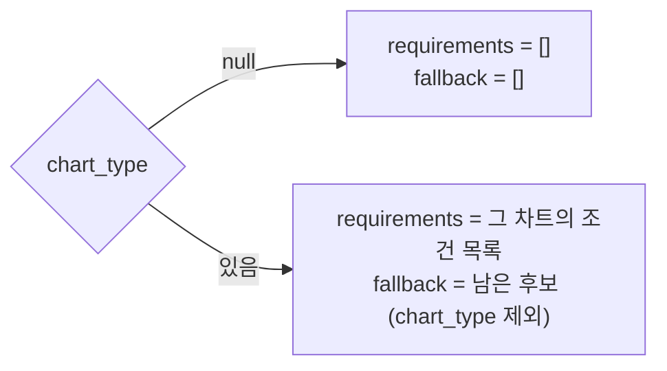

| 차트 | requirements (데이터가 지켜야 할 조건) |
| --- | --- |
| line · area | `time_axis_required`, `min_points_3` |
| bar | `max_categories_20` |
| stacked_bar · treemap | `non_negative`, `parts_sum_to_total` |
| pie · donut | `non_negative`, `parts_sum_to_total`, `max_categories_5` |
| pyramid | `two_series_required`, `non_negative`, `category_axis_required` |
| combo | `time_axis_required`, `two_series_required`, `min_points_3` |
| map | `region_dimension_required` |
| heatmap | `two_dimensions_required` |
| radar | `min_categories_3`, `max_categories_8` |
| scatter | `two_measures_required`, `min_points_5` |
| bubble | `three_measures_required` |
| dumbbell | `two_points_per_category` |

- 모듈 2는 ④에서 이 조건으로 후보를 걸렀고, 모듈 3은 실제 계산 결과로 **다시 검사**한다. 실패하면 `fallback_charts`를 차례로 내려가고, 끝까지 실패하면 표만 보여 준다.

### ⑥ reason — 마무리 (이유 · 경고 · 겹쳐 그리기 · 검증)

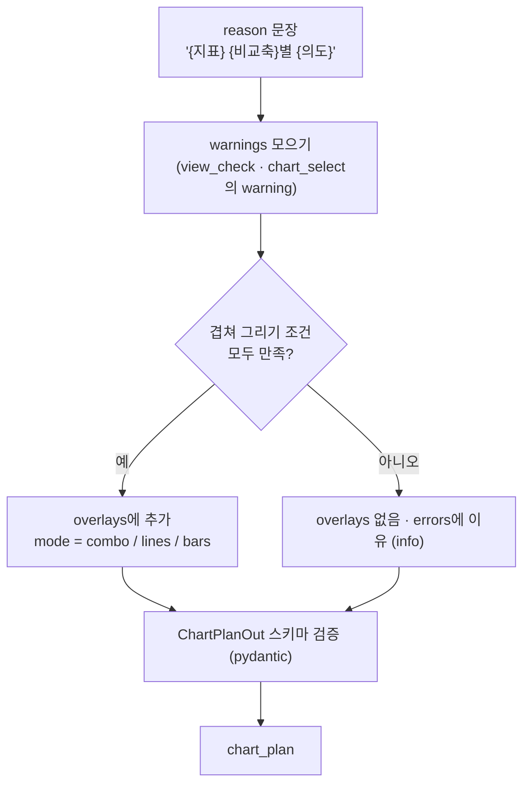

**겹쳐 그리기 조건** (모두 만족해야 함)

1. 차트가 정확히 2개이고 둘 다 차트가 있음 (null 아님)
2. 의도가 `추이` 또는 `비교`
3. 두 차트 유형이 같고 `line` 또는 `bar`
4. measure가 같음
5. x축이 같음 (기간 · 비교축 · 범주 축과 개수)
6. 두 차트 모두 계열 1개

**mode 정하기**: 두 값의 최댓값 비율이 10배 이상이거나 단위가 다르면 `combo`(큰 값 막대 + 작은 값 선), 아니면 `lines`(line) / `bars`(bar)

- 스키마 검증에 실패하면 원래 dict를 그대로 내보내고 `errors`에 기록한다 (멈추지 않음).

---

## 6. 자주 보는 결과 패턴

| 상황 | 결과 |
| --- | --- |
| "2021~2025년 혼인건수 추이" | `line` (fallback `bar`) |
| "2024년 시도별 출생아수 순위" | `bar` (measure `rank`) |
| "2015년부터 2024년까지 출생아수 연평균 증가율" | `chart_type: null` (cagr → 표만) |
| "2024년 가구원수별 가구 비중을 원그래프로" (합계 행 없음) | `bar` + 경고 "요청한 pie 차트를 그릴 수 없음 …" |
| "연도별 고령자 수를 남녀로" (표에 성별 없음) | 경고 "요청한 성별(남자, 여자) 구분이 표에 없음" |
| "2011~2025년 고령자 수" (표에 시점 1개) | `chart_type: null` + 경고 "차트 없음(표만): 추이를 물었지만 …" |
| "오늘 서울 날씨" | measure `범위 밖`, `chart_type: null` |
| 하위질문 2개, 단위 다른 추이 | 차트 2개 + `overlays` combo |

---

## 7. 더 보기

| 무엇 | 어디 |
| --- | --- |
| 개발자용 상세 README (실행 방법 · Studio · 노드별 stream) | `backend/agent/chart_decision/README.md` |
| 규칙 · 사전 · 기준 값 | `backend/agent/chart_decision/chart_decision_module/chart_type_rules.py` |
| 출력 스키마 (pydantic) | `backend/agent/chart_decision/chart_decision_module/chart_type_schema.py` |
| 회귀 테스트 (질문별 기대 결과 · 대시보드) | `private/test_agent/regression/` |
| 모듈 2 흐름도 이미지 | `private/chart_type_decision/images/module2_flow.png` |
