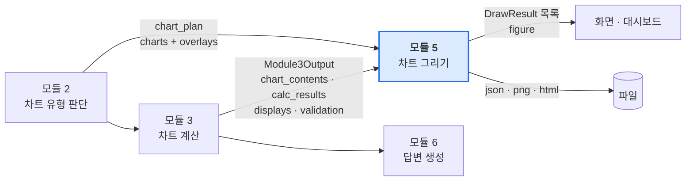
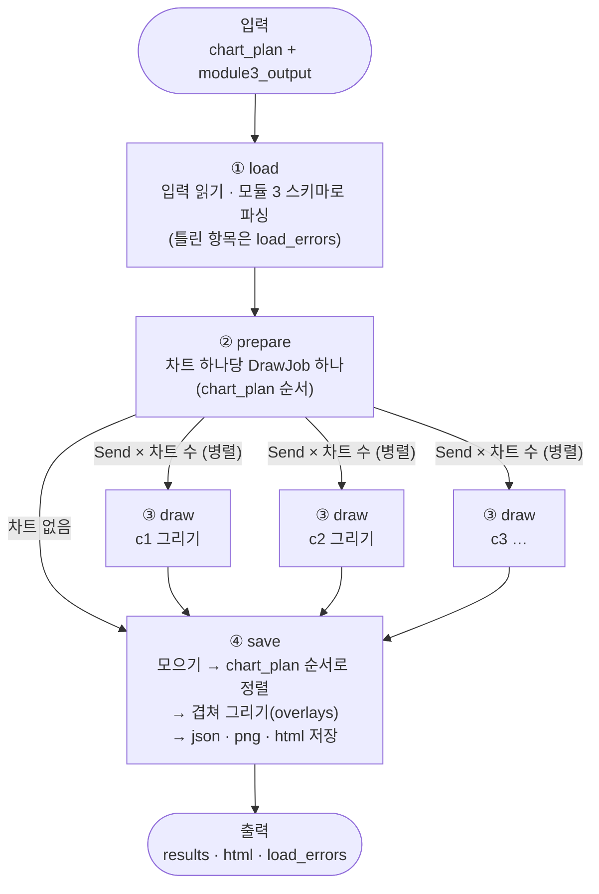
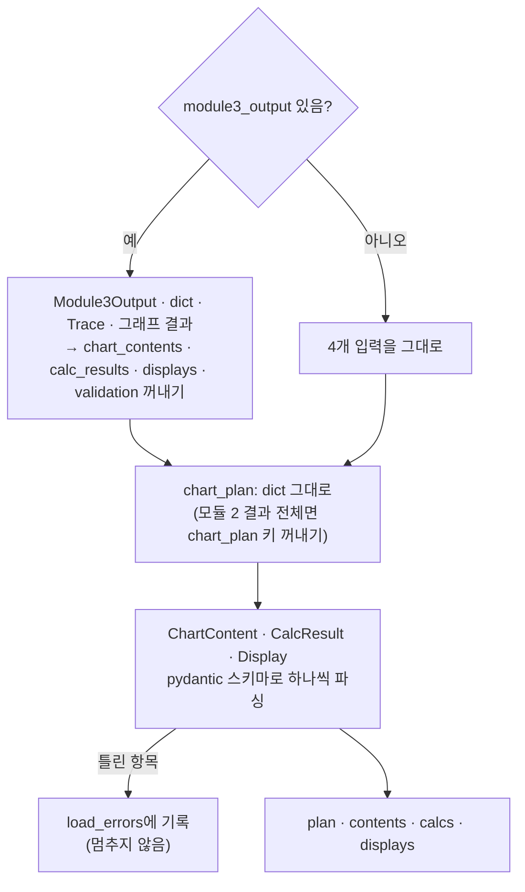
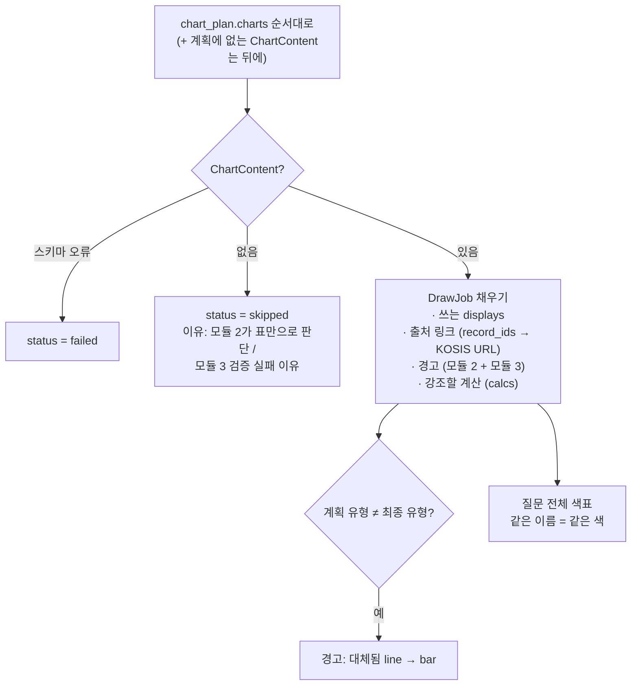
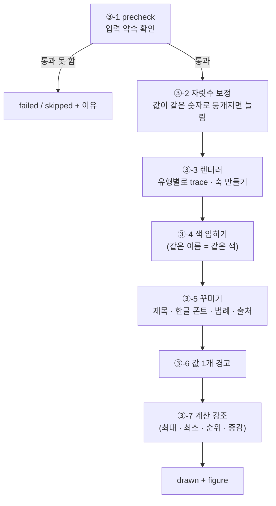
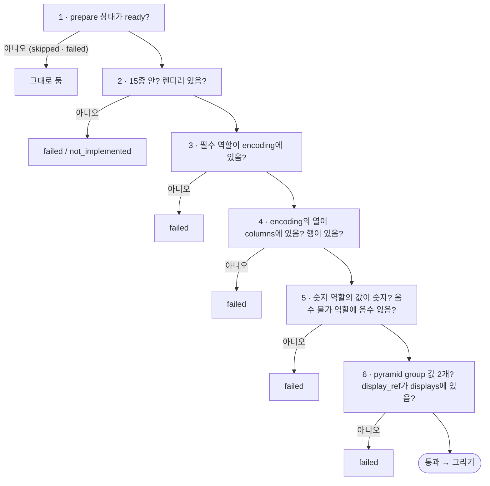
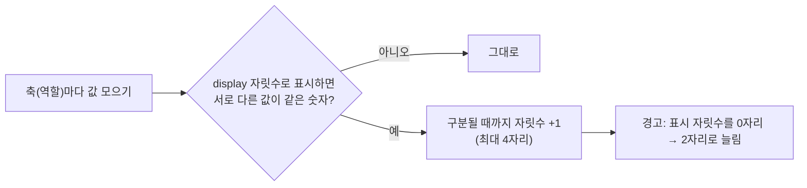
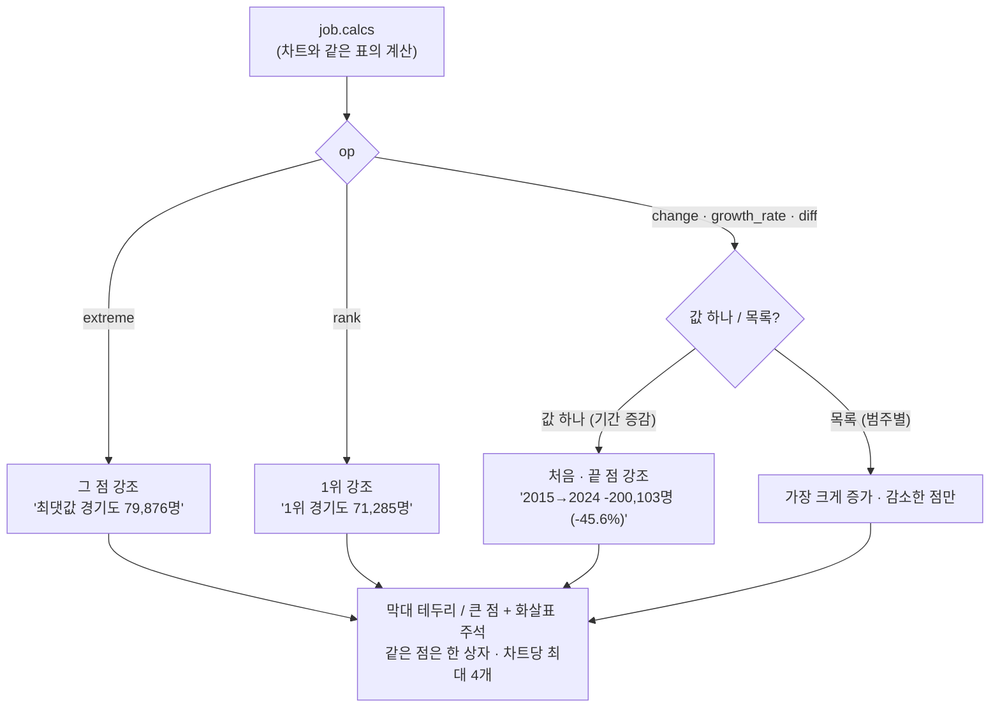
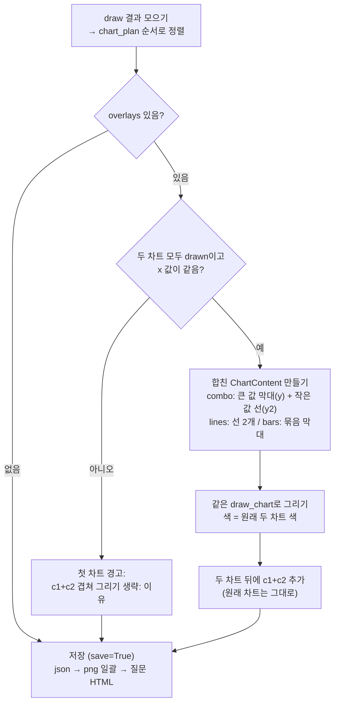

# 모듈 5 · 차트 그리기 (draw_chart) — 설명 · API 명세

> 코드 위치: `backend/agent/draw_chart/`
> 이 문서는 모듈 5를 처음 보는 사람이 **무엇을 받아 무엇을 내보내는지**, **안에서 어떤 순서로 그리는지**를 빠르게 이해하도록 정리했다.

---

## 1. 한눈에 보기

### 모듈 5가 하는 일
모듈 2의 차트 계획(`chart_plan`)과 모듈 3의 계산 결과(`ChartContent` 등)를 받아, **차트를 Plotly로 그리고** 파일(json · png · html)로 저장한다.

| 하는 일 | 하지 않는 일 |
| --- | --- |
| 차트 15종 그리기 (Plotly) | 차트 종류 고르기 (→ 모듈 2) |
| 그리기 전 입력 약속 확인 (precheck) | 수치 계산 · 차트 내용 만들기 (→ 모듈 3) |
| 숫자 표시 (단위 · 자릿수 · 값 라벨) | 답변 문장 쓰기 (→ 모듈 6) |
| 계산 결과 강조 (최대 · 최소 · 순위 · 증감) | LLM 호출 (모듈 5는 LLM을 쓰지 않는다) |
| 두 차트 겹쳐 그리기 (모듈 2의 `overlays`) | |
| 사용자용 경고 표시 · 그리지 못한 이유 안내 | |

### 파이프라인 속 위치



### 가장 짧은 사용법

```python
from backend.agent.draw_chart import run_module5, results_table

out = run_module5(chart_plan=module2_out, module3_output=module3_out, out_dir="module5_output/q1")
out["results"]          # DrawResult 목록 (차트마다 하나, figure 포함)
out["html"]             # 질문 하나 = HTML 한 장 경로
results_table(out["results"])   # 결과 요약 표 (pandas)
```

| 인자 | 기본값 | 설명 |
| --- | --- | --- |
| `chart_plan` | (필수) | 모듈 2 출력. `chart_plan` dict 또는 모듈 2 결과 전체(`{"chart_plan": …}`) |
| `module3_output` | (필수\*) | 모듈 3 출력. `Module3Output` · 그 dict · `Module3Trace` · 그래프 결과 `{"output", "trace"}` 모두 됨 |
| `chart_contents` · `calc_results` · `displays` · `validation` | | \*`module3_output` 대신 4개를 직접 줄 때 |
| `out_dir` | `backend/agent/draw_chart/output/{query_id}/` | 파일 저장 위치 |
| `save` | `True` | `False`면 파일을 쓰지 않고 그리기만 |

---

## 2. 전체 흐름 (내부 로직)

모듈 5는 LangGraph 그래프 하나다. **차트마다 그리기를 따로(병렬로) 실행**하고 마지막에 모은다.



| 단계 | 노드 | 한 줄 설명 | 코드 |
| --- | --- | --- | --- |
| ① | load | 모듈 2·3 출력을 받아 pydantic 스키마로 파싱 | `draw_chart_load.py` |
| ② | prepare | 차트마다 DrawJob (그릴 내용 · 표시 설정 · 출처 · 경고 · 강조할 계산 · 색) | `draw_chart_prepare.py` |
| ③ | draw | 차트 하나 그리기 (사전 검사 → 렌더러 → 꾸미기 → 강조) | `draw_chart_tool.py`, `draw_chart_renderers.py`, `draw_chart_highlight.py` |
| ④ | save | 모으기 · 겹쳐 그리기 · 파일 저장 | `draw_chart_overlay.py`, `draw_chart_save.py` |

- 숫자 표시 · 축 · 색 같은 공통 규칙은 `draw_chart_format.py`, 상태 코드 · DrawJob · DrawResult는 `draw_chart_schema.py`에 있다.
- **원칙: 차트 하나가 실패해도 전체는 멈추지 않는다.** 실패한 차트는 `status`와 `reason`에 이유를 남기고, HTML에는 그 자리에 안내 박스를 놓는다.

---

## 3. 최종 입력 스키마

```python
run_module5(chart_plan=…, module3_output=…, out_dir=…, save=True)
```

### 3-1. `chart_plan` (모듈 2 출력)

모듈 5가 읽는 필드만 적었다. 전체 명세는 [모듈 2 문서](module2_chart_decision.md#4-최종-출력-스키마).

| 필드 | 쓰는 곳 | 설명 |
| --- | --- | --- |
| `query_id` | 파일 이름 · 폴더 | |
| `charts[].chart_id` | 순서 · 짝짓기 | ChartContent와 같은 id로 짝짓는다 |
| `charts[].chart_type` | 대체 여부 · 표만 판단 | 계획 유형 (null = 표만) |
| `charts[].measure` · `reason` | 그리지 못한 이유 | `"범위 밖"`이면 표만 |
| `charts[].sub_question_ids` | 결과에 그대로 | |
| `charts[].warnings` | 차트 아래 경고 | 모듈 2가 남긴 사용자용 경고 |
| `overlays[]` | ④ save | 겹쳐 그릴 두 차트 · mode(`combo`/`lines`/`bars`) · axes |

### 3-2. `module3_output` (모듈 3 출력 `Module3Output`)

```text
module3_output
├── query_id
├── chart_contents[]          ChartContent — 차트 하나에 들어갈 표와 역할
├── calc_results[]            CalcResult   — 질문용 계산 (강조에 씀)
├── displays{}                {display_ref: Display} — 숫자 표시 방법
└── validation{}              {chart_id: ChartValidation} — 차트가 없을 때 이유 찾기용
```

**ChartContent** (차트 하나)

| 필드 | 예 | 설명 |
| --- | --- | --- |
| `chart_id` | `"c1"` | chart_plan과 짝 |
| `chart_type` | `"line"` | **최종** 유형 (모듈 3이 대체했으면 대체 유형) |
| `measure` | `"raw"` | |
| `title` | `"2015~2024년 전국 출생아수 연도별 추이"` | 차트 제목 |
| `encoding` | `{"x": "시점", "y": "값", "series": "항목"}` | **역할 → 열 이름** |
| `axis` | `{"y": {"label": "출생아수", "min": …, "max": …, "display_ref": "d1"}}` | 축 이름 · 범위 · 표시 설정 |
| `options` | `{"orientation": "horizontal"}` | 유형별 옵션 (marks · series_axis · center_text · scope_label …) |
| `columns` · `rows` | `["시점","항목","값"]`, `[["2015","출생아수",438420.0], …]` | 표 본체 (원래 정밀도) |
| `record_ids` | `["view::101_DT_1B8000G::Y::…"]` | 출처 링크를 만든다 |
| `warnings` | | 모듈 3 경고 |

역할 코드: `x, y, y2, series, value, label, size, region, parent, group, start, end`

**Display** (숫자 표시 방법) — 표시 = 원값 ÷ `unit_scale` → `digits` 자리 반올림 → `display_unit`

| 필드 | 예 | 설명 |
| --- | --- | --- |
| `source_unit` | `"명"` | 원래 단위 |
| `display_unit` | `"만 명"` | 보여 줄 단위 |
| `unit_scale` | `10000` | 나눌 수 |
| `digits` | `1` | 소수 자리 (없으면 단위별 기본값) |

**CalcResult** (질문용 계산) — 모듈 5는 강조에만 쓴다

| 필드 | 설명 |
| --- | --- |
| `step_id` · `op` | `a1` · `extreme` / `rank` / `change` / `growth_rate` / `diff` … |
| `value` | 값 하나 또는 `[{key, value, rank?}, …]` 목록 |
| `inputs[]` | 계산에 쓴 값 `{key: {"시점": "2015"}, value, item}` |
| `record_ids` · `display_ref` | 어느 표의 계산인지 · 표시 설정 |

---

## 4. 최종 출력 스키마

```python
out = {"query_id": "bceeb062", "results": [DrawResult, …], "html": "…/bceeb062.html", "load_errors": {}}
```

### 4-1. 출력 구조

```text
out
├── query_id
├── results[]                  DrawResult — chart_plan 순서 (+ 겹친 차트는 두 차트 뒤에)
│   ├── chart_id               "c1" | "c1+c2"
│   ├── planned_type           모듈 2 계획 유형 ("overlay" = 겹친 차트)
│   ├── chart_type             실제로 그린 유형
│   ├── status                 drawn | skipped | failed | not_implemented
│   ├── reason                 그리지 못한 이유
│   ├── title
│   ├── figure                 plotly Figure (메모리에만, drawn일 때)
│   ├── warnings[]             사용자용 경고
│   ├── merged_from[]          겹친 차트면 ["c1", "c2"]
│   ├── sub_question_ids[]
│   └── files{}                {"json", "png", "html"} 저장 경로
├── html                       질문 HTML 경로 (save=False면 None)
└── load_errors{}              {위치: 이유} 입력 스키마 오류
```

### 4-2. `results[]` (DrawResult)

| 필드 | 타입 | 설명 |
| --- | --- | --- |
| `chart_id` | str | 차트 id. 겹친 차트는 `"c1+c2"` |
| `planned_type` | str \| None | 모듈 2 계획 유형 (겹친 차트는 `"overlay"`) |
| `chart_type` | str \| None | 실제로 그린 유형 |
| `status` | str | 아래 표 |
| `reason` | str \| None | drawn이 아닐 때 이유 |
| `title` | str \| None | 차트 제목 |
| `figure` | plotly Figure \| None | 그린 그림. 화면에 바로 쓸 수 있다 (`fig.to_html()`) |
| `warnings` | list[str] | 사용자용 경고 (모듈 2 경고 + 모듈 3 경고 + 모듈 5 경고) |
| `merged_from` | list[str] | 겹친 차트면 원래 두 chart_id |
| `sub_question_ids` | list[str] | 답하는 하위질문 |
| `files` | dict | 저장한 파일 경로 |

| status | 뜻 | 예 |
| --- | --- | --- |
| `drawn` | 그림 | |
| `skipped` | 그릴 내용이 없음 (표만) | 모듈 2가 `chart_type: null` / 모듈 3 검증 실패 |
| `failed` | 그리려 했지만 실패 | 필수 역할 없음 · 숫자 아님 · 그리는 중 예외 |
| `not_implemented` | 렌더러가 없는 유형 | (지금은 15종 모두 있음) |

### 4-3. 저장 파일 (`save=True`)

```text
out_dir/                        (기본: backend/agent/draw_chart/output/{query_id}/)
├── c1.json      c1.png         drawn 차트마다 Plotly figure JSON · PNG (900×520)
├── c2.json      c2.png
├── c1+c2.json   c1+c2.png      겹친 차트
└── {query_id}.html             질문 하나 = HTML 한 장 (그린 차트 + 그리지 못한 차트 안내 박스)
```

- PNG는 kaleido + Chrome이 필요하다. 실패해도 `status`는 그대로 두고 `files["png"]`에 이유만 남긴다.

### 4-4. 출력 예시 (실제 실행 결과)

질문: "2015년부터 2024년까지 출생아수와 합계출산율 추이"

| chart_id | planned → 그린 유형 | status | warnings | merged_from |
| --- | --- | --- | --- | --- |
| c1 | line → line | drawn | | |
| c2 | line → line | drawn | 표시 자릿수를 0자리 → 2자리로 늘림 (d1: 그대로면 서로 다른 값이 같은 숫자로 보임) | |
| c1+c2 | overlay → combo | drawn | 표시 자릿수를 0자리 → 2자리로 늘림 (d1 · y2 축: …) | c1, c2 |

→ 출생아수 선, 합계출산율 선, 그리고 출생아수 막대 + 합계출산율 선(오른쪽 축)을 합친 차트, 모두 3개.

---

## 5. 단계별 세부 로직

### ① load — 입력 읽기



| 출력 | 설명 |
| --- | --- |
| `plan` | chart_plan dict |
| `contents` | `{chart_id: ChartContent \| None}` (None = 스키마 오류 → ②에서 failed) |
| `calcs` · `display_map` · `checks` | CalcResult 목록 · displays · 모듈 3 validation |
| `load_errors` | `{"chart_contents.c1": "이유", …}` |

### ② prepare — 차트마다 DrawJob 만들기



| DrawJob 필드 | 설명 |
| --- | --- |
| `chart_id` · `sub_question_ids` · `planned_type` · `chart_type` | |
| `content` | ChartContent |
| `displays` · `display_refs` | 이 차트가 쓰는 표시 설정 · 가리키는 ref 전부 |
| `source_links` | `[{label: "KOSIS DT_1B8000G", url}]` |
| `status` · `reason` | `ready` / `skipped` / `failed` |
| `warnings` | 모듈 2 `charts[].warnings` + 모듈 3 경고 + 대체 경고 |
| `calcs` | 차트와 같은 표를 쓰는 강조 대상 계산 (extreme · rank · change · growth_rate · diff) |
| `colors` | `{이름: 색}` — 질문 안에서 처음 나온 순서로 Plotly 기본 색 |

### ③ draw — 차트 하나 그리기 (`draw_chart`)

차트마다 따로(병렬) 실행되는 순수 함수다. 받은 DrawJob은 바꾸지 않고 사본으로 작업한다.



#### ③-1 precheck — 입력 약속 확인



**유형별 약속** (입력은 15종 모두 ChartContent 하나, 다른 것은 역할 · 행 모양뿐)

| chart_type | 필수 역할 | 선택 역할 | 행 모양 | 숫자 역할 |
| --- | --- | --- | --- | --- |
| line · area | x, y | series | long | y |
| bar | x, y | series | long | y |
| stacked_bar | x, y, series | | long | y |
| combo | x, y, y2 | series | long | y, y2 |
| pyramid | y, group, value | | long | value |
| pie · donut | label, value | | long | value |
| treemap | parent, label, value | | long | value |
| radar | label, series, value | | long | value |
| map | region, value | | long | value |
| heatmap | x, y, value | | long | value |
| scatter | x, y | label, series | joined | x, y |
| bubble | x, y, size | label, series | joined | x, y, size |
| dumbbell | label, start, end | | joined | start, end |

- 행 모양: long = `[분류…, 항목, 값]` (행 하나 = 값 하나) / joined = `[키…, 지표1, 지표2…]` (행 하나 = 점 하나)
- 약속 출처: 모듈 3 `SPECS`(필수 · 선택 · 행 모양 · 음수 불가 · y 기준선) + 모듈 5 `NUMERIC_ROLES` · `EXTRA_RULES`

#### ③-2 자릿수 보정



- 예: 합계출산율 1.24 · 1.17 · 1.05가 자릿수 0이면 모두 `1` → 2자리로.
- combo처럼 두 축이 같은 display를 쓰면 **늘려야 하는 축만** 따로 늘린다 (출생아수 축은 정수 그대로).
- 모듈 3 displays 원본은 바꾸지 않는다 → 모듈 6 답변 숫자에는 영향 없음.

#### ③-3 렌더러 15종

| chart_type | 그리는 방법 |
| --- | --- |
| line · area | 계열별 선 + 점 (area는 아래를 채움). 시점이 20개를 넘으면 눈금을 2 · 5 · 10칸마다 |
| bar · stacked_bar | 묶음 / 누적 막대. `orientation=horizontal`이면 가로 막대(1위가 위). 막대 2개 이하면 폭을 줄임 |
| combo | `series_axis`로 지표별 축(왼쪽 y / 오른쪽 y2), `marks`로 막대 / 선. 두 축 눈금 6개를 같은 높이로 |
| pyramid | 첫 group 왼쪽, 둘째 오른쪽 |
| pie · donut · treemap | 이름 + 비율 |
| radar | 계열별 닫힌 다각형 |
| map | 시도 타일 지도 (17칸, 색이 값). 시군구는 아직 없음 |
| heatmap | x × y 칸 색이 값 |
| scatter · bubble | 점 (bubble은 크기 = size) |
| dumbbell | 범주마다 시작 · 끝 두 점을 선으로 |

**공통 표시 규칙**
- 숫자는 모듈 3의 `format_value`로 표시 → 차트 숫자와 답변 숫자 모양이 같다
- hover: 단위 포함 (`192,507건`) / 값 라벨: 단위 없이, 계열당 점이 12개 이하일 때만
- 축 이름: `라벨(단위)` (`혼인건수(건)`) / 눈금: 천 단위 쉼표 + 소수 자리

#### ③-5 꾸미기
제목(+ `scope_label` 부제) · 맑은 고딕 · 범례(trace 2개 이상일 때) · 아래 여백 맨 밑에 `출처: KOSIS DT_…` (HTML에서는 링크)

#### ③-6 값 1개 경고
x(원그래프 종류는 조각) 값이 1개뿐이면 그리되 경고를 붙인다.
> 값이 1개뿐인 차트 (시점 '1995' 하나) — 비교를 보기 어려워 표로 보는 편이 낫다

#### ③-7 계산 강조



- 계산 키(`{'시점': '2024', '시도별': '경기도'}`)로 표의 행을 찾아 그림의 점을 찾는다. 못 찾으면 경고 `강조 생략: …`.
- 대상 유형: line · area · bar · stacked_bar · combo. 겹친 차트에는 강조를 넣지 않는다.

### ④ save — 모으기 · 겹쳐 그리기 · 저장



- 겹쳐 그릴지는 모듈 2가 정한다 (`overlays`). 모듈 5는 **그릴 수 있는지만** 다시 확인한다.
- 합친 차트의 축 범위는 원래 차트 값 기준이라 지우고 다시 정한다 (막대는 0부터).

---

## 6. 자주 보는 결과 패턴

| 상황 | 결과 |
| --- | --- |
| 모듈 2가 `chart_type: null` (예: 연평균 증가율) | `skipped` — "모듈 2가 차트 없음으로 판단 (chart_type 없음)" · HTML에 안내 박스 |
| 모듈 3 검증 실패 (원래 · 대체 차트 모두) | `skipped` — "모듈 3 검증 실패 — line: 열 없음: 행정구역별" |
| 모듈 3이 다른 유형으로 대체 | `drawn` + 경고 "대체됨: pie → bar" |
| 요청한 나눔이 표에 없음 (모듈 2 경고) | `drawn` + 경고 "요청한 성별(남자, 여자) 구분이 표에 없음" |
| 값이 1개뿐 | `drawn` + 경고 "값이 1개뿐인 차트 …" |
| 합계출산율이 `1`로 뭉개짐 | `drawn` + 자릿수를 늘림 + 경고 |
| 순위 · 최댓값 질문 | 1위 · 최댓값 막대에 테두리 + 주석 |
| overlay 중 한 차트가 skipped | 합친 차트 없음 + 첫 차트 경고 "c1+c2 겹쳐 그리기 생략: …" |
| 입력 스키마 오류 | 그 차트만 `failed`, `load_errors`에 위치와 이유 |

---

## 7. 더 보기

| 무엇 | 어디 |
| --- | --- |
| 개발자용 상세 README (폴더 구조 · 설치 · 렌더러 · 알려진 한계) | `backend/agent/draw_chart/draw_chart_module/README.md` |
| 유형별 약속 표 (코드) | `from backend.agent.draw_chart.draw_chart_module import contract_table; contract_table()` |
| 15종 예시로 렌더러 확인 | `from backend.agent.draw_chart import run_samples; run_samples()` |
| 회귀 테스트 (자동 검사 · PNG 비교 대시보드) | `private/test_agent/regression/module5/` (노트북 11번) |
| 모듈 2 문서 (chart_plan 명세) | [module2_chart_decision.md](module2_chart_decision.md) |
