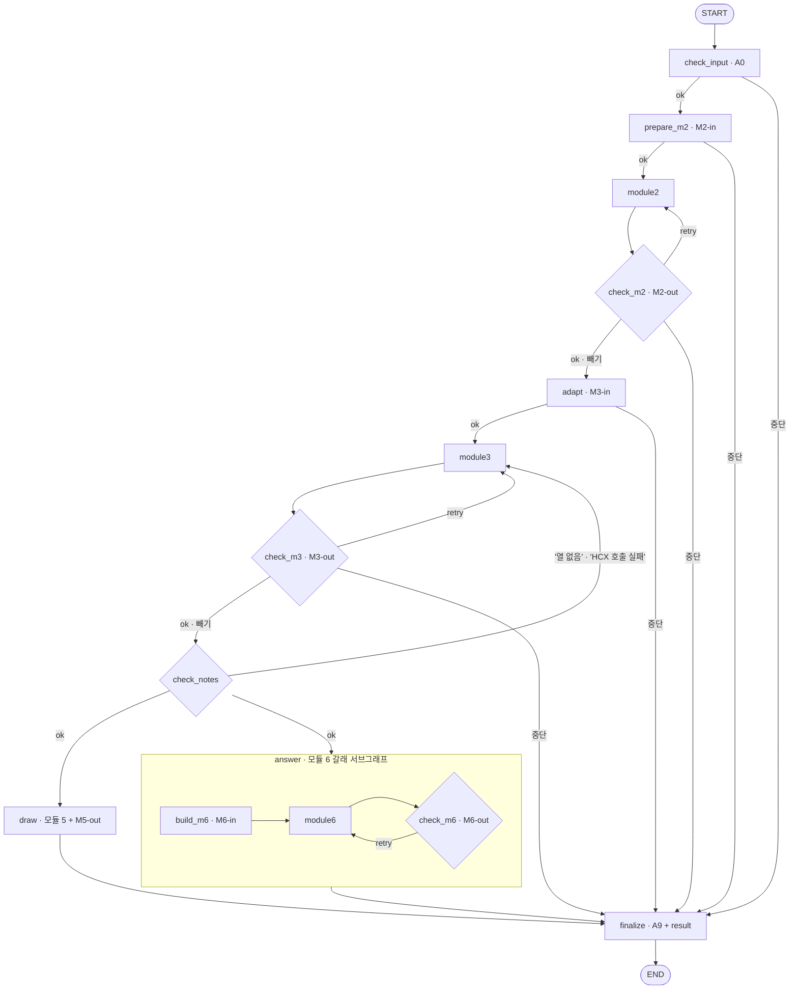

# Generator QA 설계 (초안)

> 상태: 설계 합의 중. 코드는 아직 없음. 구현은 합의 후 요청을 받아 시작한다.
> 기준 코드: `develop` 233a1a8 (2026-11-18 pull) — `backend/agent/modules.py` 통합 파이프라인

---

## 1. 목적과 범위

- **무엇을 하나**: 에이전트(`backend/agent`)로 **들어오는 입력**과 **모듈 사이를 오가는 값**이 스키마에 맞는지 검사한다. 맞지 않으면 정해 둔 방식으로 대응한다.
- **어디에 적용하나**: `backend/agent` 안의 모듈 경로(`answer_mode="modules"`, `run_modules`)에만 적용한다.
  - 질의 분석·검색·View(`backend/rag`)는 QA 대상이 아니다. 그 결과(ViewSet)가 에이전트에 **들어오는 순간**만 검사한다.
- **검사 범위**: 필드 · 타입 · 허용값 (+ 스키마에 없는 키) · **비어 있으면 안 되는 값 · 모듈 간 id 짝** (2026-11-18 추가, 5장)
  - **보지 않는 것**: 내부 구조(행 길이 = 열 수, encoding 이 가리키는 열이 있는지 등), 값의 의미(재계산).
- **제약**: 팀원 모듈(모듈 3·6, `modules.py`, `from_module2.py`, 스키마 파일)은 고치지 않는다. QA 는 `backend/agent/qa/` 에서 팀 코드를 import 해서 감싸는 방식으로만 만든다 (처음에는 `private/qa/` 에서 만들고 2026-11-18 옮김).

## 2. 합의된 결정

| # | 항목 | 결정 |
|---|---|---|
| 1 | 검사 범위 | 필드·타입·허용값 + (2026-11-18) 빈 값 · id 짝. 내부 구조는 보지 않음 |
| 2 | 보정 | **B안**: pydantic 수준만 (손실 없는 타입 변환 · 빠진 선택 필드 기본값 · 모르는 키는 그대로 두고 기록). 변환표 없음, 값 추측 없음 |
| 3 | 재시도 | LLM 을 쓰는 모듈만 **1회** |
| 4 | 실행 방식 | **(a)** QA runner 가 모듈 2→3→5→6 전체를 감싸서 실행 |
| 5 | 스키마에 없는 키 | **경고** (매번 나와도 경고로 둔다) |
| 6 | 중단 시 사용자 표시 | **어느 단계에서 멈췄는지** 보여 준다 |
| 7 | 모듈 5 입력 | 따로 검사하지 않음 (모듈 2 출력·모듈 3 출력 검사 결과를 그대로 씀) |
| 8 | 모듈 3 출력 전체가 깨짐 | 재시도 후에도 깨지면 **중단** |

## 3. 지금의 에이전트 구조 (새 코드 기준)

```
ViewSet (backend/rag/view/viewset.build_viewset 결과, status="ok")
  │  run_modules(vs)                                   backend/agent/modules.py
  ├─ view_bundle → QueryBundle.model_validate
  ├─ view_input_of(vs) · split_roles(...)              모듈 2 입력 만들기 (역할 단위 분리)
  ├─ decide_charts(bundle, view_input)
  │    ├─ 모듈 2  run_chart_decision(bundle dict, view_input)  → {chart_plan, filtered_views, errors}
  │    └─ 어댑터  to_chart_requests · records_of · unknown_view_ids · skipped_sets
  ├─ 모듈 3  run_module3(Module3Request, decision, chat)        → Module3Output
  ├─ 모듈 5  run_module5(chart_plan, module3_output)           → {results[DrawResult], html, load_errors, …} → drawn[]
  └─ 모듈 6  run_module6(Module6Request, chat)                 → Module6Output
  반환 {charts, chart_errors, chart_plan, records, module3, drawn, answer, notes}
```

이전 설계에서 바뀐 점:

- **모듈 2 입력의 질문이 RewriteBundle 이 아니라 `view_bundle`(팀 `QueryBundle`) 이다.** `decide_charts` 가 `bundle.model_dump(mode="json", by_alias=True)` 를 넘긴다. 그래서 "QueryBundle 이 두 모양" 문제는 에이전트 안에서는 사라졌다. 모든 지점에서 팀 `QueryBundle` 하나를 기준으로 삼는다.
- **3→6 연결이 생겼다.** `run_modules` 가 `Module6Request` 를 직접 만든다 (노트북의 `make_module6_request` 와 같은 내용).
- **모듈 5 는 실패해도 답변은 낸다.** `_draw` 가 예외를 잡고 `notes` 에 남긴다.
- 팀 스키마 다수가 `extra="allow"` 로 바뀌었다 (ViewSet · UnitResult · ViewItem · Candidate …). 모르는 키가 버려지지 않고 `model_extra` 에 남으므로, "스키마에 없는 키" 를 찾기 쉽다.

## 4. 검사 지점과 기준 스키마

| 지점 | 무엇 | 기준 스키마 | 스키마 출처 |
|---|---|---|---|
| **A0** 에이전트 입력 | ViewSet 전체 | `ViewSet` (status 허용값은 `"ok"` 만) | 팀 `schemas/view.py` |
| | `ViewSet.view_bundle` (`dict` 로만 선언됨) | `QueryBundle` | 팀 `schemas/query.py` |
| **M2-in** 모듈 2 입력 | 질문 | `QueryBundle` | 팀 |
| | view_input `{query_id, original, filters, units[]}` | `ViewResult` | 팀 `schemas/view.py` |
| **M2-out** 모듈 2 출력 | `chart_plan` | `ChartPlanOut` | 모듈 2 `chart_type_schema.py` |
| | `filtered_views[]` | `ViewItem` | 팀 |
| | `errors[]` | `Module2Error` *(QA 정의)* | — |
| **M3-in** 모듈 3 입력 | 요청 | `Module3Request` | 팀 `schemas/chart.py` |
| **M3-out** 모듈 3 출력 | 출력 | `Module3Output` | 팀 |
| ~~M5-in~~ | (M2-out · M3-out 결과를 그대로 씀) | — | — |
| **M5-out** 모듈 5 출력 | `results[]` | `DrawResult` (dataclass → pydantic `TypeAdapter`) | 모듈 5 `draw_chart_schema.py` |
| | `html` · `load_errors` | `Module5Result` *(QA 정의)* | — |
| **M6-in** 모듈 6 입력 | 요청 | `Module6Request` | 팀 `schemas/answer.py` |
| **M6-out** 모듈 6 출력 | 출력 | `Module6Output` | 팀 |
| **A9** 에이전트 출력 | `run_modules` 반환 dict | `ModulesResult` *(QA 정의)* | — |

QA 가 새로 정의하는 스키마는 **팀 스키마가 없는 곳만** 쓴다. 모두 `backend/agent/qa/qa_schemas.py` 에 둔다.

- `Module2Error`: `{node?, chart_id?, unit_id?, reason}` — 모듈 2 `errors` 의 실제 모양
- `Module5Result`: `{results: list[DrawResult], html, load_errors: dict}` — `run_module5` 반환값 중 쓰는 부분
- `ModulesResult`: `run_modules` 반환 8개 키 (`drawn[]` 원소 모양 포함)

## 5. 검사 항목

지점마다 같은 4가지를 본다. 결과는 **문제 목록**(`Issue`)으로 낸다.

| 종류 | 뜻 | 예 |
|---|---|---|
| `missing` | 필수 필드 없음 | `ChartContent.chart_id` 없음 |
| `type` | 타입이 다름 | `Display.digits` 에 `"1"` 이 아닌 `"한 자리"` |
| `enum` | 허용값 밖 | `chart_type: "막대"`, `ViewSet.status: "needs_selection"` |
| `extra` | 스키마에 없는 키 | `units[].search_query` 가 `UnitResult` 에 없는 경우 (경고) |

### 스키마 다음의 규칙 (2026-11-18, `qa_rules.py`)

스키마는 통과해도 느슨한 곳이 있다 (그냥 `str` 인 필드 · 빈 목록 · 다른 모듈을 가리키는 id). 스키마 검사를 통과한 값에 아래 규칙을 더 본다.
위반은 **오류** (`qa_policy.RULE_SEVERITY = "error"`) → 지금 대응 그대로 (재시도 → 그 항목만 빼기 → 중단). `"warning"` 으로 바꾸면 기록만 (진단용).

| 종류 | 지점 | 규칙 |
|---|---|---|
| `enum` 허용값 | A0 · M2-in · M3-in | `QueryBundle.intent` ∈ `Intent` 9종 (`schemas/query.py`) 또는 None |
| | M2-out | `charts[].measure` ∈ `Measure` 12종 + `'범위 밖'` 또는 None · `fallback_charts[]` ∈ `ChartType` 15종 |
| | M2-out · M3-in | `requirements[]` ∈ 모듈 3 검사기가 아는 조건 (`validate._CHECKS` + `min/max_points/categories_N`) |
| `empty` 빈 값 | A0 | status=ok 이면 `units` · `records` 1개 이상 |
| | M2-out | `chart_id` · `overlay_id` · chart_type 이 있으면 `view_ids` |
| | M3-in | 차트가 있으면 `records` |
| | M3-out | `chart_contents[]` 의 `chart_id` · `title` · `columns` · `rows` · `encoding`, `step_id` |
| | M5-out | `status=drawn` 이면 `figure` |
| | M6-out | `answer` · `tables[].table_id` · `tables[].columns` |
| `ref` id 짝 | M2-out | `charts[].view_ids` → 모듈 2 입력 View · `overlays[].charts` → `charts[].chart_id` · chart_id 중복 금지 |
| | M3-in | `charts[].view_ids` → records · `sub_question_ids` → QueryBundle 하위 질문 id · chart_id 중복 금지 |
| | M3-out | `chart_contents[]` · `plans[]` · `validation` 키의 chart_id → 요청 차트 · `record_ids` · `inputs[].record_id` → records · 모든 `display_ref` → displays |
| | M5-out | `results[].chart_id` → 차트 내용 · 계획 차트 · 겹친 차트 id |
| | M6-in · M6-out | calc 의 `display_ref` → displays · `used_step_ids` · `tables[].step_ids` → calc step_id · `tables[].record_ids` → records · `caveats[].ref` → record id 또는 step_id |

- 허용값은 **스키마에 있는 값 목록**만 쓴다. 필드가 그냥 `str` 이어도 같은 뜻의 `Literal` 이 다른 스키마에 있으면 적용 (모듈 2 measure ← 모듈 3 `Measure`). 설명 글에만 적힌 목록(`Note.type` · `Filters.의도`)은 쓰지 않는다. None 은 스키마가 허용할 때만.
- 예외: 계산 보류 사유 caveat(`source="plan_warning"`)의 `ref` (`answer_compose/caveats.py`). 스키마 설명(`Record.id 또는 CalcResult.step_id`)에는 빠져 있음 → 허용 (**모듈 6 담당자에게 알릴 내용**).
  - `withheld` 가 있으면 그 범위 = 모듈 6 에 넘긴 `withheld[]` 의 하위 질문 ID · 차트 ID (KOS-38, 2026-11-20) → QA 는 `withheld_ids` 에 있는 값만 허용
  - 범위를 모르는 사유는 `"plan"`
- 진단 (오류로 켜기 전): 정상 입력 19개(녹화 재생) + 골든 결과 14개에 '기록만' 으로 돌림 → 위 예외 한 가지만 걸림.
- 시험: `private/qa/qa_regression.py` 의 `R_*` 9개 (허용값 · 빈 값 · id 짝).

`Issue` 한 건의 모양 (초안):

```
{point: "M3-out", path: "chart_contents[1].chart_type", kind: "enum",
 message: "...", value: "막대", fixed: false, action: "drop"}
```

## 6. 보정 (B안)

원본은 그대로 두고 **보정한 사본**을 다음 모듈에 넘긴다.

| 보정 | 방법 |
|---|---|
| 손실 없는 타입 변환 (`"2023"` → `2023`) | pydantic 검사 결과(`model_validate`)의 값을 씀 |
| 빠진 선택 필드 | **기록만 (info)**. 값에 넣지 않는다 — 받는 쪽 스키마가 같은 기본값을 채운다. 넣으면 `setdefault`·`in` 처럼 키가 있는지 보는 팀 코드의 동작이 바뀐다 (예: `vb.setdefault("query_id", …)`) |
| 스키마에 없는 키 | 지우지 않고 그대로 넘김 + 경고 |

- 보정한 내용은 모두 `Issue` 에 `fixed: true` 와 전·후 값으로 남긴다.
- 보정한 다음 다시 검사해서 통과해야 다음 모듈로 넘긴다.
- 보정할 수 없는 것 (필수 필드 없음, 허용값 밖, 바꿀 수 없는 타입) → 7장의 대응으로 넘긴다.

## 7. 대응 규칙

흐름:

```
검사 → 통과 → 다음 모듈
     → 실패 → 보정(B) → 재검사 통과 → 다음 모듈 (경고 기록)
                      → 여전히 실패 → LLM 모듈? ─예→ 1회 재시도 → 재검사
                                               └아니오 / 재시도도 실패 → 그 항목만 제외 가능? → 제외 / 아니면 중단
```

지점별 대응:

| 지점 | 재시도 (1회) | 그 항목만 제외 | 전체가 깨지면 |
|---|---|---|---|
| A0 | 안 함 (앞단은 에이전트 밖) | — | **중단** |
| M2-in | 안 함 (규칙 변환 `view_input_of`·`split_roles`) | — | 중단 |
| M2-out | 모듈 2 재실행 (measure LLM) | `charts[i]` · `overlays[i]` · `filtered_views[i]` | 중단 |
| M3-in | 안 함 (규칙 어댑터) | `charts[i]` (어댑터 `to_chart_request` 를 차트마다 따로 불러 실패한 차트만 뺌) | 중단 |
| M3-out | 모듈 3 재실행 (HCX) | `chart_contents[i]` → 그 차트만 · `calc_results[i]` → 그 계산만 | 재시도 후에도 깨지면 **중단** (5·6 둘 다 못 함) |
| M5-out | 안 함 (규칙만) | `results[i]` → 그 차트를 `failed` 로 | **차트 없이 답변만** |
| M6-in | 안 함 | — | **답변 없이 차트만** |
| M6-out | 모듈 6 재실행 (HCX) | — | 답변 없이 차트만 |
| A9 | 안 함 | — | 경고만 (이미 만든 결과는 돌려줌) |

원칙:

- **모듈 5 와 6 은 서로를 읽지 않는다.** 한쪽이 실패해도 다른 쪽은 계속한다.
- **중단하면 멈춘 단계를 사용자에게 보여 준다.** 예: `"차트 계산(모듈 3) 단계에서 결과 형식이 올바르지 않아 답변을 만들지 못했습니다."`

### 형식 밖 예외: 모듈 3 메모 기반 재시도 (2026-11-18)

형식은 맞지만 HCX 편차로 계산을 못 한 경우가 있다. 모듈 3 은 이때 예외를 내지 않고 **형식이 맞는 결과 + 메모**만 남기므로 형식 검사로는 잡히지 않는다.

| 메모 문구 (`qa_policy.RETRY_NOTES["M3-out"]`) | 뜻 | 예 |
|---|---|---|
| `열 없음` | HCX 가 표에 없는 열을 조건으로 골라 그 계산을 포기 | `94ed95ab-1: 열 없음: 연령` (항목 이름의 '65세+' 를 보고 '연령' 조건을 붙임) |
| `HCX 호출 실패` | 모듈 3 이 HCX 오류를 삼키고 빈 계획을 돌려줌 | `HCX 호출 실패: …` |

- 어디서 찾나: `Module3Output.chart_plan.notes` · `calc_results[].note`
- 언제: M3-out 형식 검사를 통과한 뒤. 있으면 모듈 3 을 **1번** 다시 돌린다 (`qa_runner._note_retry`)
- 횟수: 형식 오류 재시도와 **합쳐 1번**. 이미 재시도했거나 `decision=` 으로 HCX 를 안 부르는 실행이면 재시도 없이 경고만
- 결과 고르기: 두 결과 중 메모가 **적은 쪽**을 쓴다 (같으면 처음 결과). 재시도 결과의 형식이 틀리면 처음 결과
- 기록: `issues` 에 kind `note` (warning) · `retries` 에 `{point: "M3-out", why: "note: 열 없음", result: passed|failed, kept: retry|first}`. 중단하지 않는다
- 비용: 메모가 나왔을 때만 HCX 1번 더
- 시험: `private/qa/qa_regression.py` 의 `M3_note_once` · `M3_note_always` · `M3_note_hcx_once`

## 8. QA runner

### 왜 `run_modules` 를 그대로 부르지 않나

`run_modules` 는 모듈 2→3→5→6 을 함수 하나 안에서 이어 부른다. 그 사이에 검사를 끼울 자리가 없고, 그 파일은 고칠 수 없다. 그래서 QA runner 는 **`run_modules` 와 같은 순서로, 같은 공개 함수들을 직접 부르고**, 그 사이에 검사를 넣는다.

| `run_modules` 안의 단계 | QA runner 가 부르는 것 (import 만) |
|---|---|
| 입력 변환 | `modules.view_input_of`, `modules.split_roles` |
| 모듈 2 | `chart_decision.run_chart_decision` |
| 어댑터 | `from_module2.to_chart_request` · `records_of` · `unknown_view_ids` · `skipped_sets` (`decide_charts` 와 같은 순서) |
| 모듈 3 | `chart_calculate.pipeline.run_module3` |
| 모듈 5 | `draw_chart.run_module5` (+ `modules._figure_json` 과 같은 변환) |
| 모듈 6 | `answer_compose.pipeline.run_module6` |
| 최종 | `modules.as_answer_result` |

- **위험**: 팀원이 `run_modules` 를 바꾸면 QA runner 와 어긋날 수 있다.
  - 대책: 회귀 테스트에 "**문제가 없는 입력이면 QA runner 결과 == `run_modules` 결과**" 비교를 넣는다. 어긋나면 바로 알 수 있다.

### LangGraph 구조 (2026-11-18)

`run_modules_with_qa` 는 `qa_graph.graph` 를 부른다. 노드는 state 를 읽고 바뀐 키만 돌려준다 (모듈 3 · 6 과 같은 방식).



- **모듈 5 ∥ 6**: 서로를 읽지 않으므로 동시에 돈다 (모듈 코드는 그대로, QA 가 부르는 순서만 다름).
  - LangGraph 는 단계(superstep)마다 그 단계의 노드가 다 끝나야 다음으로 간다. 모듈 6 갈래를 노드 여러 개로 두면 `module6` 이 `draw` 를 기다린다 → **모듈 6 갈래를 서브그래프(노드 하나)로** 묶었다.
  - 서브그래프 입력은 필요한 값(`bundle` · `records` · `m3` · `max_rows`)만, 출력은 새 기록만 (`AnswerInput` · `AnswerOutput`) — 부모의 기록 목록을 넘겨받았다 돌려주면 합치기 규칙 때문에 두 번 쌓인다.
- 두 갈래가 함께 쓰는 기록(`issues` · `retries` · `dropped` · `skipped` · `checked` · `notes`)은 이어 붙이기, 모듈 실행 정보(`outs` · `excs` · `tries` · `pending` · `routes`)는 키별 덮어쓰기 규칙(reducer).
- HCX 함수: `config["configurable"]["chat"]`, 시험용 모듈 바꿔 끼우기: `config["configurable"]["mods"]`. `recursion_limit` 60.
- 검증: 회귀 36/36 (정상 결과 == run_modules), 모듈 5·6 에 1.5초씩 지연을 넣으면 전체 1.97초 (순서대로면 3.47초).

### 자동으로 돌게 하는 방법: 개인 파이프라인 플러그인

팀 코드에 개인 파이프라인을 꽂는 자리가 이미 있다 (`backend/core/plugins.py`).

- `private/pipelines/<이름>.py` 에 `run_chat(question, today, top_k, n_views, **kw)` 를 두면,
  `POST /api/v1/chat {"question": …, "pipeline": "<이름>"}` 으로 그 파이프라인이 돈다.
- 그래서 `private/pipelines/qa.py` 를 둔다. 팀 코드는 고치지 않는다.

```
POST /api/v1/chat {"pipeline": "qa"}
  └▶ private/pipelines/qa.py  run_chat
        ① 질의 분석 · ② 검색·View   (팀 함수 analyze · build_viewset 을 그대로 부름 — QA 안 함)
        └▶ QA runner: A0 검사 → 모듈 2 → 검사 → 모듈 3 → 검사 → 모듈 5 → 검사 → 모듈 6 → 검사 → A9 검사
```

- `pipeline` 에 `"qa"` 를 넣었을 때만 돈다 (합의됨). 기본 경로에서도 늘 돌게 하려면 `backend/agent/modules.py` 를 고쳐야 하므로 지금은 하지 않는다.
- 되묻기·표 고르기는 Retriever(①·②) 파트의 일이라 QA 와 관계없다. ①·② 결과의 status 가 `ok` 가 아니면 그 결과를 그대로 돌려주고, Generator·QA 는 돌지 않는다.

### 반환값

`run_modules` 와 같은 11개 키 (기본 8개 + KOS-41 `render_status` · `request_outcomes` · `chart_notices`, 16장) + `qa`:

```
qa = {
  "status": "ok" | "warned" | "partial" | "stopped",
  "stopped_at": null | "M3-out",              # 멈춘 지점
  "stopped_stage": null | "차트 계산(모듈 3)", # 사용자에게 보여 줄 단계 이름
  "issues": [Issue, ...],
  "retries": [{"point": "M3-out", "result": "passed" | "failed"}],
  "dropped": [{"point": "M3-out", "path": "chart_contents[1]"}],
}
```

### 파일 구성

`backend/agent/qa/` (git) 에는 **실제 실행에 필요한 것만** 둔다. 시험·확인용 도구는 개인 폴더 `private/qa/` (git 에 안 올림).

```
backend/agent/qa/            실제 실행 (패키지 backend.agent.qa, 안에서는 상대 import)
  qa 설계.md
  __init__.py      run_modules_with_qa · run_chat
  qa_schemas.py    지점별 기준 스키마 + QA 가 정의하는 스키마 (Module2Error · DrawResultQA · DrawnChart · 묶음 모델)
  qa_check.py      check(point, raw, ctx) → Checked(ok, value, issues, error_locs) · drop_items (스키마 → 규칙)
  qa_rules.py      스키마 다음의 규칙: 허용값 · 빈 값 · id 짝 (5장)
  qa_policy.py     지점별 대응 표 (7장) + 단계 이름 · 안내 문구 · RETRY_NOTES
  qa_state.py      그래프 State (QAInput · QAResult · QAState · 모듈 6 갈래 AnswerState) · QA 기록 요약
  qa_nodes.py      그래프 노드 (모듈 실행 · 검사 · 대응) · 분기 함수
  qa_graph.py      LangGraph 조립 → graph
  qa_runner.py     run_modules_with_qa(vs, …) (= graph.invoke) · run_chat(question, …)

private/qa/                  개발 도구 (git 에 안 올림, 패키지 'qa' — backend.agent.qa 를 import 해서 쓴다)
  qa_cases.py      시험 입력 만들기: 질문 → ViewSet 고정 + 모듈 3·6 HCX 녹화 + baseline(run_modules 결과)
  qa_cassette.py   HCX 응답 녹화·재생 (모듈 3·6 의 chat 인자)
  qa_regression.py 회귀 시험 (9장)
  qa_report.py     QA 결과 HTML (대시보드 조각 · 실행 한 번 페이지 · 회귀 dashboard.html)
  qa_inspect.py    이미 돌린 결과를 검사만 (노트북용)
  cases/inputs/    고정 입력 (환경변수 QA_CASES_DIR 로 바꿀 수 있음)
storage/runs/qa/<label>/     회귀 결과 (git 밖, RUNS_DIR/qa)
private/pipelines/qa.py      플러그인 입구 (from backend.agent.qa import run_chat)
```

실행 (저장소 루트에서, 개발 도구는 `private` 를 경로에 넣는다):

```
PYTHONPATH=".;private" python -m qa.qa_cases          # 시험 입력 만들기 (HCX·검색 — 유료, 먼저 확인)
PYTHONPATH=".;private" python -m qa.qa_regression     # 회귀 시험 (HCX 없음)
```

- 모듈 2 는 자체 HCX 함수를 써서 녹화할 수 없다 → 시험에서는 `use_llm_chart=False`. 실제 실행(플러그인)은 LLM 을 쓴다.
- 모듈이 예외를 내면 그 지점의 `exception` 문제로 본다 (LLM 모듈이면 재시도).

## 9. 테스트 계획

| 묶음 | 내용 |
|---|---|
| 정상 입력 | ViewSet 고정 입력 → 문제 0건 + `run_modules` 결과와 같음 |
| 망가뜨린 입력 | 지점마다 일부러 망가뜨린 값 (필수 필드 삭제 · 타입 변경 · 허용값 밖 · 모르는 키 추가) → 기대한 `Issue` 와 대응이 나오는지 |
| 재시도 | 가짜 `chat` 으로 첫 번째 응답만 틀리게 → 재시도 1회 후 통과 / 두 번 다 틀리면 중단 |
| 부분 실행 | 모듈 5 만 실패 → 답변은 나옴 / 모듈 6 만 실패 → 차트는 나옴 |

**고정 입력 문제**: 기존 회귀 입력(`private/test_agent/regression/inputs`)은 예전 모양이라 `ViewSet` 이 아니다. `view_bundle` + `views`(ViewResult)는 있지만, `ViewUnit.conflict`(필수)와 `status` 가 없어서 A0 검사에서 실패한다. → 10장 질문 2.

## 10. 결정 (2026-11-18)

1. **적용 경로**: 모듈 경로(2→3→5→6)만. 모듈이 출력을 내면 검사하고, 통과하면 다음 모듈로 넘긴다.
2. **테스트 입력**: 예전 회귀 질문 19건을 새 파이프라인으로 다시 돌려 ViewSet 을 새로 고정한다. (실행 전에 `private/` 밖에 써지는 파일이 있는지 먼저 확인한다.)
3. **실행**: 질문이 들어오면 분석·검색 후 Generator 가 돌 때 QA 도 자동으로 돈다 → 8장 "개인 파이프라인 플러그인" (`private/pipelines/qa.py`).
4. **A9(에이전트 출력) 검사**: 한다.
5. **플러그인 방식**: `pipeline: "qa"` 로 고를 때만 QA 가 돈다. QA 는 Generator(agent) 부분에만 있고, 되묻기·표 고르기(Retriever)는 다루지 않는다.
   → **바뀜 (2026-11-18)**: git 폴더로 옮길 때 **QA 가 늘 돌게** 한다 (12장). 플러그인은 그때 없앤다.

## 12. git 폴더로 옮기기

**진행 상황 (2026-11-18)**: QA 파일을 `backend/agent/qa/` 로 옮김 (회귀 결과 위치 `storage/runs/qa`). ~~팀원 코드(pipeline.py · chat.py)는 아직 안 고침~~ → **2026-11-18 고침 (PR 전)**: `pipeline.py` 의 `answer_mode="modules"` 분기와 `chat.py` 의 `POST /agent/modules` 가 `run_modules_with_qa` 를 부른다 (`run_modules` 는 그대로 남김). 답변이 없으면 멈춘 단계를 답변 칸에. 플러그인(`private/pipelines/qa.py`)과 `qa_runner.run_chat` 은 이제 필요 없음 (지울지 결정 전).


- 위치: `backend/agent/qa/` (패키지 `backend.agent.qa`). 안쪽은 상대 import 라 import 줄은 그대로.
- **QA 가 늘 돌게**: 모듈 경로를 부르는 두 곳에서 `run_modules` → `run_modules_with_qa` 로 바꾼다.
  `run_modules` 자체는 그대로 둔다 (회귀 시험의 'QA 결과 == run_modules 결과' 비교 기준).

  | 파일 | 지금 | 바꾼 뒤 |
  |---|---|---|
  | `backend/agent/pipeline.py` 96~97줄 (`answer_mode="modules"`) | `run_modules(vs, …)` | `run_modules_with_qa(vs, …)` + 답변이 없을 때(QA 중단·모듈 6 실패) 멈춘 단계를 답변 칸에 넣기 (`as_answer_result` 는 answer 가 있어야 함) |
  | `backend/api/chat.py` 63~64줄 (`POST /agent/modules`) | `run_modules(vs, …)` | `run_modules_with_qa(vs, …)` |

  - 응답 모양: `modules` dict 안에 `qa` 키가 하나 늘어난다. `ChatResponse.modules` 는 `dict` 라 스키마는 안 바꿔도 된다.
  - `answer_mode="default"` (HCX 1회 답변, `agent/answer.py`)는 모듈을 거치지 않으므로 QA 대상이 아니다.
  - 팀원 코드 수정이므로 팀에 알린다.

- 옮긴 파일 (실제 실행용만): `__init__.py` · `qa_schemas.py` · `qa_check.py` · `qa_policy.py` · `qa_runner.py` · `qa 설계.md`. 개발 도구(`qa_cases` · `qa_cassette` · `qa_regression` · `qa_report` · `qa_inspect`)와 시험 입력은 `private/qa` 에 둔다
- 옮기지 않은 것: `results/` (생성물) · `__pycache__/` · `private/qa/test_qa.ipynb`
- 옮기면서 고친 것 (끝남): 개발 도구의 import 를 `backend.agent.qa.…` 로 · `RESULTS_DIR` → `storage/runs/qa` · 시험 입력 위치 → `private/qa/cases/inputs` · `inspect` 를 `qa_runner` 에서 `private/qa/qa_inspect.py` 로 · `private/pipelines/qa.py` 가 `backend.agent.qa` 를 부르게 · `test_module.ipynb` 의 import·경로
- **QA 가 늘 돌게 할 때 남은 일** (팀원 코드 — 팀 합의 후)

  | 파일 | 할 일 |
  |---|---|
  | `backend/agent/pipeline.py` · `backend/api/chat.py` | 위 표대로 `run_modules` → `run_modules_with_qa` |
  | `qa_runner.py` · `__init__.py` | 플러그인 입구 `run_chat` 삭제 (pipeline.py 가 같은 일을 함) |
  | `private/pipelines/qa.py` | 삭제. 지우면 `private/pipelines/` 가 비어 PRIVATE_DIR 자동 탐색이 꺼진다 — 다른 플러그인이 없으면 상관없음 |

- 주의: QA 가 팀원 코드의 내부 함수(`modules._figure_json` · `pipeline._first_option` · `_finish` · `_missing_notes` · `OUT_OF_SCOPE_RESULT`)를 import 한다 → 팀에 알리거나 QA 안에 복사.

## 13. 모듈 3·6 스키마 추가 반영 (2026-11-20, KOS-26 · KOS-38)

develop 에 `role_links` (역할 단위 ↔ 본 질문 연결) · `ChartPlan.withheld` (보류 범위) 가 추가됐다. `run_modules` 는 이미 넘기므로 QA 경로도 맞췄다.

| 파일 | 변경 |
|---|---|
| `qa_nodes.prepare_m2` | `split_roles` → `split_roles_linked`, `role_links` 를 state 에 |
| `qa_nodes.adapt` | `Module3Request(…, role_links=…)` |
| `qa_nodes.build_m6` | `Module6Request(…, withheld=m3.chart_plan.withheld, role_links=…)` |
| `qa_state` | `QAState.role_links` · 모듈 6 갈래 입력 `AnswerInput.role_links` |
| `qa_nodes.ref_ctx` · `qa_rules._m6out` | 보류 사유 caveat 의 `ref` 가 `withheld` 의 하위 질문 · 차트 ID 이면 허용 (반영 전 규칙이면 모듈 6 재시도 후 '답변 없이 차트만' 이 됨) |

- 반영 전에는 QA 경로의 모듈 6 이 예전 동작 (보류 경고가 질문 전체에 붙음 · 대체 결과 구분 없음 · 계산 없음 사유 문구 없음)

### 새 필드의 id 짝 규칙 (2026-11-21)

| 필드 | 가리키는 곳 | 검사 지점 | 틀리면 |
|---|---|---|---|
| `role_links[].unit_id` | 질문에서 뺀 역할 단위 | M3-in · M6-in | 그 연결만 뺌 |
| `role_links[].supports` | 남은 하위 질문 | M3-in · M6-in | 그 연결만 뺌 |
| `role_links[].record_ids` | records | M3-in · M6-in | 그 연결만 뺌 |
| `chart_plan.withheld[].sub_question_id` · `chart_id` | 하위 질문 · 차트 | M3-out · M6-in | 재시도 → 그 항목만 뺌 |
| `answer_steps[].sub_question_id` | 하위 질문 | M3-out · M6-in | 재시도 → 그 단계만 뺌 |
| `calc_results[].sub_question_id` | 하위 질문 | M3-out · M6-in | 재시도 → 그 계산만 뺌 |

- `qa_policy` 의 뺄 수 있는 목록에 `role_links` (M3-in), `chart_plan.answer_steps` · `chart_plan.withheld` (M3-out) 를 추가했다. 없으면 항목 하나가 틀려도 전체가 중단된다.
- `withheld` 를 빼도 같은 사유가 `chart_plan.warnings` 에 남아, 모듈 6 이 `ref="plan"` 인 주의사항(질문 전체)으로 붙인다.
- 차트 단계의 `sub_question_id` 는 원래 None 이라 보지 않는다.

## 14. 형식 경고 정리 (2026-11-21)

| 변경 | 내용 | 위치 |
|---|---|---|
| 같은 경로 묶기 | `candidates[0].x`, `candidates[1].x` → `candidates[].x` 한 줄 + `count` (보정 · 없는 키 · 빠진 필드). 오류는 '그 항목만 빼기' 에 위치가 필요해서 묶지 않음 | `qa_check._Walk` · `Issue.count` |
| 30건 자르기 삭제 | 앞의 경고가 칸을 채워 `keep_unusable` · `stitched` 같은 다른 키가 가려졌음 | `qa_check` |
| 모듈이 읽지 않는 영역 | M2-in 의 `view_input.units[].candidates` 는 없는 키 · 빠진 필드를 기록하지 않음 (모듈 2 가 입력을 받자마자 지움). 스키마 오류는 그대로 잡음 | `qa_policy.QUIET_PATHS` |
| 알려진 새 필드 | A0 의 `candidates[].years_have` · `years_missing` · `stitch` (검색 PR #76) 는 경고 대신 info. 처음 보는 키는 계속 경고 | `qa_policy.KNOWN_EXTRAS` |

남은 형식 경고: A0 `units[].conflict.views[].point_notes` · `units[].keep_unusable` · `units[].stitched`, M2-out `filtered_views[].filter_info` (담당자가 스키마에 넣기 전까지 경고).

## 15. 형식 경고 · 내용 경고 분리 (2026-11-21)

| 구분 | 뜻 | 종류 (`Issue.kind`) | QA 상태에 반영 |
|---|---|---|---|
| **형식 경고** | 스키마와 어긋나지만 결과는 그대로 | `extra` · `fixed_type` | 안 함 (`ok` 유지) |
| **내용 경고** | 사람이 결과를 확인해야 함 | `withheld` (모듈 3 계산 보류) · `plan_warning` (보류 범위가 없는 모듈 3 경고) · `answer_fallback` (모듈 6 `method` = template · none) · `note` (모듈 3 메모 재시도) | `warned` |

- QA 상태: `stopped` (중단) · `partial` (일부 뺌 · 건너뜀) · `warned` (오류 · 재시도 · 내용 경고) · `ok` (문제 없음 또는 형식 경고만)
- 건수: `qa.counts` 의 `semantic` · `format`. 구분은 `qa_policy.SEMANTIC_KINDS`
- 내용 경고는 최종 모듈 3 · 6 출력을 읽기만 한다 (`qa_semantic.meaning_issues`). 재시도 · 빼기 · 중단은 하지 않는다
- 보류 사유는 모듈 6 이 답변의 주의사항으로 이미 보여 주므로 `qa.message` 에 다시 넣지 않는다
- `ok` 는 답이 맞다는 뜻이 아니다. 질문과 답의 뜻이 맞는지는 아직 보지 않는다 (조건 미적용 · 비율 계산 없음 · 답변과 주의사항 모순 등은 기준을 정한 뒤 추가)

## 16. 차트 지정 요청 연결 (2026-11-21, KOS-41)

QA 경로도 일반 경로와 같은 `chart_notice.finalize_chart_request()` 를 부른다. 모듈 5 · 6 결과가 합쳐지는 `finalize` 에서 A9 검사 전에 호출하고, 별도 노드는 두지 않는다.

| 상황 | 넘기는 값 | 결과 |
|---|---|---|
| 모듈 5 예외 | `error` (`render_error`) | `failed/exception` → 안내 |
| M5-out 이 출력 전체를 버림 | `rejected=True` (`render_rejected`) | `failed/render_error` → 안내 |
| 그리기 끔 | `draw=False` | `skipped/draw_disabled` → 안내 없음 |
| QA 중단 | `stopped=True` | `skipped/qa_stopped` → 차트 안내 없음 (중단 메시지만) |

- 차트 목록은 `charts_dump` 를 넘긴다. state 의 `charts` 에는 M3-in 에서 뺀 차트가 남아 있어 응답의 `charts` 와 달라진다
- `finalize_chart_request` 가 실패해도 답변은 나간다 (A9 오류로 기록, 상태 `warned` 이상)

**QA 가 뺀 요청 차트의 안내.** M2-out · M3-in 에서 `request` 가 있는 차트를 빼면 그 차트는 목록에서 사라져 위 함수가 안내를 만들 수 없다. 그래서 QA 가 `dropped_requests` 에 남겼다가 `finalize` 에서 더한다.

- 안내: `요청한 차트(원그래프)를 만들지 못했습니다.` (이름을 알 수 없으면 `요청한 차트를 만들지 못했습니다.`)
- 결과: `table_only / validation_failed`, 렌더링 상태 `skipped/no_chart_content`. 화면이 기본 차트로 대신 그리지 않게 한다
- 요청이 없는 차트를 뺀 경우와 QA 가 중단한 경우에는 이 안내를 넣지 않는다

**규칙은 추가하지 않는다.** `request.stage.reason` 이 틀리면 M3-in 변환에서 그 차트가 빠지고, 이 값은 규칙 코드가 만들어 재시도해도 같다. `request.outcome` 은 변환 때 버려진다. 최종 outcome 과 reason 의 조합은 `finalize_chart_request` 가 만들 때 강제한다.

## 17. 내용 검사 · 답할 수 없는 질문 (2026-11-21)

새 검사는 HCX 없이 규칙으로 판단한다. 내용 경고는 **기록만** 하고 답변을 막지 않으며 (`warned`), 사용자 화면에는 보이지 않는다. 기준값은 `qa_policy.py`, 판단은 `qa_semantic.py`.

| 종류 (`Issue.kind`) | 지점 | 판단 기준 | 오탐 방지 |
|---|---|---|---|
| `condition_unused` | M3-out | 질문에 숫자 기준(99,000명 이상)이 있는데 조건식이 비어 있고 수치 답변이 나감 | 조건식이 있으면 모듈 3 이 처리. `65세 이상` · 표의 분류 이름(`5인이상`)은 제외 |
| `ratio_missing` | M3-out | 질문에 비율 · 비중 · 구성비 · % 가 있는데 비율 계산 없이 수치 답변이 나감 | 표의 항목 · 단위가 이미 비율(`고령인구비율`)이면 제외 |
| `measure_mismatch` | M3-out | 모듈 2 는 계산을 요구했는데 그 차트 · 하위 질문의 결과가 원값뿐 | 모듈 2 가 `raw` 이고 모듈 3 이 계산한 것은 제외. 이미 보류된 범위 제외 |
| `too_many_marks` | M3-out | 막대 차트의 행이 100개 초과 | 막대형만 |
| `chart_answer_mismatch` | A9 | 그린 차트가 있는데 `answer.insufficient=true` | |
| `answer_caveat_conflict` | A9 | 보류된 하위 질문의 값을 `참고로` 없이 답함 | 다른 하위 질문의 보류는 제외. `ref=plan` 은 하위 질문이 하나이거나 사유가 답변의 항목을 직접 말할 때만 |
| `value_list` | M6-out | 규칙 문장(`template`)에 `외 N개` (N ≥ 5) | HCX 문장은 제외 |

**형식 오류가 아닌 중단 (A0).** 둘 다 상태는 `stopped` 이고 `qa.message` 는 형식 오류 문구 대신 아래 문구를 쓴다.

- `no_data`: `records` 가 비어 있음 → `요청한 지표를 찾지 못했습니다.`
- `indicator_not_found`: 본 질문의 지표가 **① 질의 분석의 사전에 없고 ② 고른 표 어디에도 없음** → `요청한 지표(등록대수)를 찾지 못해 답변을 만들지 못했습니다.` 모듈 2~6 을 돌지 않는다

②만 보면 안 된다. `인구수` 를 물었는데 표의 항목이 `국제결혼 이주자` 인 질문은 표 안에 정답이 있다. ①을 보려고 `pipeline.py` 가 `run_modules_with_qa(vs, analysis=analysis, ...)` 로 질의 분석 결과를 넘긴다. `analysis` 가 없는 입구(`/agent/modules`)에서는 이 검사만 건너뛴다.

