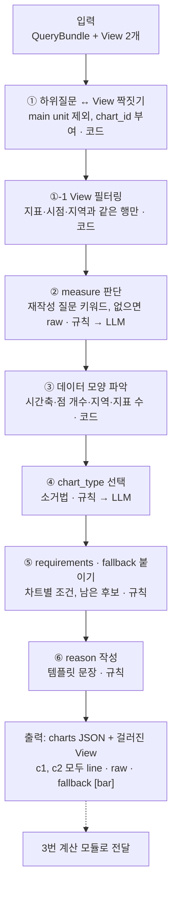
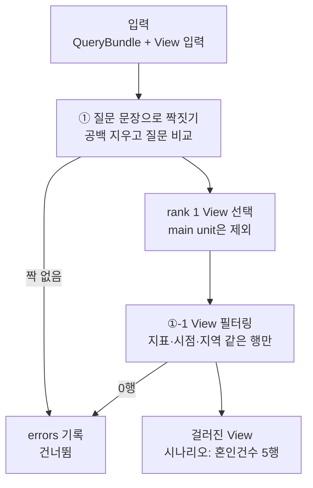
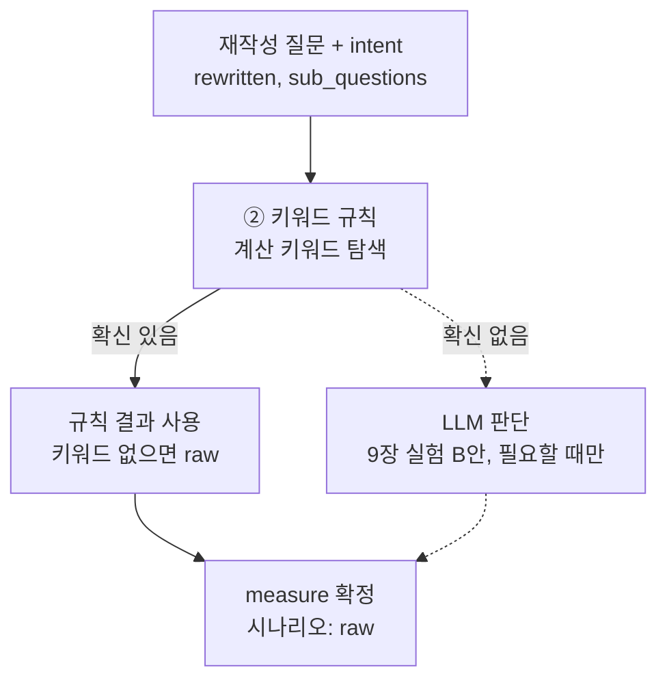
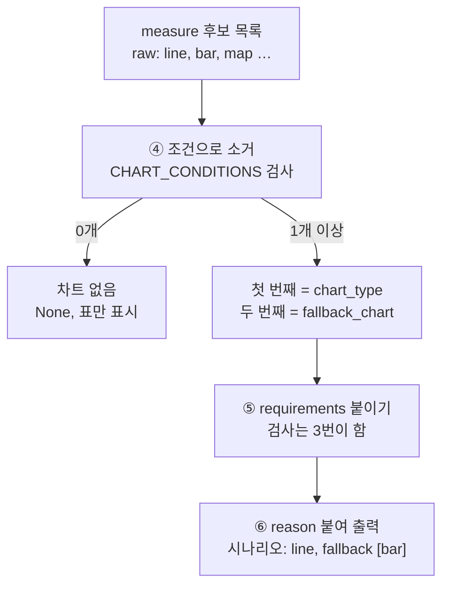

# 2번 차트 유형 판단 모듈 구현계획

Nov 10, 2026 · @catherine

## 1. 개요

2번 모듈은 QueryBundle과 View를 받아 **하위질문마다 어떤 차트로, 어떤 값(measure)을 그릴지** 정하는 모듈이다. View에서 질문에 맞는 행만 걸러 낸 뒤, 걸러진 View와 filters를 보고 판단한다. 수치 계산은 하지 않는다.

| 모듈 | 이 모듈에서 해야 할 것 |
| --- | --- |
| 2번 차트 유형 판단 | 질문에 맞게 View 행 필터링, 하위질문별 chart\_type, measure, requirements, fallback 결정 |
| 3번 계산 | measure 계산, requirements 검증, x/y 결정 |
| 5번 차트 생성 | 3번이 넘긴 x·y 값으로 실제 차트 렌더링 |

4번 모듈은 삭제되어 2번 → 3번 → 5번 순서로 이어진다.

## 2. 시나리오 데이터

이 계획은 `query_id: 27077dec` 시나리오를 기준으로 작성했다. 사용자 원 질문은 다음과 같다.

> 2021년부터 2025년까지 결혼 건수랑 출생아 수 변화 그래프로 그려줘

| 항목 | 값 |
| --- | --- |
| 변환 질문 (rewritten) | 2021\~2025년 전국 혼인건수 출생아수 연도별 추이 |
| 의도 (intent) | 추이 |
| 비교축 | 연도 |
| 시점 | 2021년\~2025년, 연간 (5개 시점) |
| 지역 | 전국 |
| 대상 / 지표 | 혼인·출생아 / 혼인건수, 출생아수 |

| unit\_id | 변환 질문 | 차트 매핑 |
| --- | --- | --- |
| main | 2021\~2025년 전국 혼인건수 출생아수 연도별 추이 | 제외 (두 하위질문을 합친 것) |
| 27077dec-1 | 2021\~2025년 혼인건수 연도별 추이 | c1 |
| 27077dec-2 | 2021\~2025년 출생아수 연도별 추이 | c2 |

## 3. 입력값

입력은 두 가지다. QueryBundle은 질의 변환 결과이고, View 입력은 검색(retrieval) 결과 묶음이다. 2번 모듈은 View 입력에서 하위질문별 rank 1 View를 사용한다.

### 3-1. QueryBundle

```json
[
 {
  "original": "2021년부터 2025년까지 결혼 건수랑 출생아 수 변화 그래프로 그려줘.",
  "rewritten": "2021~2025년 전국 혼인건수 출생아수 연도별 추이",
  "sub_questions": [
   "2021~2025년 혼인건수 연도별 추이",
   "2021~2025년 출생아수 연도별 추이"
  ],
  "intent": [
   "추이"
  ],
  "filters": {
   "시점": [
    "2021년",
    "2022년",
    "2023년",
    "2024년",
    "2025년"
   ],
   "지역": [
    "전국"
   ],
   "대상": [
    "혼인",
    "출생아"
   ],
   "지표": [
    "혼인건수",
    "출생아수"
   ],
   "비교축": [
    "연도"
   ]
  },
  "sub_filters": [
   {
    "시점": [
     "2021년",
     "2022년",
     "2023년",
     "2024년",
     "2025년"
    ],
    "대상": [
     "혼인"
    ],
    "지표": [
     "혼인건수"
    ],
    "비교축": [
     "연도"
    ]
   },
   {
    "시점": [
     "2021년",
     "2022년",
     "2023년",
     "2024년",
     "2025년"
    ],
    "대상": [
     "출생아"
    ],
    "지표": [
     "출생아수"
    ],
    "비교축": [
     "연도"
    ]
   }
  ]
 }
]
```

`sub_questions[i]`와 `sub_filters[i]`는 같은 순서로 짝을 이룬다. QueryBundle에는 `query_id`가 없어서, `query_id`는 View 입력에서 가져온다. 2번 모듈이 QueryBundle에서 쓰는 값은 다음과 같다.

| 필드 | 2번에서의 용도 | 시나리오 값 |
| --- | --- | --- |
| rewritten | measure 키워드 탐색 | 2021\~2025년 전국 혼인건수 출생아수 연도별 추이 |
| intent | "변화"를 추이로 볼지 판단 | 추이 |
| filters.지역 | 지역 차원 여부 | 전국 |
| sub\_questions\[i\] | 하위질문 문장, measure 키워드 탐색 | 혼인건수 / 출생아수 연도별 추이 |
| sub\_filters\[i\].시점 | 시간축 여부, 점 개수 | 2021년\~2025년 (5개) |
| sub\_filters\[i\].지표 | 지표 수, reason 문장 | 혼인건수 / 출생아수 |
| sub\_filters\[i\].비교축 | reason 문장 | 연도 |

### 3-2. Views

View 입력은 검색 모듈 결과에서 모든 unit의 `candidates`를 빼고, `views`는 unit마다 rank 1만 남긴 것이다.

```json
{
  "query_id": "27077dec",
  "original": "2021년부터 2025년까지 결혼 건수랑 출생아 수 변화 그래프로 그려줘",
  "filters": {
    "시점": [2021, 2022, 2023, 2024, 2025],
    "지역": null, "대상": ["혼인", "출생아"], "성별": null, "연령": null,
    "지표": ["혼인건수", "출생아수"], "비교축": "연도", "의도": "추이"
  },
  "units": [
    {
      "unit_id": "main",
      "query": "2021~2025년 전국 혼인건수 출생아수 연도별 추이",
      "filters": {
        "시점": [2021, 2022, 2023, 2024, 2025],
        "지역": null, "대상": ["혼인", "출생아"], "성별": null, "연령": null,
        "지표": ["혼인건수", "출생아수"], "비교축": "연도", "의도": "추이"
      },
      "views": [
        {
          "record": {
            "id": "view::101_DT_1B8000G::Y::27077dec-1::trend",
            "lexical_text": "월.분기.연간 인구동향(출생,사망,혼인,이혼) 인구동향조사 시점 2021~2025 행정구역별 전국 종류별 출생아수(명) 혼인건수(건) 조혼인율(천명당) 일반혼인율(남편) 일반혼인율(아내) 출생사망혼인이혼 명 건",
            "table": {
              "columns": ["시점", "행정구역별", "종류별", "항목", "값"],
              "rows": [
                ["2021", "전국", "출생아수(명)", "출생사망혼인이혼", 260562],
                ["2021", "전국", "혼인건수(건)", "출생사망혼인이혼", 192507],
                ["2021", "전국", "조혼인율(천명당)", "출생사망혼인이혼", 3.8],
                ["2021", "전국", "일반혼인율(남편)", "출생사망혼인이혼", 8.6],
                ["2021", "전국", "일반혼인율(아내)", "출생사망혼인이혼", 8.5],
                ["2022", "전국", "출생아수(명)", "출생사망혼인이혼", 249186],
                ["2022", "전국", "혼인건수(건)", "출생사망혼인이혼", 191690],
                ["2022", "전국", "조혼인율(천명당)", "출생사망혼인이혼", 3.7],
                ["2022", "전국", "일반혼인율(남편)", "출생사망혼인이혼", 8.5],
                ["2022", "전국", "일반혼인율(아내)", "출생사망혼인이혼", 8.4],
                ["2023", "전국", "출생아수(명)", "출생사망혼인이혼", 230028],
                ["2023", "전국", "혼인건수(건)", "출생사망혼인이혼", 193657],
                ["2023", "전국", "조혼인율(천명당)", "출생사망혼인이혼", 3.8],
                ["2023", "전국", "일반혼인율(남편)", "출생사망혼인이혼", 8.6],
                ["2023", "전국", "일반혼인율(아내)", "출생사망혼인이혼", 8.5],
                ["2024", "전국", "출생아수(명)", "출생사망혼인이혼", 238317],
                ["2024", "전국", "혼인건수(건)", "출생사망혼인이혼", 222412],
                ["2024", "전국", "조혼인율(천명당)", "출생사망혼인이혼", 4.4],
                ["2024", "전국", "일반혼인율(남편)", "출생사망혼인이혼", 9.9],
                ["2024", "전국", "일반혼인율(아내)", "출생사망혼인이혼", 9.7],
                ["2025", "전국", "출생아수(명)", "출생사망혼인이혼", 254341],
                ["2025", "전국", "혼인건수(건)", "출생사망혼인이혼", 240326],
                ["2025", "전국", "조혼인율(천명당)", "출생사망혼인이혼", 4.7],
                ["2025", "전국", "일반혼인율(남편)", "출생사망혼인이혼", 10.6],
                ["2025", "전국", "일반혼인율(아내)", "출생사망혼인이혼", 10.5]
              ]
            },
            "doc_type": "view",
            "parent_id": "table::101_DT_1B8000G",
            "metadata": {
              "survey_nm": "인구동향조사", "category": "인구동향조사", "survey_type": "구분없음(전체집계)",
              "view_type": "trend", "prd_se": "Y", "prd_from": "2021", "prd_to": "2025", "is_latest": true,
              "unit": "명 건", "geo_level": "전국", "n_points": 25,
              "items": ["출생사망혼인이혼"], "dims": ["종류별"]
            },
            "source": {
              "table_key": "101_DT_1B8000G", "file": "processed/101_DT_1B8000G.parquet",
              "org_id": "101", "tbl_id": "DT_1B8000G", "prd_se": "Y", "itm_id": ["T1"],
              "dims": { "c1": { "codes": ["00"] }, "c2": { "codes": ["10", "20", "21", "23", "24"] } },
              "period": { "in": ["2021", "2022", "2023", "2024", "2025"] },
              "kosis_url": "https://kosis.kr/statHtml/statHtml.do?orgId=101&tblId=DT_1B8000G"
            },
            "notes": [],
            "match": { "rank": 1, "cover": 1, "unmet": [] }
          },
          "notes": [],
          "rank": 1,
          "tbl_id": "DT_1B8000G"
        }
      ],
      "notes": []
    },
    {
      "unit_id": "27077dec-1",
      "query": "2021~2025년 혼인건수 연도별 추이",
      "filters": {
        "시점": [2021, 2022, 2023, 2024, 2025],
        "지역": null, "대상": ["혼인"], "성별": null, "연령": null,
        "지표": ["혼인건수"], "비교축": "연도", "의도": "추이"
      },
      "views": [
        {
          "record": {
            "id": "view::101_DT_1B8000G::Y::27077dec-1-1::trend",
            "lexical_text": "월.분기.연간 인구동향(출생,사망,혼인,이혼) 인구동향조사 시점 2021~2025 행정구역별 전국 종류별 혼인건수(건) 조혼인율(천명당) 일반혼인율(남편) 일반혼인율(아내) 출생사망혼인이혼 명 건",
            "table": {
              "columns": ["시점", "행정구역별", "종류별", "항목", "값"],
              "rows": [
                ["2021", "전국", "혼인건수(건)", "출생사망혼인이혼", 192507],
                ["2021", "전국", "조혼인율(천명당)", "출생사망혼인이혼", 3.8],
                ["2021", "전국", "일반혼인율(남편)", "출생사망혼인이혼", 8.6],
                ["2021", "전국", "일반혼인율(아내)", "출생사망혼인이혼", 8.5],
                ["2022", "전국", "혼인건수(건)", "출생사망혼인이혼", 191690],
                ["2022", "전국", "조혼인율(천명당)", "출생사망혼인이혼", 3.7],
                ["2022", "전국", "일반혼인율(남편)", "출생사망혼인이혼", 8.5],
                ["2022", "전국", "일반혼인율(아내)", "출생사망혼인이혼", 8.4],
                ["2023", "전국", "혼인건수(건)", "출생사망혼인이혼", 193657],
                ["2023", "전국", "조혼인율(천명당)", "출생사망혼인이혼", 3.8],
                ["2023", "전국", "일반혼인율(남편)", "출생사망혼인이혼", 8.6],
                ["2023", "전국", "일반혼인율(아내)", "출생사망혼인이혼", 8.5],
                ["2024", "전국", "혼인건수(건)", "출생사망혼인이혼", 222412],
                ["2024", "전국", "조혼인율(천명당)", "출생사망혼인이혼", 4.4],
                ["2024", "전국", "일반혼인율(남편)", "출생사망혼인이혼", 9.9],
                ["2024", "전국", "일반혼인율(아내)", "출생사망혼인이혼", 9.7],
                ["2025", "전국", "혼인건수(건)", "출생사망혼인이혼", 240326],
                ["2025", "전국", "조혼인율(천명당)", "출생사망혼인이혼", 4.7],
                ["2025", "전국", "일반혼인율(남편)", "출생사망혼인이혼", 10.6],
                ["2025", "전국", "일반혼인율(아내)", "출생사망혼인이혼", 10.5]
              ]
            },
            "doc_type": "view",
            "parent_id": "table::101_DT_1B8000G",
            "metadata": {
              "survey_nm": "인구동향조사", "category": "인구동향조사", "survey_type": "구분없음(전체집계)",
              "view_type": "trend", "prd_se": "Y", "prd_from": "2021", "prd_to": "2025", "is_latest": true,
              "unit": "명 건", "geo_level": "전국", "n_points": 20,
              "items": ["출생사망혼인이혼"], "dims": ["종류별"]
            },
            "source": {
              "table_key": "101_DT_1B8000G", "file": "processed/101_DT_1B8000G.parquet",
              "org_id": "101", "tbl_id": "DT_1B8000G", "prd_se": "Y", "itm_id": ["T1"],
              "dims": { "c1": { "codes": ["00"] }, "c2": { "codes": ["20", "21", "23", "24"] } },
              "period": { "in": ["2021", "2022", "2023", "2024", "2025"] },
              "kosis_url": "https://kosis.kr/statHtml/statHtml.do?orgId=101&tblId=DT_1B8000G"
            },
            "notes": [],
            "match": { "rank": 1, "cover": 1, "unmet": [] }
          },
          "notes": [],
          "rank": 1,
          "tbl_id": "DT_1B8000G"
        }
      ],
      "notes": []
    },
    {
      "unit_id": "27077dec-2",
      "query": "2021~2025년 출생아수 연도별 추이",
      "filters": {
        "시점": [2021, 2022, 2023, 2024, 2025],
        "지역": null, "대상": ["출생아"], "성별": null, "연령": null,
        "지표": ["출생아수"], "비교축": "연도", "의도": "추이"
      },
      "views": [
        {
          "record": {
            "id": "view::101_DT_1B8000G::Y::27077dec-2-1::trend",
            "lexical_text": "월.분기.연간 인구동향(출생,사망,혼인,이혼) 인구동향조사 시점 2021~2025 행정구역별 전국 종류별 출생아수(명) 출생사망혼인이혼 명 건",
            "table": {
              "columns": ["시점", "행정구역별", "종류별", "항목", "값"],
              "rows": [
                ["2021", "전국", "출생아수(명)", "출생사망혼인이혼", 260562],
                ["2022", "전국", "출생아수(명)", "출생사망혼인이혼", 249186],
                ["2023", "전국", "출생아수(명)", "출생사망혼인이혼", 230028],
                ["2024", "전국", "출생아수(명)", "출생사망혼인이혼", 238317],
                ["2025", "전국", "출생아수(명)", "출생사망혼인이혼", 254341]
              ]
            },
            "doc_type": "view",
            "parent_id": "table::101_DT_1B8000G",
            "metadata": {
              "survey_nm": "인구동향조사", "category": "인구동향조사", "survey_type": "구분없음(전체집계)",
              "view_type": "trend", "prd_se": "Y", "prd_from": "2021", "prd_to": "2025", "is_latest": true,
              "unit": "명 건", "geo_level": "전국", "n_points": 5,
              "items": ["출생사망혼인이혼"], "dims": []
            },
            "source": {
              "table_key": "101_DT_1B8000G", "file": "processed/101_DT_1B8000G.parquet",
              "org_id": "101", "tbl_id": "DT_1B8000G", "prd_se": "Y", "itm_id": ["T1"],
              "dims": { "c1": { "codes": ["00"] }, "c2": { "codes": ["10"] } },
              "period": { "in": ["2021", "2022", "2023", "2024", "2025"] },
              "kosis_url": "https://kosis.kr/statHtml/statHtml.do?orgId=101&tblId=DT_1B8000G"
            },
            "notes": [],
            "match": { "rank": 1, "cover": 1, "unmet": [] }
          },
          "notes": [],
          "rank": 1,
          "tbl_id": "DT_1B8000G"
        }
      ],
      "notes": []
    }
  ]
}
```

2번 모듈은 `main`을 뺀 하위질문 unit(`27077dec-1`, `27077dec-2`)의 View만 사용한다. `main`의 View id 끝 `27077dec-1`은 하위질문 id가 아니라 main 안의 순번이므로, 하위질문과 짝지을 때는 `unit_id`를 기준으로 한다.

View는 KOSIS 원본 통계표(`parent_id`)에서 질문 조건(지역·시점·항목 코드)으로 필터링한 조각이다. 2번 모듈은 아래 메타데이터만 사용한다.

| 구분 | View 1 (혼인) | View 2 (출생) |
| --- | --- | --- |
| view\_id | view::101\_DT\_1B8000G::Y::27077dec-1-1::trend | view::101\_DT\_1B8000G::Y::27077dec-2-1::trend |
| 하위질문 | 27077dec-1 | 27077dec-2 |
| 원본 표 | DT\_1B8000G 월.분기.연간 인구동향 | DT\_1B8000G 월.분기.연간 인구동향 |
| prd\_se / 기간 | Y / 2021\~2025 | Y / 2021\~2025 |
| geo\_level | 전국 | 전국 |
| n\_points | 20 (다른 지표 포함) | 5 |
| 지표가 든 열 | 종류별 | 종류별 |
| 섞인 지표 | 혼인건수, 조혼인율, 일반혼인율(남편/아내) | 출생아수만 |

View 1의 rows는 `시점 / 행정구역별 / 종류별 / 항목 / 값` 5개 열, 20행이다. 한 행이 숫자 1개이고, 실제 지표 이름은 `종류별` 열에 있다. `항목` 열은 모든 행이 "출생사망혼인이혼"이라 의미가 없다.

## 4. 최종 출력값

출력은 차트 계획 목록(`charts`)이다. 이 시나리오에서는 하위질문 2개에 대해 꺾은선 차트 2개가 나온다.

| 필드 | 의미 | 결정 방법 | c1 / c2 값 |
| --- | --- | --- | --- |
| query\_id | 어떤 질문의 결과인지 | 코드: View 입력의 query\_id 복사 | 27077dec |
| chart\_id | 차트 이름표 | 코드: ① 짝짓기에서 짝지은 순서대로 부여 | c1 / c2 |
| sub\_question\_ids | 이 차트가 답하는 하위질문 | 규칙: 하위질문 1개당 차트 1개, combo면 2개 | 27077dec-1 / 27077dec-2 |
| view\_ids | 이 차트에 쓸 View | 코드: 1번 선택 결과 | 혼인 rank 1 / 출생 rank 1 |
| measure | 값을 그대로 쓸지, 가공할지 | 규칙(재작성 질문 키워드) → 애매하면 LLM | raw / raw |
| chart\_type | 차트 모양, 그릴 차트가 없으면 None (표만 표시) | 규칙: 소거법 → 애매하면 LLM | line / line |
| requirements | 데이터가 지켜야 할 조건, None이면 \[\] | 규칙: 차트별 딕셔너리 | time\_axis\_required, min\_points\_3 |
| fallback\_chart | 조건 실패 시 대신 그릴 차트 1개 (문자열), 없으면 None | 규칙: 소거 후 남은 후보의 두 번째 | bar / bar |
| reason | 선택 이유 (QA·로그용) | 규칙: 템플릿 문장 | 혼인건수 연도별 추이 / 출생아수 연도별 추이 |

```json
{
  "query_id": "27077dec",     // [코드] View 입력의 query_id 그대로
  "charts": [
    {
      "chart_id": "c1",    // [코드] 첫 번째 차트
      "sub_question_ids": ["27077dec-1"],   // [규칙] 혼인건수 하위질문 1개에 차트 1개
      "view_ids": ["view::101_DT_1B8000G::Y::27077dec-1-1::trend"], // [코드] 혼인 unit의 rank 1 View
      "chart_type": "line", // [규칙] raw + 시계열(2021~2025, 5개 시점) → 꺾은선
      "requirements": ["time_axis_required", "min_points_3"],  // [규칙] line 기본 조건
      "fallback_chart": "bar",   // [규칙] 소거 후 남은 후보(line, bar) 중 두 번째
      "measure": "raw", // [규칙] 계산 키워드 없음, "변화"는 의도=추이라 제외
      "reason": "혼인건수 연도별 추이"   // [규칙] 템플릿 문장, QA·로그용
    },
    {
      "chart_id": "c2",   // [코드] 두 번째 차트
      "sub_question_ids": ["27077dec-2"], // [규칙] 출생아수 하위질문 1개에 차트 1개
      "view_ids": ["view::101_DT_1B8000G::Y::27077dec-2-1::trend"],    // [코드] 출생 unit의 rank 1 View
      "chart_type": "line",     // [규칙] raw + 시계열(2021~2025, 5개 시점) → 꺾은선
      "requirements": ["time_axis_required", "min_points_3"],        // [규칙] line 기본 조건
      "fallback_chart": "bar",       // [규칙] 소거 후 남은 후보(line, bar) 중 두 번째
      "measure": "raw",               // [규칙] 계산 키워드 없음
      "reason": "출생아수 연도별 추이"      // [규칙] 템플릿 문장, QA·로그용
    }
  ]
}
```

2번 모듈은 하위질문 조건으로 걸러낸 View(`filter_info` 포함)를 3번 모듈에 넘긴다. 3번은 걸러진 행으로 바로 계산할 수 있다.

## 5. 동작 흐름

모듈은 입력을 받아 아래 7단계를 하위질문마다 반복하고, 결과를 모아 JSON으로 출력한다.



①①-1③은 판단 없이 값을 가져오는 코드, ②④⑤⑥은 딕셔너리·if문 규칙이다. ②④만 규칙으로 정할 수 없을 때 LLM을 호출한다.

### 5-1. 세부 동작 다이어그램

입력에서 걸러진 View가 나오기까지다. 짝이 없거나 필터 결과가 0행이면 `errors`에 기록하고 그 하위질문은 건너뛴다.



measure는 규칙을 먼저 쓰고, 규칙이 확신하지 못할 때만 LLM을 부른다 (점선 경로).



③ 데이터 모양 파악은 소거 조건 검사 안에 포함된다. 후보가 하나도 안 남으면 chart\_type은 None이고 표만 보여준다. combo 묶음 판단은 ④에서 하위질문별로 고르기 전에 한 번 확인한다.



## 6. 세부 동작

### ① 하위질문 ↔ View 짝짓기 \[코드\]

- View 입력의 `units`에서 `unit_id`가 `main`인 것을 뺀다.
- 남은 unit을 QueryBundle의 `sub_questions[i]`와 **질문 문장으로** 짝짓는다. 공백을 지운 `sub_questions[i]`와 `units[].query`가 같으면 같은 하위질문이다. 같은 순서의 `sub_filters[i]`도 함께 가져온다.
- 짝이 없는 하위질문은 `errors`에 기록하고 건너뛴다.
- unit마다 rank 1 View를 연결하고, 짝지은 순서대로 `chart_id`(c1, c2…)를 붙인다. 뒤 단계는 이 `chart_id`를 그대로 쓴다. (건너뛰는 하위질문은 없다.)
- 시나리오 결과: "2021\~2025년 혼인건수 연도별 추이" ↔ 27077dec-1 → View 27077dec-1-1 (c1), "2021\~2025년 출생아수 연도별 추이" ↔ 27077dec-2 → View 27077dec-2-1 (c2)

```python
def match_units(query_bundle, view_input):
    norm = lambda s: s.replace(" ", "")
    units = {norm(u["query"]): u for u in view_input["units"] if u["unit_id"] != "main"}
    n = 0
    for sub_q, sub_f in zip(query_bundle["sub_questions"], query_bundle["sub_filters"]):
        unit = units.get(norm(sub_q))
        if unit is None:
            continue                                   # 짝 없음 → errors 기록
        view = min(unit["views"], key=lambda v: v["rank"])
        n += 1
        yield f"c{n}", unit, sub_q, sub_f, view        # chart_id는 짝지은 순서대로
```

### ①-1 View 필터링 \[코드\]

짝지은 View에서 하위질문 조건(지표·시점·지역)에 맞는 행만 남긴다. 시나리오에서는 혼인 View 20행 중 혼인건수 5행만 남는다.

**원리: 질문을 이해하는 게 아니라 글자를 맞춰 본다.** 필터는 질문 문장을 읽지 않고, 질의 변환이 뽑아 둔 `sub_filters[i].지표` 글자를 표의 글자와 비교한다. 명단에 적힌 이름표와 같은 이름표를 단 행만 통과시키는 방식이다.

1. 기준 글자 준비: `sub_filters[i].지표` → "혼인건수"
2. 지표 열 찾기: 값 중 "혼인건수"가 있는 열을 찾는다 → `종류별` (표마다 `기본항목별`, `항목` 등으로 다름)
3. 글자 정리 후 비교: 단위 괄호·공백을 지우고 같은 것만 남긴다. "혼인건수(건)" → "혼인건수" 남김, "조혼인율(천명당)" → "조혼인율" 버림
4. 시점 비교: "2021년" → "2021"로 바꿔 요청 연도만 남긴다
5. 지역 비교: `filters.지역`(전국) 값이 들어 있는 열이 있으면 그 행만 남긴다

원본 View는 바꾸지 않고 복사본을 걸러서 반환하며, `filter_info`에 지표 열과 단위를 담는다.

```json
"filter_info": { "indicator_col": "종류별", "indicators": ["혼인건수"], "unit": "건" }
```

**키워드는 고정이 아니다.** 코드에 "혼인건수"가 박혀 있는 게 아니라, 그때그때 `sub_filters[i].지표`에 들어온 값으로 찾는다.

| sub\_filters\[i\].지표 | 남는 행 (혼인 View 기준) |
| --- | --- |
| \["혼인건수"\] | 혼인건수(건) 5행 |
| \["조혼인율"\] | 조혼인율(천명당) 5행 |
| \["혼인건수", "조혼인율"\] | 두 지표 합쳐 10행 |

시나리오 txt의 하위질문 View 6개(DT\_1B8000G, INH\_1B8000F\_03, DT\_1B8000F, INH\_1B8000F\_01)에 모두 적용해 각각 5행이 남는 것을 확인했다.

**한계와 확장 방향**

| 상황 | 예시 | 현재 | 확장 방법 |
| --- | --- | --- | --- |
| 표기 차이 | "결혼건수" ↔ "혼인건수(건)" | 못 찾음 | 비교 전에 KOSIS 용어 동의어 사전으로 표준화 |
| 성별·연령 조건 | "남자 출생아수" | 필터 없음 | 지표·지역·성별·연령을 "슬롯 → 값이 든 열" 반복 구조로 일반화 |
| 지표가 여러 열에 흩어짐 | 지표 2개가 다른 열 | 첫 지표의 열만 찾음 | 지표마다 열을 따로 찾기 |
| 월·분기 시점 | "2024.01" | 숫자만 남아 "202401" | 주기(`prd_se`)별 시점 변환 규칙 추가 |
| 아무것도 안 맞음 | 표기 전부 다름 | 빈 표가 넘어감 | `filter_info`에 매칭 실패 기록 → 다음 rank View 또는 LLM 매칭 |

가장 튼튼한 방법은 글자 대신 `source.dims`의 KOSIS 분류코드로 거르는 것이다. 지표 이름 ↔ 코드 매핑을 검색 단계에서 받거나, View를 만들 때부터 요청한 코드만 넣으면 표기 차이 문제가 없어진다.

### ② measure 판단 \[규칙 → 애매하면 LLM\]

- QueryBundle의 **재작성된 질문**(`rewritten`, `sub_questions[i]`)에서 계산 키워드를 찾는다. 원 질문(`original`)은 보지 않는다.
- `intent`(의도)도 함께 보고 판단해도 된다. 예: `intent`가 "추이"이면 "변화"는 change 키워드로 보지 않는다.
- 키워드가 없으면 `raw`로 둔다.
- 규칙으로 정할 수 없을 때만 LLM을 호출한다 (9장 실험 B안).

| measure | 키워드 예시 |
| --- | --- |
| change | 증감, 늘었/줄었, 몇 명 차이 |
| growth\_rate | 증가율, 감소율, 몇 % |
| cagr | 연평균 증가율 |
| index | 기준 대비, 지수 |
| share | 비중, 구성비, 차지 |
| diff | 차이 (같은 시점 두 항목) |
| ratio | 몇 배 |
| rank | 순위, 상위, 하위 |
| extreme | 가장 많은, 가장 적은, 최대, 최소 |
| aggregate | 합계, 총, 평균 |

시나리오 결과: 원 질문의 "변화"는 의도가 추이이므로 제외 → `raw`

### ③ 데이터 모양 파악 \[코드\]

①-1에서 걸러진 View와 filters를 본다. 값을 계산하지는 않는다.

| 확인 항목 | 보는 곳 | 시나리오 값 |
| --- | --- | --- |
| 시간축 | `sub_filters[i].시점`, View `metadata.prd_se` | 있음 (Y, 5개) |
| 점 개수 | `len(sub_filters[i].시점)` | 5 |
| 지역 차원 | `filters.지역`, View `metadata.geo_level` | 없음 (전국 1곳) |
| 지표 수 | `sub_filters[i].지표` | 1 |
| 기타 차원 | `sub_filters[i]`의 성별·연령 키 | 없음 |

점 개수는 `metadata.n_points`로 세지 않는다. View 1은 다른 지표가 섞여 20으로 나오지만, 혼인건수만 보면 5개다.

`CHART_CONDITIONS`가 쓰는 나머지 값(`n_categories`, `n_series`, `non_negative`, `has_total`, `n_dims`, `n_measures`, `two_points_per_category`)은 추후 추가한다. 그 전까지는 위 5개 항목만 채운다.

### ④ chart\_type 선택 \[규칙 → 애매하면 LLM\]

measure로 후보 목록을 꺼내고, 데이터 모양으로 거른다. 후보 목록은 우선순위 순서다.

```python
MEASURE_TO_CHARTS = {
    "raw":         ["line", "bar", "map", "combo", "bubble", "scatter", "pyramid", "heatmap"],
    "change":      ["bar", "dumbbell", "map", "heatmap"],
    "growth_rate": ["bar", "line", "combo", "map", "heatmap", "scatter"],
    "cagr":        [],
    "index":       ["line", "radar"],
    "share":       ["donut", "pie", "stacked_bar", "treemap", "pyramid", "area", "map"],
    "diff":        ["dumbbell", "bar"],
    "ratio":       ["bar"],
    "rank":        ["bar"],
    "extreme":     [],
    "aggregate":   ["bar", "area"],
}
```

시나리오 결과: raw 후보 중 시간축 있음 + 지표 1개 + 지역 없음 → `line`

**소거법으로 고른다.** measure의 후보 목록을 우선순위 순서대로 보며, 데이터 모양 조건을 못 지키는 차트를 하나씩 지운다. 남은 후보가 여러 개면 정해진 순서의 첫 번째가 chart\_type, 두 번째가 fallback\_chart다 (없으면 None). 하나도 남지 않으면 chart\_type은 `None`이다.

```python
# rules.py: 차트별로 데이터 모양이 지켜야 할 조건
CHART_CONDITIONS = {
    "line":        lambda p: p["has_time"] and p["n_points"] >= 3,
    "area":        lambda p: p["has_time"] and p["n_points"] >= 3,
    "bar":         lambda p: p["n_categories"] <= 20,
    "stacked_bar": lambda p: p["non_negative"] and p["has_total"],
    "pie":         lambda p: p["non_negative"] and p["has_total"] and p["n_categories"] <= 5,
    "donut":       lambda p: p["non_negative"] and p["has_total"] and p["n_categories"] <= 5,
    "treemap":     lambda p: p["non_negative"] and p["has_total"],
    "pyramid":     lambda p: p["n_series"] == 2 and p["has_category"] and p["non_negative"],
    "combo":       lambda p: p["has_time"] and p["n_series"] == 2 and p["n_points"] >= 3,
    "map":         lambda p: p["has_region"],
    "heatmap":     lambda p: p["n_dims"] >= 2,
    "bubble":      lambda p: p["n_measures"] >= 3,
    "scatter":     lambda p: p["n_measures"] >= 2 and p["n_points"] >= 5,
    "radar":       lambda p: 3 <= p["n_categories"] <= 8,
    "dumbbell":    lambda p: p["two_points_per_category"],
}

# chart_picker.py
def pick_charts(measure, profile):
    candidates = MEASURE_TO_CHARTS.get(measure, [])          # 우선순위 순서
    survivors = [c for c in candidates if CHART_CONDITIONS[c](profile)]
    if not survivors:
        return None, None                                     # 차트 없음 → 표만
    fallback = survivors[1] if len(survivors) > 1 else None
    return survivors[0], fallback                             # chart_type, fallback_chart (문자열 1개)
```

시나리오(혼인건수, raw)의 소거 과정:

| raw 후보 (순서대로) | 조건 | 결과 |
| --- | --- | --- |
| line | 시간축 있음, 점 5개 ≥ 3 | 남음 → chart\_type |
| bar | 범주 5개 ≤ 20 | 남음 → fallback\_chart |
| map | 지역 차원 없음 (전국 1곳) | 소거 |
| combo | 시리즈 1개 (2개 필요) | 소거 |
| bubble | 지표 1개 (3개 필요) | 소거 |
| scatter | 지표 1개 (2개 필요) | 소거 |
| pyramid | 시리즈 1개 (2개 필요) | 소거 |
| heatmap | 차원 1개 (2개 필요) | 소거 |

**combo 묶음 판단.** 하위질문별로 고르기 전에, 두 하위질문을 combo 차트 1개로 묶을지 먼저 본다. 묶이면 `sub_question_ids`와 `view_ids`에 2개씩 들어간다.

- 두 하위질문의 `비교축`과 `시점`이 같다.
- 의도가 비교·관계다 (예: "결혼이 늘면 출생도 늘어?").
- 두 지표의 단위가 다르다 (건 / 명) → 축 2개짜리 combo.

시나리오는 의도가 "추이"라 묶지 않고, 하위질문별로 line 2개를 만든다.

### ⑤ requirements, fallback 붙이기 \[규칙\]

- `CHART_REQUIREMENTS[chart_type]`을 붙인다. 실제 검사는 3번이 한다. `CHART_REQUIREMENTS` 딕셔너리는 추후 추가하며, 그 전까지는 빈 딕셔너리로 둔다.
- fallback\_chart는 **문자열 1개**다. 소거 후 남은 후보 중 두 번째이고, 남은 후보가 1개뿐이면 `None`이다. 3번은 chart\_type이 조건을 못 지키면 fallback\_chart로 바꾼다.
- 후보 목록을 계속 내려가는 로직은 2번 안의 소거법(④)이 맡는다. 조건을 만족하는 후보만 남긴 뒤, 3번에는 1순위를 chart\_type, 2순위를 fallback\_chart로 **문자열 1개씩만** 넘긴다. 3번에서 fallback까지 실패하면 표만 보여준다.
- chart\_type이 `None`이면 requirements는 `[]`, fallback\_chart는 `None`이고, 차트 없이 표만 보여준다 (예: cagr, extreme).
- 시나리오 결과: requirements = `time_axis_required`, `min_points_3` / fallback\_chart = `bar`

### ⑥ reason 작성 및 출력 \[규칙\]

- 템플릿 `"{지표} {비교축}별 {의도}"`로 만든다.
- 시나리오 결과: "혼인건수 연도별 추이", "출생아수 연도별 추이"

### 전체 의사코드

```python
def decide_charts(query_bundle, view_input):
    charts, filtered_views = [], []

    for chart_id, unit, sub_q, sub_f, view in match_units(query_bundle, view_input):  # ① 짝짓기 + rank 1 + chart_id
        view = filter_view(view, sub_f, query_bundle["filters"]) # ①-1 필터링
        filtered_views.append(view)

        measure = decide_measure(sub_q, query_bundle)            # ② measure
        profile = profile_data(sub_f, query_bundle, view)        # ③ 데이터 모양
        chart_type, fallback = pick_charts(measure, profile)    # ④ 소거법

        charts.append({
            "chart_id": chart_id,                                 # ①에서 붙인 번호
            "sub_question_ids": [unit["unit_id"]],
            "view_ids": [view["record"]["id"]],
            "chart_type": chart_type,
            "requirements": CHART_REQUIREMENTS.get(chart_type, []),  # ⑤
            "fallback_chart": fallback,
            "measure": measure,
            "reason": make_reason(sub_f, query_bundle),          # ⑥
        })

    return {"query_id": view_input["query_id"], "charts": charts}, filtered_views
```

## 7. 결정 사항

| 항목 | 결정 | 반영 위치 |
| --- | --- | --- |
| 차트 후보 선택 방식 | 소거법: 후보 목록을 순서대로 보며 조건 못 지키는 차트를 지우고, 남은 것 중 정해진 순서의 첫 번째를 고름 | 6장 ④ |
| measure 키워드 기준 | 재작성된 질문(rewritten, sub\_questions)으로 판단, intent(의도)도 함께 봄 | 6장 ② |
| 차트가 없는 measure (cagr, extreme) | 차트 없이 표만 보여줌, chart\_type = None | 4장, 6장 ⑤ |
| LLM 호출 범위 | 미정, 우선 B안(규칙 실패 시 measure·chart\_type도 LLM)으로 진행 | 9장 실험 |
| fallback도 실패할 때 | 2번 안에서 후보 목록을 계속 내려가며 조건을 만족하는 후보만 남김. 3번에는 fallback\_chart를 문자열 1개(두 번째 후보)로 넘김. 3번에서 fallback까지 실패하면 표만 | 4장 fallback\_chart, 6장 ⑤, 8-4 |
| combo 차트 | 포함. 같은 비교축·시점 + 비교·관계 의도 + 단위 다름이면 하위질문 2개를 combo 1개로 묶음 | 6장 ④ |
| QueryBundle ↔ View 입력 연결 | 우선 질문 문장으로 연결 (공백 제거 후 sub\_questions와 units.query 비교) | 6장 ① |
| measure 키워드를 찾는 문장 | 재작성된 질문(rewritten, sub\_questions)만 봄, original은 보지 않음 | 3-1, 6장 ② |
| chart\_id 번호 | ① 짝짓기에서 짝지은 순서대로 c1, c2… 부여, 뒤 단계는 그대로 사용 (건너뛰는 하위질문 없음) | 6장 ①, 8-3 |
| chart\_type이 None인 차트 | 다른 차트와 똑같이 3번 calculation으로 보냄, answer로 갈라지지 않음 | 8-4 |
| 데이터 모양의 추가 값 | `n_categories`, `n_series`, `non_negative`, `has_total`, `n_dims`, `n_measures`, `two_points_per_category`는 추후 추가 | 6장 ③ |
| CHART\_REQUIREMENTS | 추후 추가, 그 전까지는 빈 딕셔너리 | 6장 ⑤ |

**남은 미결 사항**

- [ ] measure별 후보 목록의 우선순위 순서 최종 확정 (6장 ④의 MEASURE\_TO\_CHARTS는 초안)
- [ ] combo 묶음 조건의 "비교·관계" 키워드 목록 확정
- [ ] 질문 문장 연결이 실패하는 경우(문장 표기 차이)가 잦으면 공통 id 연결로 전환할지 검토

## 8. 구현 구조 (모듈화 · LangGraph)

먼저 ipynb 파일 하나에 ①부터 ⑥까지 처음부터 끝까지 작성해, 시나리오 입력으로 결과를 셀 단위로 확인한다. 동작이 확인되면 각 세부 동작을 아래 구조의 py 파일로 분리하고, 2번 모듈은 Generator 그래프 안의 LangGraph 노드 하나로 구현한다. 노드 안에서는 세부 동작 함수를 순서대로 호출한다.

| 단계 | 작업 | 확인할 것 |
| --- | --- | --- |
| 1. ipynb 작성 | 세부 동작을 함수로 셀마다 작성하고 시나리오 txt로 실행 | 셀마다 중간 결과(걸러진 행, measure, chart\_type)가 맞는지 |
| 2. py 분리 | 셀의 함수를 8-1 구조의 파일로 옮김 | ipynb와 같은 입력에 같은 출력이 나오는지 |
| 3. LangGraph 연결 | node.py, graph.py 작성 | LangGraph Studio에서 State 변화가 맞는지 |

### 8-1. 파일 구조

```text
generator/
├── state.py                 # GeneratorState 정의 (노드 간 공유 데이터)
├── graph.py                 # 그래프 조립 (노드·엣지 연결)
└── chart_decision/          # 2번 차트 유형 판단 모듈
    ├── __init__.py
    ├── node.py              # LangGraph 노드 함수 (아래 함수들을 순서대로 호출)
    ├── matcher.py           # ① 하위질문 ↔ View 짝짓기, rank 1 선택
    ├── view_filter.py       # ①-1 View 필터링 (filter_view)
    ├── measure.py           # ② measure 판단 (키워드 사전 + LLM 보완)
    ├── profiler.py          # ③ 데이터 모양 파악
    ├── chart_picker.py      # ④ 소거법으로 chart_type·fallback_chart 선택, combo 묶음 판단
    ├── reason.py            # ⑥ reason 템플릿
    └── rules.py             # 규칙 딕셔너리 (MEASURE_TO_CHARTS, CHART_REQUIREMENTS, 키워드·동의어 사전)
```

| 파일 | 담당 단계 | 입력 | 출력 |
| --- | --- | --- | --- |
| matcher.py | ① | QueryBundle, View 입력 | (unit, sub\_question, sub\_filter, rank 1 View) 목록 |
| view\_filter.py | ①-1 | View, sub\_filter, filters | 걸러진 View + filter\_info |
| measure.py | ② | sub\_question, rewritten, intent | measure |
| profiler.py | ③ | 걸러진 View, sub\_filter, filters | profile (시간축·점 개수·지역·지표 수) |
| chart\_picker.py | ④⑤ | measure, profile | chart\_type, requirements, fallback\_chart |
| reason.py | ⑥ | sub\_filter, intent | reason 문장 |
| rules.py | 공통 | - | 규칙·사전 딕셔너리 |

규칙과 사전을 `rules.py` 한 곳에 모아 두면, 차트 종류나 키워드를 늘릴 때 판단 코드를 건드리지 않고 이 파일만 고치면 된다.

### 8-2. State 정의

노드끼리는 State 하나를 주고받는다. 2번 노드는 앞 노드가 채운 `query_bundle`, `view_input`을 읽고 `chart_plan`, `filtered_views`를 채운다.

```python
# state.py
from typing import TypedDict, Optional

class GeneratorState(TypedDict, total=False):
    query_bundle: dict              # 입력: 질의 변환 결과
    view_input: dict                # 입력: 검색 결과 (unit별 rank 1 View)
    chart_plan: Optional[dict]      # 2번 출력: {"query_id", "charts": [...]}
    filtered_views: list            # 2번 출력: 하위질문별로 걸러진 View
    errors: list                    # 매칭 실패 등 기록
```

### 8-3. 노드 함수

```python
# chart_decision/node.py
from .matcher import match_units
from .view_filter import filter_view
from .measure import decide_measure
from .profiler import profile_data
from .chart_picker import pick_charts
from .reason import make_reason
from .rules import CHART_REQUIREMENTS

def chart_decision_node(state: GeneratorState) -> dict:
    qb, vi = state["query_bundle"], state["view_input"]
    charts, filtered_views, errors = [], [], []

    for chart_id, unit, sub_q, sub_f, view in match_units(qb, vi):         # ① chart_id 포함
        view = filter_view(view, sub_f, qb["filters"])                     # ①-1
        if not view["record"]["table"]["rows"]:
            errors.append({"unit_id": unit["unit_id"], "reason": "필터 매칭 실패"})
            continue
        filtered_views.append(view)

        measure = decide_measure(sub_q, qb)                                # ②
        profile = profile_data(view, sub_f, qb["filters"])                 # ③
        chart_type, fallback = pick_charts(measure, profile)              # ④ 소거법
        charts.append({
            "chart_id": chart_id,                                          # ①에서 붙인 번호
            "sub_question_ids": [unit["unit_id"]],
            "view_ids": [view["record"]["id"]],
            "chart_type": chart_type,
            "requirements": CHART_REQUIREMENTS.get(chart_type, []),        # ⑤
            "fallback_chart": fallback,
            "measure": measure,
            "reason": make_reason(sub_f, qb),                              # ⑥
        })

    return {
        "chart_plan": {"query_id": vi["query_id"], "charts": charts},
        "filtered_views": filtered_views,
        "errors": state.get("errors", []) + errors,
    }
```

노드는 State 전체를 다시 쓰지 않고, 바꾼 키만 dict로 돌려준다. LangGraph가 그 키만 State에 합친다.

### 8-4. 그래프 연결

```python
# graph.py
from langgraph.graph import StateGraph, START, END
from .state import GeneratorState
from .chart_decision.node import chart_decision_node
from .calculation.node import calculation_node      # 3번
from .chart_render.node import chart_render_node    # 5번
from .answer.node import answer_node                # 차트 없이 답변

def route_after_chart(state: GeneratorState) -> str:
    return "calculation" if state["chart_plan"]["charts"] else "answer"

builder = StateGraph(GeneratorState)
builder.add_node("chart_decision", chart_decision_node)
builder.add_node("calculation", calculation_node)
builder.add_node("chart_render", chart_render_node)
builder.add_node("answer", answer_node)

builder.add_edge(START, "chart_decision")
builder.add_conditional_edges("chart_decision", route_after_chart,
                              {"calculation": "calculation", "answer": "answer"})
builder.add_edge("calculation", "chart_render")
builder.add_edge("chart_render", END)
builder.add_edge("answer", END)

graph = builder.compile()
```

- chart\_type이 `None`인 차트도 `charts` 목록에 들어가므로 3번 calculation으로 간다 (예: cagr, extreme만 있는 질문). 3번 계산 후 5번에서 차트 없이 표만 보여준다. answer로 가는 것은 `charts` 목록 자체가 비었을 때(모든 하위질문이 짝짓기·필터에서 실패)뿐이다.
- 3번에서 requirements 검사가 실패하면 3번 안에서 `fallback_chart`로 바꾼다. fallback까지 실패하면 표만 보여준다. 2번으로 되돌아가는 엣지는 두지 않는다.
- 3번·5번·답변 노드의 파일 이름은 예시이며, 팀의 실제 노드 구성에 맞춰 바꾼다.

### 8-5. 구현 순서

1. **ipynb: 규칙 셀** — 6장 ②④의 표와 코드를 딕셔너리로 옮긴다 (나중에 `rules.py`).
2. **ipynb: 입력 셀** — 시나리오 QueryBundle과 View 입력 txt를 읽어 온다.
3. **ipynb: ① · ①-1 셀** — 짝짓기와 필터를 작성하고, View 6개 모두 5행이 남는지 확인한다.
4. **ipynb: ② \~ ⑥ 셀** — 함수를 하나씩 작성하고 셀마다 중간 결과(measure, profile, chart\_type, reason)를 출력해 확인한다.
5. **ipynb: 통합 셀** — 전체 함수를 묶어 실행하고, 4장 출력 JSON과 같은 결과가 나오는지 확인한다.
6. **py 분리** — 셀의 함수를 8-1 구조의 파일로 옮기고, ipynb와 같은 입력에 같은 출력이 나오는지 확인한다.
7. **LangGraph 연결** — `node.py`, `graph.py`를 작성하고 LangGraph Studio에서 State 변화를 확인한다.

## 9. 실험: LLM 호출 범위 (A안 vs B안)

LLM을 어디까지 부를지 아직 정하지 못해, 두 안을 같은 질문 세트로 비교해 결정한다. **실험 전까지는 B안으로 구현한다.**

| 구분 | A안 | B안 (현재) |
| --- | --- | --- |
| LLM을 쓰는 곳 | reason 문장만 | reason + 규칙이 정하지 못한 measure·chart\_type |
| 동작 | measure·chart\_type은 항상 규칙 | 규칙 먼저, "확신 없음"일 때만 LLM |
| 장점 | 빠르고 같은 질문에 결과가 일정함 | 애매한 질문(예: "요즘 아기 덜 태어나?")에 강함 |
| 단점 | 애매한 질문에서 규칙이 틀릴 수 있음 | 느리고, 같은 질문에 결과가 달라질 수 있음 |

**실험 방법**

1. 질문 세트를 만든다: 명확한 질문과 애매한 질문을 섞어 30\~50개, 질문마다 정답 measure·chart\_type을 적어 둔다.
2. 같은 세트를 A안과 B안으로 각각 실행한다.
3. 아래 지표로 비교한다.

| 지표 | 측정 방법 |
| --- | --- |
| 정답 일치율 | measure·chart\_type이 정답과 같은 질문의 비율 (전체 / 애매한 질문만 따로) |
| 응답 시간 | 질문당 2번 모듈 처리 시간 평균 |
| 일관성 | 같은 질문을 3번 반복했을 때 결과가 같은 비율 |
| LLM 호출 비율 | B안에서 LLM이 호출된 질문의 비율 |

**판단 기준(초안):** B안이 애매한 질문에서 정답 일치율이 확실히 높고 응답 시간·일관성 손해가 크지 않으면 B안을 유지하고, 차이가 작으면 A안으로 단순화한다.

B안 구현을 위해 규칙 함수는 결과와 함께 "확신 여부"를 돌려줘야 한다. 예: `decide_measure()`가 `("raw", False)`를 돌려주면 LLM을 호출한다.
