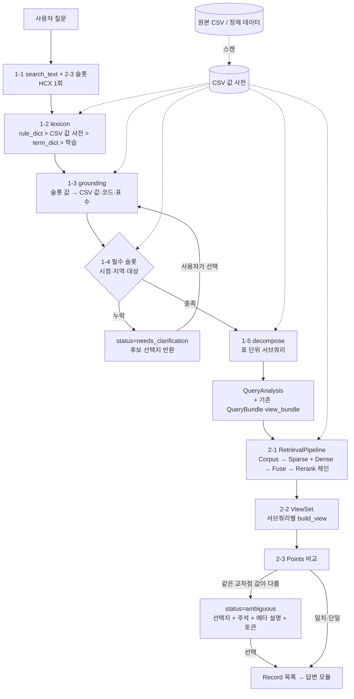

# 질의·검색·View 고도화 (v4) — Step 1 설계

> 대상 브랜치 `develop` (93e8ed8, 2026-11-09 기준, 테스트 93개 통과).
> 원칙: **기존 계약을 깨지 않고 더한다.** `RewriterBundle`·View 입력 `QueryBundle`·`Record` 는 그대로 두고,
> 새 기능은 바깥 응답(wrapper)과 새 모듈로 붙인다. 각 단계는 import 해서 단독 실행(노트북)할 수 있고,
> 단계마다 **파라미터 + 중간 출력**을 남긴다(`StepTrace`).

---

## 0. 현재 develop 에서 그대로 쓰는 것 / 새로 만드는 것

| 요구사항 | develop 에 이미 있는 것 | v4 에서 할 일 |
|---|---|---|
| 1-1 Query Rewriting | `query_analyzer` v3: 2-2 규칙 추출 → 2-1 용어 힌트 → 2-3 HCX 슬롯(1회) → 2-4 검증 → 3 문장 → 4 `QueryBundle` | **검색용 문장(search_text) 생성**을 독립 단계로 분리 (지금은 슬롯을 이어 붙인 문장). HCX 호출은 슬롯 호출과 합쳐 1회 유지 |
| 1-2 동의어·CSV 인덱싱 | `term_dict.json`(일상어→통계어) · `rule_dict.json`(지역·성별·축…) · `build_dicts.py` / `normalize` 의 `std_geo_name`·`parse_age`·`SIDO` | **CSV 값 사전**(원본 CSV 의 열 이름·분류 이름·항목·단위·코드값을 전부 스캔) + 세 사전을 합친 **조회 계층** + LLM 표현 변형 학습(승인 대기열) |
| 1-3 슬롯 추출 | 슬롯 12개(`SLOT_KEYS`), 의도 9종, `validate.fix_slots` | 슬롯 값을 **CSV 값 사전에 접지(grounding)** — "20대"→연령 20~29 + 그 범위를 덮는 실제 코드가 있는 표 수 |
| 1-4 되묻기 | 없음 (빈 슬롯은 None → View 단계 기본값) | **필수 슬롯 3개(시점·지역·대상)** 검사 + 시점 규칙 + 후보 선택지(CSV 값 사전에서) 반환, 선택 결과로 재개 |
| 1-5 서브쿼리 | HCX 의 `sub_questions` + `adapter` 의 하위 의도 | **표 단위 분리 판정**: 지표들이 한 표에 같이 있는지 CSV 값 사전으로 확인 → 따로 있으면 분리 |
| 2-1 하이브리드+리랭커 | `table_search.search`(BM25 kiwi → bge-m3 재정렬) · `fusion.Index`(RRF, legacy) · `reranker.py`(자리만) · `resolve.rerank`(조건 충족 재정렬) | **인터페이스 + Factory + Config**: 코퍼스·토크나이저·임베더·리랭커·융합을 설정만으로 교체. 벤치마크 러너(recall@k·MRR·nDCG·지연) |
| 2-2 View 생성 | `build_view`(슬롯대로 자르기·notes·match) · `views.run_query`(검색 단위별) | 그대로 사용. 서브쿼리별 View 묶음을 `ViewSet` 으로 관리 |
| 2-3 충돌·사용자 선택 | `judge`(View 가 조건을 담았는지 판정) | **Point 충돌 감지**: 필수 메타를 모두 쓴 View 끼리 같은 교차점 값이 다르면 `ambiguous` + 선택지(주석·메타 설명) + 선택 API |

---

## 1. 디렉토리 구조 (새 파일 ★, 고치는 파일 ✎)

```
backend/
├── core/
│   ├── tracking.py            ★ StepTrace·RunLog: 단계별 params·입력 요약·출력·소요시간 → storage/runs/<run_id>/*.jsonl
│   └── settings_v4.py         ★ v4 설정 (Pydantic BaseSettings + YAML). 필수 슬롯·시점 규칙·검색 기본 구성
├── rag/
│   ├── csv_index/             ★ [Part1-2·3·4·5 공통] 원본 CSV 행·열 사전
│   │   ├── scanner.py           원본 CSV 1회 스캔 → 표별 구조(열·분류·코드값·항목·단위·기간·주석)
│   │   ├── store.py             값 사전 저장/조회 (parquet + json, 역색인: 값 → 표·분류)
│   │   └── source.py            DataSource 인터페이스 (KOSIS raw CSV / 정제 데이터 parquet — 타 파트 데이터로 교체)
│   ├── query_analyzer/        (v3 그대로) + v4 단계
│   │   ├── v4/
│   │   │   ├── search_text.py   ★ 1-1 검색용 문장 (HCX 슬롯 호출과 같은 1회 응답에서 받음, 실패 시 규칙 조립)
│   │   │   ├── lexicon.py       ★ 1-2 동의어 조회 계층: rule_dict > CSV 값 사전 > term_dict > 학습 사전
│   │   │   ├── grounding.py     ★ 1-3 슬롯 값 → CSV 값·코드 접지 (+ 그 값을 가진 표 수)
│   │   │   ├── clarify.py       ★ 1-4 필수 슬롯 검사·시점 규칙·후보 선택지·선택 반영
│   │   │   ├── decompose.py     ★ 1-5 표 단위 서브쿼리 분리
│   │   │   └── pipeline.py      ★ analyze(question) → QueryAnalysis (단계 순서·trace)
│   │   └── adapter.py         ✎ QueryAnalysis → View 입력 QueryBundle (기존 to_view_bundle 재사용)
│   ├── retrieval/
│   │   ├── interfaces.py      ★ Protocol: Corpus · Tokenizer · SparseRetriever · Embedder · DenseRetriever · Reranker · Fuser
│   │   ├── corpus.py          ★ 코퍼스: table_text(현재 표 설명문) / csv_index 설명문 / 외부 정제 데이터
│   │   ├── tokenizers.py      ★ kiwi(기존) · kiwi+사전 · okt/mecab(선택 설치) · 문자 n-gram · 공백
│   │   ├── embedders.py       ★ hcx-bge-m3(기존 dense.py) · sentence-transformers 로컬(bge-m3, multilingual-e5, KoE5 …)
│   │   ├── rerankers.py       ★ none · cross-encoder(bge-reranker-v2-m3 등 HF) · condition(resolve.rerank 감싸기) · 체인
│   │   ├── fusion.py          ✎ RRF·가중합 함수 추가 (Index 클래스는 그대로)
│   │   ├── factory.py         ★ build_pipeline(config) — YAML/dict 하나로 조립
│   │   ├── pipeline.py        ★ RetrievalPipeline.search(query, filters) → 후보 + 단계별 점수·순위
│   │   └── reranker.py        ✎ 기존 자리 함수는 rerankers.none 으로 연결 (호출부 호환)
│   ├── view/                  ★ [Part2-2·3]
│   │   ├── viewset.py           서브쿼리별 View 묶음 (기존 build_view 호출)
│   │   ├── points.py            View → 교차점(Point) 표: (시점, 지역, 성별, 연령, 지표, 단위) → 값
│   │   ├── conflict.py          필수 메타 사용 확인 + Point 값 비교 → ok / ambiguous / partial
│   │   └── selection.py         선택지 묶기(주석·메타 설명) + 선택 토큰 발급·검증 (서버 상태 없음)
│   └── ingestion/ … judge/ …  (그대로)
├── schemas/
│   ├── query_v4.py            ★ QueryAnalysis · Clarification · SlotGrounding · SubQuery …
│   ├── retrieval_v4.py        ★ RetrievalConfig · RetrievalHit · BenchmarkRequest/Result
│   └── view_v4.py             ★ ViewSet · PointConflict · ChoiceOption · SelectionRequest
└── api/
    ├── v1_query.py            ✎ v4 엔드포인트 추가 (기존 경로는 그대로)
    ├── v1_csv_index.py        ★ CSV 값 사전 스캔·조회
    ├── v1_retrieval_lab.py    ★ 구성별 검색·벤치마크
    └── v1_search.py           ✎ View 묶음 + 충돌 판정 + 선택 엔드포인트 추가
configs/retrieval/             ★ 실험 구성 YAML (baseline.yaml, kiwi_bge_rerank.yaml …)
eval/retrieval/                ★ 벤치마크 러너 + 노트북 (gold 표 id 로 recall@k·MRR·nDCG·지연)
notebooks/v4/                  ★ 단계별 실험 노트북 (query / retrieval / view)
storage/csv_index/             ★ CSV 값 사전 산출물 (git 제외)
storage/runs/                  ★ 실행 trace (git 제외)
```

---

## 2. 데이터 흐름



---

## 3. 데이터 스키마 (Pydantic, 요지)

```python
# schemas/query_v4.py
class SlotValue(BaseModel):          # 슬롯 값 하나의 접지 결과
    raw: str                         # LLM·규칙이 낸 표현 ('20대', '대구')
    value: Any                       # 표준 값 ('대구광역시', {"from":20,"to":29}, 2025)
    source: Literal["rule_dict", "csv", "term_dict", "learned", "llm", "default_rule"]
    csv_matches: list[CsvMatch] = [] # 이 값을 가진 실제 (표, 분류, 코드, 이름) 상위 n개
    n_tables: int = 0

class Clarification(BaseModel):      # 되묻기 한 건
    slot: Literal["시점", "지역", "대상"]
    reason: str                      # "지역이 없음" / "대상 '그거'를 CSV 에서 찾지 못함"
    options: list[ChoiceOption]      # 클릭용 후보 (value, label, n_tables, example_tables)
    multi: bool                      # 여러 개 선택 가능 여부

class SubQuery(BaseModel):
    id: str                          # S1, S2 …
    text: str                        # 검색 문장
    filters: dict                    # 기존 View 입력 filters 형식 그대로
    reason: str                      # 분리 근거 ("출생아수·사망자수가 함께 있는 표 없음")
    candidate_tables: list[str] = [] # CSV 값 사전 기준 그 지표를 가진 표 (힌트)

class QueryAnalysis(BaseModel):      # Part 1 최종 출력 (기존 계약은 안에 그대로)
    status: Literal["ok", "needs_clarification", "out_of_scope"]
    bundle: RewriterBundle           # 기존 재작성 출력 그대로
    view_bundle: QueryBundle | None  # 기존 View 입력 그대로 (status=ok 일 때)
    search_text: str
    slots: dict[str, list[SlotValue]]
    clarifications: list[Clarification] = []
    sub_queries: list[SubQuery] = []
    applied_rules: list[str] = []    # "'최근' → 2026년", "'추이' → 2022~2026"
    trace: list[StepTrace]           # 단계별 params·출력·초

class ClarifyAnswer(BaseModel):      # 되묻기 응답 → 같은 질문을 선택값으로 다시 분석 (서버 상태 없음)
    question: str
    selections: dict[str, list[str]] # {"지역": ["대전광역시"]}
    previous: QueryAnalysis | None   # 있으면 HCX 다시 안 부름

# schemas/view_v4.py
class Point(BaseModel):              # 교차점 키 + 값
    key: dict[str, str]              # {시점, 지역, 성별, 연령, 지표}
    value: float | None; unit: str; record_id: str

class ChoiceOption(BaseModel):
    option_id: str                   # "opt-1"
    record_id: str; tbl_id: str; tbl_nm: str
    value_preview: list[Point]
    footnotes: list[str]             # 메타 CMMT(통계표·항목·분류 주석)
    description: str                 # 표 설명문(카탈로그) + 산출 기준·단위
    kosis_url: str

class PointConflict(BaseModel):
    sub_query_id: str
    status: Literal["ok", "ambiguous", "partial"]
    used_slots: dict[str, bool]      # 필수 메타가 View 에 모두 적용됐는지
    differing_points: list[dict]     # 같은 key, 다른 값
    options: list[ChoiceOption] = []
    selection_token: str | None      # 후보 묶음 서명(HMAC). 선택 API 에 그대로 돌려보냄

class SelectionRequest(BaseModel):
    selection_token: str; option_id: str
```

- `RetrievalConfig` (YAML 과 같은 모양)

```yaml
name: kiwi_bge_rerank
corpus:   {type: table_text}                 # table_text | csv_index | external(path=…)
sparse:   {type: bm25, tokenizer: {type: kiwi, user_dict: lexicon}, k: 50}
dense:    {type: embed, embedder: {type: hcx_bge_m3}, k: 50}  # 또는 {type: st, model: BAAI/bge-m3}
fusion:   {type: rrf, k: 60, weights: {sparse: 1.0, dense: 1.0}}
rerank:   [{type: condition}, {type: cross_encoder, model: BAAI/bge-reranker-v2-m3, top_n: 30, max_length: 512}]
top_k: 10
```

---

## 4. 핵심 규칙

**필수 슬롯·시점 규칙 (1-4)** — `settings_v4.yaml` 로 관리
- 대상(Target) = `대상` 또는 `지표` 중 하나라도 있으면 충족 (기존 슬롯 12개와 호환)
- `최근·요즘·현재·지금` → `2026년` / `추이·변화·흐름` → 최근 5년 `2022~2026년` (기준 연도는 설정값)
  - 2026 년 자료가 없는 표가 대부분 → View 단계(resolve)의 '최신 자료 대체'와 notes 로 처리 (되묻지 않음)
- 누락 시 검색 중단, 후보:
  - 지역: CSV 값 사전의 실제 시도·시군구 이름 (`전국` 포함, 표 수 순)
  - 시점: 대상·지표가 있으면 그 지표를 가진 표들의 실제 연도 범위, 없으면 전체 최신 연도들
  - 대상: 질문의 단어와 가까운 지표·항목 이름 (사전·CSV 값 사전 유사도) 상위 n개

**서브쿼리 분리 (1-5)** — 지표가 둘 이상일 때 CSV 값 사전에서 "모든 지표를 함께 가진 표"가 있으면 하나로,
없으면 지표별 서브쿼리 (지역·시점이 서로 다르게 붙은 경우도 분리). 근거를 `reason` 에 남김.

**Point 충돌 (2-3)**
1. View 마다 필수 메타(시점·지역·대상/지표 + 질문에 있던 성별·연령)가 **실제로 적용됐는지** — `build_view` notes·`judge.extract` 로 확인.
   하나라도 못 쓴 View 는 비교 대상에서 빼고 `partial` 로 표시.
2. 남은 View 들을 Point 로 펼쳐 key 가 같은 것끼리 비교. 값이 다르면(상대 차 > 설정값, 기본 0) `ambiguous`.
   단위가 다르면(명 vs 천명) 환산 후 비교, 환산 불가면 다른 지표로 봄.
3. `ambiguous` 면 하나를 고르지 않고 선택지(표 이름, 값 미리보기, 주석, 표 설명, 산출 기준) + `selection_token` 반환.
   `POST …/views/select {selection_token, option_id}` → 고른 Record 로 다음 단계 진행.
   토큰은 후보 Record id 목록의 서명이라 서버에 세션 저장이 필요 없음 (CLI·노트북·Swagger 에서 그대로 재현).

---

## 5. API (Swagger 태그별, 기존 경로는 그대로)

| 메서드·경로 | 단계 | 비고 |
|---|---|---|
| `POST /api/v1/csv-index/build` · `GET …/csv-index/values?slot=지역` · `GET …/csv-index/tables/{tbl_id}` | 1-2 | CSV 값 사전 만들기·조회 |
| `POST /api/v1/rag/v4/lexicon/lookup` | 1-2 | 표현 → 표준 값 (어느 사전에서 왔는지) |
| `POST /api/v1/rag/v4/analyze` | 1-1~1-5 | 질문 → `QueryAnalysis` |
| `POST /api/v1/rag/v4/clarify` | 1-4 | `ClarifyAnswer` → `QueryAnalysis` |
| `POST /api/v1/rag/v4/decompose` | 1-5 | 슬롯 → 서브쿼리 (단독 확인) |
| `GET /api/v1/retrieval-lab/configs` · `POST …/search` · `POST …/benchmark` | 2-1 | 구성 이름·YAML 로 검색 / gold 로 평가 |
| `POST /api/v1/rag/v4/views` | 2-2·2-3 | `QueryAnalysis`(또는 view_bundle) → `ViewSet` + `PointConflict` |
| `POST /api/v1/rag/v4/views/select` | 2-3 | 선택 반영 → Record 목록 |

---

## 6. 평가·추적

- 모든 단계 함수는 `(result, StepTrace)` 를 돌려주고, `RunLog` 가 `storage/runs/<run_id>/` 에
  `params.json`(설정 전체) · `steps.jsonl`(단계별 입력 요약·출력·초) · `results.jsonl` 로 남김 → 평가 러너가 그대로 읽음.
- 검색 벤치마크: gold 표 id 가 있는 질의 묶음 × 구성 목록 → recall@1/5/10 · MRR · nDCG@10 · 단계별 지연 → `eval/retrieval/results/<날짜>/` 표·CSV.
  HCX 답변 호출 없이 검색만 돌리므로 구성 비교가 싸다.
- Part 1 평가: 슬롯 정확도(기존 `eval/query_rewrite` gold 재사용) + 되묻기 정확도(필수 슬롯 누락 질문 세트) + 서브쿼리 분리 정확도.

---

## 7. 진행 순서

| Step | 내용 | 완료 기준 |
|---|---|---|
| 2 | `csv_index` · `lexicon` · `grounding` · `clarify` · `decompose` · `analyze` API | 기존 테스트 유지 + 단계별 단위 테스트, Swagger 에서 되묻기 왕복 |
| 3 | `retrieval` 인터페이스·Factory·구현체 · 벤치마크 러너·노트북 | 현재 검색(`table_search.search`)을 baseline 구성으로 재현 (같은 순위) + 구성 2개 이상 비교표 |
| 4 | `view` 묶음 · Point 충돌 · 선택 API | 충돌 재현 테스트(같은 key 다른 값 두 표) + 선택 왕복 |
