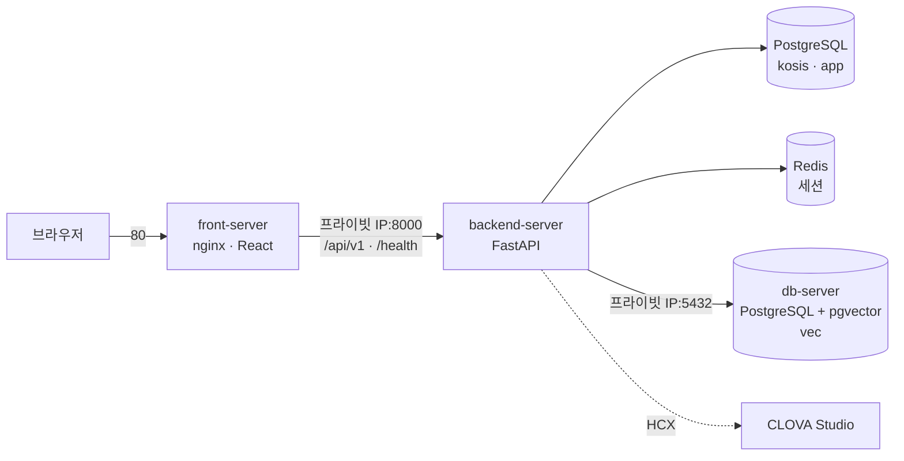

# AWS 배포용 DB 구조

EC2 세 대(Docker)에 올릴 때 데이터를 어디에 어떤 모양으로 두는지 정리한 문서다. 배포 순서는 [deploy/README.md](../deploy/README.md)에 있다.

## 1. 서버별 배치

| 서버 | 사양 | 컨테이너 | 저장하는 것 |
|---|---|---|---|
| backend-server | t3.xlarge · 16 GiB · 100 GB | `backend`(FastAPI) · `postgres`(16) · `redis`(7) | KOSIS 통계값(`kosis`) · 대화 이력(`app`) · 멀티턴 세션(Redis) · 검색 색인 파일 |
| db-server | t3.medium · 4 GiB · 20 GB | `vector`(PostgreSQL 16 + pgvector) | 임베딩 캐시 · dense 문서 벡터(`vec`) |
| front-server | t3.medium · 4 GiB · 20 GB | `web`(nginx + React 빌드) | 없음 (`/api/v1/*` 는 backend 의 프라이빗 IP:8000 으로 전달) |



신청서 "현재 조건으로 사양 예상"의 RDS(db.t4g.medium)·ElastiCache 는 실제로 받은 EC2 세 대로 바꿨다. RDS 자리는 db-server 의 pgvector 컨테이너, ElastiCache 자리는 backend-server 의 Redis 컨테이너다.

## 2. 결정 사항

### ① PostgreSQL 에 무엇을 저장하는가

| 데이터 | 위치 | 이유 |
|---|---|---|
| KOSIS 통계값 (정규화 parquet 의 모든 행) | backend PG `kosis.stat_value` | 신청서 결정대로 이전한다. View 생성·좌표 재조회·시리즈 비교가 여기서 읽는다 |
| 표 프로필 · 코드 사전 · 항목 · 시점 | backend PG `kosis.stat_table` · `stat_code` · `stat_item` · `stat_period` | 값 행에는 코드만 두고 이름·순서·합계 여부는 사전 표로 뺐다 (행당 약 115 B) |
| 대화 이력 | backend PG `app.chat_session` · `app.chat_turn` | 끝난 `/chat` 호출마다 한 행. 질문 · 상태 · 답변 · 쓴 표 · 요청 · 응답 JSON · 소요 시간 |
| 임베딩 캐시 (글 → 1,024차원) | db-server `vec.embedding_cache` | 예전 `embed_cache.sqlite`. 같은 글은 HCX 를 다시 부르지 않는다 |
| dense 문서 벡터 (표 1,092개 설명문) | db-server `vec.doc_embedding` | 예전 `search_cache/dense/*.pkl`. 질문 벡터와 내적을 db-server 에서 계산한다 |
| 검색 색인 (BM25 토큰 · CSV 값 사전 · OKF · 메타 프로필) | backend 의 파일 (`/srv/t4core/storage`) | 서버를 켤 때 메모리로 올려 쓰는 읽기 전용 산출물이라 파일로 둔다. 표 1,092개 기준 약 300 MiB |

DuckDB + Parquet 로 남기는 길도 열려 있다. `STAT_BACKEND=parquet` 이면 지금과 똑같이 동작한다. PostgreSQL 에 없는 표는 서버에 parquet 가 있으면 그것을 읽는다 (`stats load --max-rows` 로 아주 큰 표만 parquet 에 둘 수도 있다).

### ② 데이터를 어디서 갱신하는가

| 단계 | 어디서 | 명령 |
|---|---|---|
| 원본 수집 (56.9 GiB) | 원본이 있는 팀 PC | `python -m backend.rag.ingestion.collector …` (지금과 같음) |
| 정규화 · 색인 | 같은 PC | `python -m backend.rag.ingestion.prepare` · `python -m backend.db stats normalize --all` |
| 묶음 만들기 | 같은 PC | `python -m backend.db bundle create` (원본 CSV `raw/` 는 넣지 않음) |
| PostgreSQL 적재 | backend-server | `stats load --all` — 바뀐 표만 (parquet·프로필의 크기·수정 시각 비교) |
| 벡터 갱신 | backend-server → db-server | `vectors import-sqlite` · `vectors sync` — 없는 임베딩만 HCX 호출 |

서버가 답할 때 쓰는 값(검색 대상 1,092개 표의 모든 행)은 이 과정으로 전부 PostgreSQL 에 들어가므로, 원본이 없어도 서버만으로 동작한다. 검색 대상이 아닌 표까지 DB 에 두려면 `stats normalize --catalog-all`. 원본 CSV 는 기본으로 EC2 에 올리지 않는다. 100 GB 디스크에 원본(57 GiB)과 PostgreSQL 사본을 함께 두면 여유가 없고, 정규화는 원본이 있는 곳에서 한 번만 하면 된다. 주기는 KOSIS 갱신(대부분 월·연 단위)에 맞춰 주 1회 정도면 충분하다. 표를 다시 올릴 때는 새 파티션에 넣은 뒤 한 트랜잭션에서 바꿔 끼우므로, 서버를 켜 둔 채로 해도 답변이 끊기지 않는다.

### ③ Redis 에 어떤 세션을 두는가

| 항목 | 내용 |
|---|---|
| 키 | `t4:session:<session_id>` (hash). session_id 는 프론트엔드의 질문 id(UUID) |
| 값 | `status`(running · ok · needs_clarification · needs_selection · out_of_scope · error) · `question` · `response`(마지막 응답 JSON = 다음 요청의 previous) · `turns` · 시각 |
| 저장 시점 | `/chat` 을 받자마자 `running`, 끝나면 응답과 상태 |
| 만료 | `SESSION_TTL_SECONDS` (기본 24시간). 쓸 때마다 다시 늘어남. 선택 토큰 유효 시간(`selection_ttl_hours` 168)보다 짧아도 이어가기에는 충분 |
| 새로고침 | 프론트엔드가 시작할 때 "새로고침으로 끊긴" 질문의 세션을 조회해, 서버가 끝낸 응답이 있으면 그대로 붙인다 (HCX 다시 안 부름). 아직 `running` 이면 5초마다 다시 확인 |
| 재배포 | Redis 는 AOF(`appendonly yes`)로 `/srv/t4core/redis` 에 남아 컨테이너 재시작·EC2 중지/시작 뒤에도 남는다 |
| 세션 유실 | 프론트엔드는 지금처럼 `previous` 도 함께 보내므로 그대로 이어진다. `previous` 없이 `session_id` 만 보냈는데 세션이 없으면 409 "세션이 만료되었습니다. 질문을 처음부터 다시 보내 주세요" |
| 메모리 | `maxmemory 512mb` · `volatile-lru`. 응답 하나가 수백 KB 라 수백~수천 세션까지 여유 |

## 3. 스키마

### backend PostgreSQL — `kosis`

```
stat_table   table_id PK · table_key UNIQUE('<기관>_<표>') · org_id · tbl_id · tbl_nm · survey_nm · category · path
             selected · levels smallint[] · profile jsonb(정규화 프로필) · n_rows · source_sig · load_report · loaded_at
stat_code    (table_id, level, code) PK · name · label · std · ord · depth · is_total · geo_type · parent
stat_item    (table_id, itm_id) PK · itm_nm · itm_ord · itm_kind · itm_total
stat_period  (table_id, prd_se, prd_de) PK · year · period_label · period_date
stat_value   table_id · prd_se · prd_de · year · itm_id · c1 … c8 · unit · unit_inferred · value · value_raw · symbol
             PARTITION BY LIST (table_id) — 표마다 파티션 stat_value_<table_id>
             인덱스 (prd_se, year, itm_id) + 20만 행이 넘는 표는 (prd_se, year, c1) · (prd_se, year, c2)
```

읽을 때는 `backend/data_engine/stat_store.py` 가 사전 표를 붙여 parquet 와 같은 열(`c1_code · c1_label · … · itm_nm · period_label`)로 돌려준다. View 생성이 쓰는 조건(`prd_se = 'Y'`, `c1_code IN (...)`, `year IN (...)` …)은 PostgreSQL 에서 먼저 걸러 필요한 행만 가져오고, DuckDB 쪽 SQL 은 그대로다. 그래서 parquet 모드와 결과가 같다 (`tests/test_db_aws.py` 가 같은 질문의 답·표·좌표를 두 모드에서 비교한다).

같은 코드에 원본 CSV 의 이름이 여러 개면 가장 많은 행이 쓴 이름을 사전에 둔다. 그런 코드 수는 `stat_table.load_report.code_variants` 에 남고, `stats verify` 가 표본 행으로 차이를 알려 준다.

### backend PostgreSQL — `app`

```
chat_session  session_id PK · created_at · updated_at · first_question · n_turns · last_status
chat_turn     turn_id PK · session_id FK · turn_no · kind(ask·clarify·select) · question · status · answer · tables text[]
              request jsonb(previous 제외) · response jsonb · timings jsonb · error · elapsed_ms · created_at
```

### db-server PostgreSQL + pgvector — `vec`

```
embedding_cache  k PK (sha1("<모델>\n<글>") — sqlite 와 같은 키) · model · dim · embedding vector · text_preview
doc_set          set_id PK · set_key UNIQUE(코퍼스 서명 · 임베더 · 문서 종류 · 글 해시) · n_docs · n_rows · dim
doc_embedding    (set_id, row_no) PK · doc_idx · tbl_id · dim · embedding vector
                 HNSW (embedding::vector(1024) vector_ip_ops) WHERE dim = 1024
```

검색 엔진은 표 1,092개의 점수를 모두 쓰므로(가중 RRF) 질문마다 묶음 전체와 내적을 계산한다 (약 1,100행 — 순차 계산이 몇 ms). HNSW 색인은 상위 k 개만 보는 `vectors nearest` 확인용이다. db-server 에 닿지 않으면 backend 에 남겨 둔 파일 사본으로 계속하고, 사본도 없으면 표 전체를 HCX 로 다시 임베딩하지 않고 오류로 멈춘다.

## 4. 환경변수

| 변수 | 값 | 기본 |
|---|---|---|
| `STAT_BACKEND` | `postgres` · `parquet` | parquet (배포 compose 는 postgres) |
| `DATABASE_URL` | backend PostgreSQL | compose 가 채움 |
| `VECTOR_STORE` | `pgvector` · `file` | file (배포 compose 는 pgvector) |
| `VECTOR_DB_URL` | db-server PostgreSQL (프라이빗 IP) | - |
| `VECTOR_SCORE` | `db` · `memory` | db |
| `REDIS_URL` | 세션 저장 | compose 가 채움 (없으면 세션 저장 안 함) |
| `SESSION_TTL_SECONDS` | 세션 만료 | 86400 |
| `CHAT_HISTORY` · `CHAT_HISTORY_RESPONSE` | `on` · `full`/`summary` | off · full |
| `ADMIN_TOKEN` | `/api/v1/history` 조회 헤더 `X-Admin-Token` | 비움 (누구나) |
| `DB_MIGRATE_ON_START` | 시작할 때 스키마 적용 | off (배포 compose 는 on) |

## 5. 크기 어림

로컬 측정(행 220만, 분류 3개)에서 PostgreSQL 은 행당 약 115 B (인덱스 포함), 적재는 초당 약 20만 행이었다. 실제 값은 정규화한 뒤 `python -m backend.db stats estimate` 로, 적재한 뒤 `stats status` 로 확인한다. 1억 행이면 약 11 GiB 로, backend-server 100 GB 안에 들어간다. 더 크면 `stats load --all --max-rows 30000000` 처럼 아주 큰 표만 parquet 로 남긴다.
