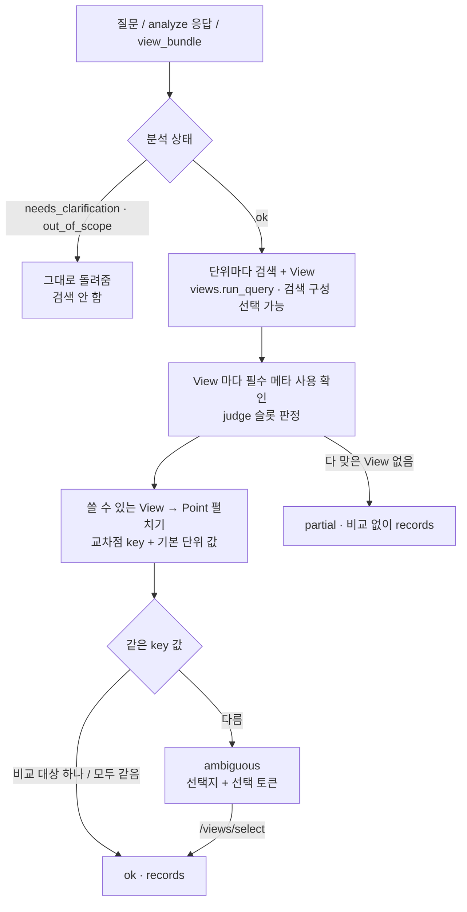

# Step 4 — View 묶음 · Point 충돌 · 선택

질문의 검색 단위(본 질의 + 서브쿼리)마다 View 를 여러 개 만들고, **같은 교차점에서 표마다 값이 다르면**
하나를 몰래 고르지 않고 선택지를 돌려준다. 선택은 서버에 세션을 두지 않는 서명 토큰으로 왕복한다.

- 코드: `backend/rag/view/` (`points` · `conflict` · `selection` · `viewset` · CLI `__main__`)
- API: Swagger `② View 묶음·충돌·선택 v4` — `POST /api/v1/rag/v4/views` · `/views/select` · `/views/points`
- CLI: `python -m backend.rag.view "작년 대전 인구 수"` (되묻기·선택을 터미널에서)
- 노트북: `notebooks/v4/view_conflict.ipynb`
- 설정: `configs/query_v4.yaml` 의 `view_*` · `conflict_*` · `selection_ttl_hours`

---

## 1. 흐름



## 2. 판정 규칙

**① 필수 메타를 썼는가** (`conflict.view_usage`) — 판단 모듈(`backend/rag/judge`)의 슬롯 판정을 그대로 쓴다.

| 슬롯 판정 | 처리 |
|---|---|
| `match` · `not_requested` | 씀 |
| `partial` 인데 `conflict_allow_partial` 에 든 슬롯 (기본 `시점`) | 씀 + 메모 ('최근 → 2026' 이 표에 없어 최신 2025 를 쓴 경우 — Step 2 결정) |
| `unknown` | 씀 + 메모 |
| 그 밖의 `partial` · `missing` · `unsupported` | 못 씀 → 비교에서 빠짐 (`usable: false`) |

대상은 Step 2 와 같게 **지표 또는 대상 중 하나**가 맞으면 충족. 값이 없는 View 도 비교에서 빠진다.

**② Point** (`points.record_points`) — 표가 달라도 같은 교차점이면 같은 key:

| key | 만드는 법 |
|---|---|
| 시점 | 라벨의 숫자 (`2025`, `2025.01` → `202501`). 주기가 다르면 비교 안 됨 |
| 지역 | 표준 이름 (`judge.extract.region_std`, View 라벨 규칙과 같음) |
| 성별 · 연령 | 분류 열 값. 성별은 항목 이름에서도 (`남자인구수` → 성별 남자). 합계 라벨(계·연령계)은 '구분 없음' |
| 지표 | 항목의 **핵심 이름**(괄호·성별 단어·`총/전체` 를 뗀 것)이 질문의 지표·대상 단어(또는 끝의 `수` 를 뗀 것)와 **같을 때만** 그 단어 (`총인구수`·`인구` → `인구수`). 포함만으로는 같은 지표가 아님: `다문화출생아수` ≠ `출생아수`, `추계인구` ≠ `인구` |
| 단위 | 기본 단위 (`천명` → `명`). 값은 배수를 곱해 비교 (`27.129 천명` = `27129 명`) |
| 그 밖의 분류 | 합계 행만 key 에서 빠지고, 나머지는 `분류=값` 으로 남음 → 같은 분류가 있는 표끼리만 비교 |

**③ 충돌** — 같은 key 값이 `|a-b| > max(conflict_abs_tol, conflict_rel_tol × max(|a|,|b|))` 이면 다름 (기본: 조금이라도 다르면).

| 상태 | 뜻 | records |
|---|---|---|
| `ok` | 비교 대상이 하나뿐이거나 겹치는 교차점 값이 모두 같음 (같으면 "교차 확인" 메모) | 그 단위 View 전부 |
| `ambiguous` | 같은 교차점 값이 다른 표가 있음 | 고르기 전에는 비움 → `pending` |
| `partial` | 필수 메타를 다 쓴 View 가 없음 | 비교 없이 전부 (기존처럼 notes 와 함께) |
| `empty` | View 없음 | — |

전체 `status`: 고를 단위가 하나라도 남으면 `needs_selection`, 아니면 `ok`.

## 3. 선택지

값이 서로 같은 표끼리 한 선택지로 묶는다 (A·B 같고 C 다르면 `[A, B]` / `[C]`, 검색 순위 순).

```json
{
  "option_id": "opt-1",
  "record_ids": ["view::101_DT_Y001::Y::q1-1::value"],
  "tbl_ids": ["DT_Y001"],
  "tbl_nm": "행정구역(시도)별 인구수 (외국인 포함)",
  "value_preview": [{"key_str": "시점=2025 | 지역=대전광역시 | 지표=인구수 | 단위=명", "value": 39474.0, "unit": "명",
                     "others": [{"tbl_id": "DT_Y002", "value": 27.129, "unit": "천명"}, {"tbl_id": "DT_1B040A3", "value": 27129.0, "unit": "명"}]}],
  "footnotes": [{"type": "통계표", "target": "", "text": "외국인 포함 집계"},
                {"type": "항목", "target": "총인구수", "text": "내국인+외국인"}],
  "description": "주민등록인구현황 | 행정구역(시도)별 인구수 (외국인 포함)\n분류: …\n항목: 총인구수, …\n단위: 명\n기간: 2021~2025\n경로: …",
  "basis": {"조사": "주민등록인구현황", "주기": "Y", "기간": "2025~2025", "단위": "명", "항목": ["총인구수"], "검색 순위": 1},
  "kosis_url": "https://kosis.kr/statHtml/statHtml.do?orgId=101&tblId=DT_Y001"
}
```

- `footnotes`: 메타 CMMT (CSV 값 사전 → 없으면 메타 JSON). 통계표 주석 + **이 View 의 항목·분류 값을 가리키는 주석만**
- `description`: CSV 값 사전 설명문 (없으면 표 색인 설명문 → Record lexical_text)

## 4. 선택 왕복 (세션 없음)

`selection_token` = (단위, 질의 id, 슬롯, 선택지별 Record id, 만료) 를 담은 HMAC-SHA256 서명 문자열.

| 어디서 | 방법 |
|---|---|
| Swagger | `POST /api/v1/rag/v4/views/select` `{"selections": [{"selection_token": …, "option_id": "opt-2"}], "previous": <views 응답>}` → 전체 `records` |
| | `previous` 없이 토큰만 → 토큰의 좌표(표·슬롯·번호)로 **View 를 다시 만들어** 고른 Record 만 (같은 id 인지 확인) |
| 노트북 | `build_viewset(…, on_ambiguous=lambda conflict: "opt-1")` · `apply_selections(vs, …)` · `resolve(token, "opt-1")` |
| CLI | `python -m backend.rag.view "질문"` (번호로 고름) · `--select first` · `--token … --option opt-2` |
| 자동 | `auto_select: "first"` = 검색 순위가 가장 높은 선택지 |

변조된 토큰·없는 선택지·만료(`selection_ttl_hours`, 기본 7일)는 거부한다.
서명 키: `VIEW_SELECTION_SECRET` (서버 여러 대면 같은 값) → 없으면 `storage/.view_selection_secret` 자동 생성.

## 5. 설정

```yaml
view_top_k: 10                # 단위마다 후보 표 수
view_n_views: 3               # 그중 View 를 만들어 비교할 표 수
view_retrieval_config: null   # Step 3 검색 구성 이름 (null = 기존 검색)
view_keep_unusable: true      # 필수 메타를 못 쓴 View 도 records 로 (false = 다 맞은 View 가 있으면 뺌)
view_main_with_subs: false    # 서브쿼리가 있으면 본 질의(합친 문장) 단위는 생략 (true = 예전처럼 본 질의도)
conflict_rel_tol: 0.0
conflict_abs_tol: 1.0e-9
conflict_allow_partial: [시점]
conflict_preview_points: 6
conflict_max_footnotes: 8
selection_ttl_hours: 168
```

요청마다 `overrides` 로 바꿀 수 있고, 값은 `trace` 의 params 에 남는다.

## 6. 검색 문장 찌꺼기 정리 (이번에 같이 고침)

`resolve.search_query` (views.run_query 가 쓰는 검색 문장 다듬기):
- 기간·월 먼저 지움: `2022~2026년` · `1983~1995년생` · `7~9월` · `9월` (이전엔 연도만 지워 `~`·`생`·`9월` 이 남음)
- 지역 뒤 조사 추가: `로·으로·에서의·에게·까지·부터` (`경기도로` → 이전엔 `로` 가 남음)
- 지운 뒤 홀로 남은 조사·기호 토큰 버림 (`,` `~` `및` `로` …). `70~79세` 처럼 단어 안의 기호는 그대로

재작성 80문항 + 예시 + 샘플 125개 검색 단위 중 27개 문장이 바뀜 (모두 찌꺼기 제거). baseline 검색 구성은
같은 함수를 쓰므로 `baseline == table_search.search` 재현은 그대로 성립.

## 7. 확인한 것 (tests/v4/test_view_v4.py)

가짜 데이터에 표 두 개를 복제해 넣음: DT_Y001 (같은 교차점 +12345, 주석 있음), DT_Y002 (같은 값을 천명 단위로).
- 2025·대전·인구수에서 4개 표 값이 갈림 → `ambiguous`, 선택지 3개, **천명 표와 명 표는 같은 선택지**
- 지표가 없는 표(이동자수)는 `usable=false` 로 비교에서 빠짐
- 주석: 통계표·해당 항목 주석만 (무관한 항목 주석 제외), 설명·기준·KOSIS 링크
- 선택: previous 와 함께 / 토큰만(다시 만든 View 의 표 내용이 원래와 같음) / 변조·없는 선택지·만료 거부
- `auto_select` · 허용 오차를 넓히면 `ok` + 교차 확인 · 지표가 없는 질문은 `partial` · 비교 대상 하나면 `ok`
- `/views/points` (검색 없이 Record 끼리, 성별은 항목 이름에서) · 질문부터 · analyze 응답 · 되묻기 상태 전달
- 찌꺼기 정리 단위 테스트 8개

## 8. 전체 흐름 노트북으로 찾아 고친 것

`notebooks/v4/pipeline_v4_e2e.ipynb` (질문 → ①~⑤ 단계별 출력 + 최종 View) 를 돌려 보며 고침:
- **지표 key 가 너무 느슨함** — 포함 매칭이라 `다문화출생아수`·`추계인구` 가 `출생아수`·`인구` 와 같은 지표로 묶여 거짓 충돌 → 핵심 이름이 같을 때만
- **서브쿼리가 있을 때 본 질의 단위도 비교** → 서브쿼리와 겹쳐 불필요한 선택을 만듦 → `view_main_with_subs: false` (기본) 로 생략
- **되묻기 뒤 검색 문장에 의도 값** (`1인가구 값 조회`) → 슬롯 문장에서 의도 제외 (v4 쿼리 모듈)

## 9. 남은 것

- 실제 데이터에서 '같은 교차점' 판정이 너무 엄격하거나 느슨한지 사람이 봐야 함 — 특히 지표 단어 매칭
  (`인구` 를 담는 항목이 여러 개인 표). 이상하면 `/views/points` 로 key 를 확인하고 알려 주세요
- `/api/v1/chat` 은 아직 기존 `/rag/views` 경로. v4 묶음으로 바꾸려면 답변 단계에 `needs_selection` 처리가 필요
