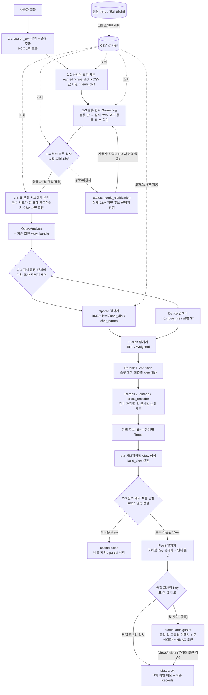

# 질의·검색·View 고도화 (v4) 통합 파이프라인 및 근거 비교

본 문서는 기존 `develop` (v3) 환경의 한계를 해결하기 위해 도입된 **v4 고도화 방법론**과, 각 단계별 **기존 대비 출력 결과 및 검증 근거**를 통합하여 비교한 문서입니다.

---

## 1. 전체 통합 파이프라인 (End-to-End Mermaid)

질의 분석(Step 2), 검색 실험실(Step 3), View 생성 및 충돌 판정(Step 4)의 분리된 흐름을 하나로 통합한 전체 아키텍처입니다.

---

## 2. 단계별 문제 정의 · 해결 방법론 · 출력 결과 및 근거 비교

### Step 2. 질의 분석 및 CSV 값 사전 접지 (Query Module)

#### ① 슬롯 환각 및 미존재 조건 검색 문제 → CSV 값 사전 접지 (Grounding) 및 되묻기
* **문제점 (v3):** 
  * 일상어/통계어 사전(`term_dict`, `rule_dict`)에만 의존하여 실제 원본 CSV에 해당 항목이나 분류 코드가 존재하는지 알 수 없었음.
  * 시점·지역·대상 등 필수 조건이 빠져도 빈 값(`None`)인 채로 검색 및 View 기본값으로 넘어가 의도와 다른 표가 검색됨.
* **해결 방법론 (v4):**
  * 원본 CSV 전체의 열 머리(`C{i}_OBJ_NM`), 분류 값(`C{i}_NM`), 항목(`ITM_NM`), 단위, 기간을 스캔하여 **CSV 값 사전(역색인)** 구축.
  * 추출된 슬롯 값을 실제 CSV 행 값에 접지(Grounding)하고, **시점·지역·대상(또는 지표)** 중 하나라도 누락되거나 CSV에 접지되지 않으면 검색을 중단(`needs_clarification`)하고 실제 표에 존재하는 후보 선택지를 반환.
* **출력 결과 및 근거 비교:**

| 비교 항목 | 기존 (v3) 출력 | 고도화 (v4) 출력 및 근거 |
| :--- | :--- | :--- |
| **질문: "출생아 수 알려줘"** *(시점·지역 누락)* | `filters: {"시점": None, "지역": None, "지표": ["출생아수"]}` 상태로 즉시 검색 진행 (임의의 최신/전국 표 반환) | **`status: "needs_clarification"`** (검색 중단) • `시점` 후보: `"2021~2025년"`, `"2025년"` (출생아수 지표가 있는 표들의 실제 연도) • `지역` 후보: `{"value": "전국", "n_tables": 3}`, `"서울특별시"` 등 실제 분류 값 반환 |
| **되묻기 응답 반영** *(대전, 2025년 선택)* | 재질문 시 HCX(LLM) 재호출 필요 | 직전 응답(`previous`) + `selections: {"지역": ["대전광역시"], "시점": ["2025년"]}` 전달 시 **HCX 재호출 없이(0회)** 즉시 `status: "ok"` 및 `view_bundle` 생성 |
| **질문: "최근 추이..."** *(시점 비명시)* | 모호한 시점 해석 또는 누락 | **시점 규칙 자동 적용:** `최근·요즘` → `2026년`, `추이·변화` → `2022~2026년` 부여. 2026년 자료가 표에 없어도 되묻지 않고 `note: "2026년 자료가 있는 표가 없음"` 기록 후 View 최신 대체로 위임 |

#### ② 복합 지표 질문의 단일 검색 한계 → 표 단위 서브쿼리 분리 (Decompose)
* **문제점 (v3):** 질문에 여러 지표가 있을 때 LLM이 임의로 하위 질문을 나누거나, 하나의 쿼리로 묶어 검색해 두 지표가 한 표에 없는 경우 검색에 실패함.
* **해결 방법론 (v4):** 추출된 복수 지표들이 **함께 들어 있는 표가 CSV 값 사전에 실제로 존재하는지 확인**하고, 공통 표가 없을 때만 지표별 서브쿼리로 분리.
* **출력 결과 및 근거 비교:**
  * **기존 (v3):** `"출생아수와 사망자수"` → 단일 검색 또는 근거 없는 분리.
  * **고도화 (v4):** `SubQuery` 생성 시 `reason: "출생아수·사망자수가 함께 있는 표 없음"` 과 같이 **CSV 값 사전 기반의 명확한 분리 근거**와 `candidate_tables`(힌트 표 ID 목록)를 함께 출력.

---

### Step 3. 검색 파이프라인 모듈화 및 정제 (Retrieval Lab)

#### ① 고정된 검색 구조와 정답셋 부재 문제 → 조립식 파이프라인 및 비교 판정표
* **문제점 (v3):** `BM25(kiwi) → 조건 확인 → HCX bge-m3 재정렬` 로 코드가 고정되어 있어, 형태소 분석기(사용자 사전 유무), 로컬 임베더, Cross-Encoder 리랭커, RRF 융합 등의 효과를 실험하거나 어느 단계에서 순위가 바뀌었는지 추적할 수 없었음.
* **해결 방법론 (v4):** 
  * 코퍼스·토크나이저·임베더·검색기·합치기(Fusion)·리랭커를 인터페이스로 분리하고 YAML 설정 하나로 조립하는 Factory 구현.
  * 모든 후보 표에 `stages[단계 이름] = {rank, score}` 를 기록하고, 동일 (질의, 표) 쌍을 한 번만 채점하면 전 구성에 반영되는 판정표(`review.csv`) 도입.
* **출력 결과 및 근거 비교:**

| 검증 항목 | 비교 내용 및 수치 근거 |
| :--- | :--- |
| **기존 검색 완벽 재현** (`baseline` vs `table_search`) | 재작성 80문항에서 파생된 검색 단위 **103개** + 슬롯 없는 질문 **50개** = **총 153건 테스트 결과, 순위·점수·미충족 조건(`unmet`) 100% 동일** 확인 |
| **단계별 순위 추적** | 단일 최종 점수만 내던 기존과 달리, `bm25(rank 5) → condition(rank 2, cost 0) → cross_encoder(rank 1)` 형태로 **어느 모듈이 순위를 끌어올렸는지 `stages` 근거 출력** |
| **형태소 사전 연동** (`kiwi_lexicon`) | 기존 `kiwi`는 `'1인가구'` 등을 쪼개어 검색 품질이 저하되었으나, CSV 값 사전 항목명 + `term_dict`를 사용자 사전으로 주입하여 **단일 토큰 인식률 개선** |

#### ② 검색 문장(Query Prep) 전처리 찌꺼기 문제 해결
* **문제점 (v3):** `resolve.search_query` 가 질문에서 시점·지역 단어를 지울 때 연도 숫자나 지역명만 지워, 기간 기호(`~`), 파생 접미사(`생`), 조사(`로`)가 검색 문장에 찌꺼기로 남음.
* **해결 방법론 (v4):** 기간·월 패턴(`2022~2026년`, `1983~1995년생`, `7~9월`)을 통째로 먼저 제거하고, 지역 뒤 조사(`로·으로·에서의·에게·까지·부터`) 및 홀로 남은 기호 토큰을 제거.
* **출력 결과 및 근거 비교:**
  * **질문 1:** `"2022~2026년 대전광역시 인구수 추이"`
    * **기존 (v3) 출력:** `"~ 인구수 추이"` (`~` 잔류)
    * **고도화 (v4) 출력:** `"인구수 추이"` (찌꺼기 완벽 제거)
  * **질문 2:** `"경기도로 전입한 사람 수"`
    * **기존 (v3) 출력:** `"로 전입한 사람 수"` (조사 `로` 잔류)
    * **고도화 (v4) 출력:** `"전입한 사람 수"`
  * **수치 근거:** 전체 125개 검색 단위(재작성 80문항 + 예시 + 샘플) 중 **오염되었던 27개 문장의 찌꺼기가 모두 제거됨**을 검증.

---

### Step 4. View 묶음 · Point 충돌 감지 및 사용자 선택 (View Conflict)

#### ① 다중 표 간 수치 불일치(충돌) 은폐 문제 → 교차점(Point) 정규화 비교 및 선택지 제공
* **문제점 (v3):** 동일한 질문 조건(예: 2025년 대전 인구수)에 대해 검색된 여러 통계표가 집계 기준(외국인 포함 여부 등)이나 단위(명 vs 천명) 차이로 서로 다른 값을 가지고 있어도, 시스템이 임의로 상단 표를 쓰거나 구분 없이 나열하여 혼란을 초래함.
* **해결 방법론 (v4):**
  1. **필수 메타 적용 확인 (`judge` 연동):** 필수 슬롯을 실제로 적용하지 못한 View(예: 지표 불일치)는 `usable: false`로 판정해 비교 대상에서 제외.
  2. **Point 정규화 및 단위 환산:** 각 View를 `(시점, 지역, 성별, 연령, 지표, 기본단위)` 교차점 Key로 펼침. 단위가 다르면 기본 단위로 환산(`27.129 천명` → `27129 명`)하여 비교.
  3. **충돌 판정 및 그룹핑:** 동일 Key에서 값 차이가 허용 오차를 넘으면 `status: "ambiguous"`로 판정. **값이 같은 표끼리는 하나의 선택지로 묶고**, 해당 View의 항목·통계표 주석(`footnotes`)과 산출 기준(`basis`), HMAC 서명된 무상태 `selection_token`을 반환.
* **출력 결과 및 근거 비교:**

| 테스트 시나리오 (2025년 · 대전 · 인구수) | 기존 (v3) 처리 결과 | 고도화 (v4) 출력 결과 및 근거 |
| :--- | :--- | :--- |
| **표 4개 검색 상황** • `DT_Y001`: 39,474명 (외국인 포함) • `DT_Y002`: 27.129천명 • `DT_1B040A3`: 27,129명 • `DT_MOVE`: 이동자수 표 (지표 불일치) | 4개 표의 View를 단순 반환하거나 1순위 표 값만 사용. 단위 차이(`27.129` vs `27129`)를 다른 값으로 오인하거나, 왜 값이 다른지 주석 근거를 제시하지 못함 | **1. 미충족 표 배제:** `DT_MOVE`(이동자수)는 필수 메타 미충족(`usable: false`)으로 비교에서 자동 제외 **2. 단위 환산 및 그룹핑:** `DT_Y002`(27.129천명)와 `DT_1B040A3`(27,129명)를 **동일 값(`27129.0명`)으로 인식하여 하나의 선택지로 묶음** **3. 충돌 반환 (`status: "ambiguous"`):** • `opt-1`: `39474.0명` (`DT_Y001`) + 주석 `"외국인 포함 집계"`, `"내국인+외국인"` 자동 발췌 • `opt-2`: `27129.0명` (`DT_Y002`, `DT_1B040A3`) + 타 선택지 값 미리보기(`others`) 제공 |
| **사용자 선택 후 처리** (`/views/select`) | 선택 인터페이스 없음 | **서버 세션 없이 `selection_token`만으로 검증:** • `previous` 응답 없이 토큰만 보내도 토큰 내 좌표로 View를 즉시 재생성하여 동일 Record ID 반환 • 변조된 토큰·만료 토큰·없는 `option_id` 요청은 전수 거부 확인 |